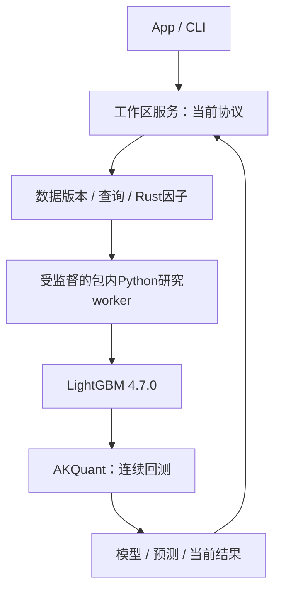

当前采集体系：HiThink（Rust REST主源）、通达信（Python SDK备用）、独立巨潮公告。版本权威定义见各组件源码；接口、价格口径、构建和验收见[采集组件](crates/storage/collectors/README.md)。

# JFQuant Analytics

[](https://github.com/Dennishaha/JFQuant/actions)
[](https://opensource.org/licenses/MIT)

[](https://codecov.io/gh/Dennishaha/JFQuant)

macOS 优先的本地量化研究平台。Rust App 和独立 `jfquant` CLI 共用工作区服务：
数据采集、DuckDB 查询和 GTJA191／Alpha158 因子保留 Rust 实现；Python LightGBM
负责模型训练与预测，AKQuant 0.3.66 负责连续账户回测。用户无需外部 Python。



## 组件

| crate | 职责 |
|---|---|
| analytics-core | 无后端依赖的请求、manifest、日期、股票池、数据事件与规则配置 |
| analytics-storage | 行情与事件采集、Parquet和格式读取、来源及不可变版本 |
| analytics-engine | worker 内 DuckDB 查询、分页和导出 |
| analytics-factor | GTJA191／Alpha158 定义、执行、null 语义和参考测试 |
| analytics-workflow | 工作区服务、任务、配置、Rust研究编排及Python监督 |
| analytics-desktop | egui 产品界面 |
| analytics-cli | 独立命令行与JSON接口 |

逐组件文档见 [crates/README.md](crates/README.md)。研究后端协议、构建和能力边界见
[研究worker](crates/workflow/research/README.md)。研究执行保持 Rust 因子、Python 撮合和 Rust 成交账本校验；配股使用固定原生扩展。
架构重构不改变量化计算口径，不增加实盘。

## 当前主程序版本边界

App、CLI 与工作区服务统一使用协议47；采集协议16、研究worker4、研究模板12。
正常入口拒绝旧协议和旧输入格式，历史数据升级通过显式本地迁移执行。
版本权威定义与组件入口见[工作流组件](crates/workflow/src/README.md)。

GTJA191 使用公式版本 `gtja191-paper-2017+jfquant-audit-v5`，191项均有执行实现，
默认选择190项；Alpha030须显式选择，并由所选行情提供真实 MKT／SMB／HML。
原始公式、显式解释、特征顺序和独立参考测试见[因子组件](crates/factor/README.md)。

三因子可通过 App／CLI 共用任务采集及计算，也可由 BigQuant 固定投影构造后登记为新行情。
因子文件使用小数收益率，MKT 未减RF；缺失输入保持null，研究前检查实际日期覆盖。
BigQuant 的日频股本保留历史修订风险；PIT财务与XPS试用权限不代表长期免费。
[输入、构造及发布说明](crates/storage/src/bigquant/README.md#pit-年度分组与-smbhml)。
本机数据与审计属于工作区产物，源码提交不携带数据、凭据或SDK环境。

## 使用与构建

**快速开始（推荐使用 DevContainer）：**
```bash
# 使用 VSCode Dev Container（零配置）
# 1. 安装 VSCode "Dev Containers" 扩展
# 2. 打开项目，点击 "Reopen in Container"
# 3. 所有工具已预装，直接开发

# 或手动配置本地环境：
crates/app/packaging/build-collector.sh
export DUCKDB_DOWNLOAD_LIB=1
cargo build -p analytics-desktop -p analytics-cli
cargo run -p analytics-desktop
```

**工作区使用：**
```bash
jfquant workspace create "$HOME/JFQuantWorkspace"
export JFQUANT_WORKSPACE="$HOME/JFQuantWorkspace"
jfquant research demo
jfquant jobs wait TASK_UUID
jfquant jobs results TASK_UUID
```

一个工作区同时执行一个计算任务。关闭客户端不终止服务任务；取消先协作退出，
无法退出时终止研究进程组。数据、模型、日志和运行产物保留在工作区，不提交Git。

因子、标的和工作流独立保存，研究输入在提交时冻结。协议与产物的权威定义见
[工作流组件边界](crates/workflow/src/README.md)。旧研究产物归档后重建，保留原始数据、
证据和用户配置；离线操作见[维护说明](crates/workflow/README.md#架构边界与离线维护)。

## 开发者工具

项目集成了自动化 CI/CD、Git hooks 和开发容器：

- **快速开始**：[5 分钟快速入门指南](docs/QUICKSTART.md)
- **CI/CD**：自动格式检查、测试、覆盖率报告（每次 PR 和推送）
- **Git Hooks**：提交前格式检查，推送前 Clippy 验证
- **DevContainer**：零配置开发环境（Rust + Python + 所有工具）
- **覆盖率报告**：使用 `./scripts/dev cov` 或 `cargo llvm-cov --html --open` 查看本地覆盖率
- **开发脚本**：`./scripts/dev check|test|watch|cov|release` - 统一的开发命令
- **一键设置**：`bash scripts/dev-setup.sh` - 自动安装所有工具

详细文档：
- [工程化指南](docs/ENGINEERING.md) - 完整的工程化实践
- [优化建议](docs/ENGINEERING_OPTIMIZATION.md) - 工程化优化分析
- [代码规范](AGENTS.md) - 代码风格和架构规则

## 回测口径与兼容

日终信号，下一日线开盘成交；模型分折训练，账户跨年连续。分红和拆股使用AKQuant
除权除息日语义，不区分登记、到账和上市日；已识别不支持事件警告并跳过，普通未决问题仍阻断。
费用仅展示上游合计。交易单位采用板块增量，独立最低申报量及每日涨跌停规则不模拟。
这些结果不能标为原精细真实权益账本。具体边界见研究worker README。

因子缓存、模型和回测分别签名。账户参数不进入因子计算，模型参数变化不重算已验证
因子；依赖、特征顺序、公式版本和样本掩码均纳入适当阶段的复现记录。

## 验收

```bash
cargo fmt --all -- --check
DUCKDB_DOWNLOAD_LIB=1 cargo nextest run --workspace
DUCKDB_DOWNLOAD_LIB=1 cargo clippy --workspace --all-targets -- -D warnings
DUCKDB_DOWNLOAD_LIB=1 RUSTDOCFLAGS="-D warnings" cargo doc --workspace --no-deps
PYTHONPATH=crates/workflow/research target/collector-build/python/bin/python3 -B -m unittest discover -s crates/workflow/research/tests
crates/app/packaging/package-macos.sh
```

打包通过锁定wheel获取LightGBM和AKQuant，只编译OpenMP辅助库。包内Python全部Mach-O
对象通过arm64、macOS14、依赖路径审核。另一台干净Apple Silicon/macOS14设备的
安装、离线读取及取消验收需要在实际设备执行，不能由本机测试代替。

## 组合优化与统一账户

股票评分后支持等权、最小方差、风险预算及滚动样本外校准的均值方差；多策略引用冻结目标，通过一个AKQuant账户净额成交。98%为目标仓位，实际漂移、拒单和锁定资产单独披露。参考账允许分数股且无费用，不能代替扣费收益。

股票优化支持显式的逐日完整历史资格检查，在排序前筛选并记录排除原因；校准仅排除已确认停牌标签，未知缺价仍阻断。App 提供方法与常用约束控件。研究结果22、回测计划4、模板12；旧配置需显式离线迁移，细节及复现命令见 [workflow](crates/workflow/README.md#allocation-admission-revision)。


Catalog、任务记录、证据包映射、迁移计划及共享配置现存于SQLite schema v2。旧工作区须先停止
旧服务，再用新CLI执行`jfquant storage migrate-json`。原数据库和JSON有完整备份；迁移后
不能删除`index.sqlite`来重建扫描缓存。[离线迁移与验收](crates/workflow/src/storage_management/README.md#json元数据拆表协议47)。
