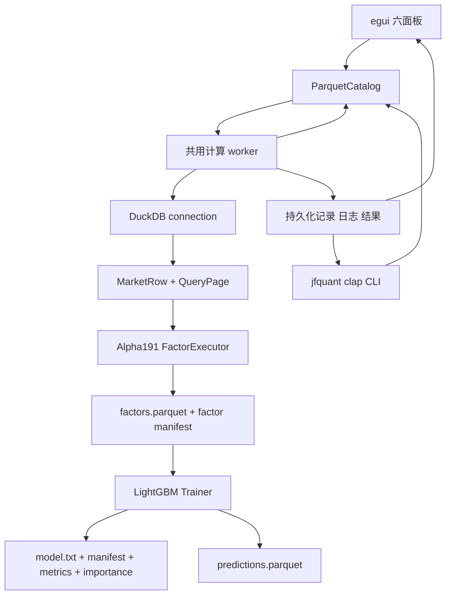
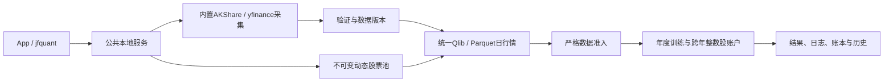

# JFQuant Analytics

开发导航：[Crates分层与逐目录文档](crates/README.md)。

本项目是一个 macOS 优先的本地量化分析平台：App 和独立 jfquant CLI 共用工作区服务，进行数据获取、DuckDB 查询、Alpha191 因子计算、LightGBM 训练与年度研究。原生句柄留在服务计算 worker；客户端只交换数据。

## 分层架构



## Crate 职责

| 层级 | crate | 责任 | 关键接口 |
|---|---|---|---|
| 1 | `analytics-core` | 无后端依赖的领域类型和请求契约 | `MarketRow`、`PageRequest`、`ModelManifest` |
| 2 | `analytics-storage` | Parquet/schema 校验、独立行情下载与格式读取 | `ParquetCatalog`、`acquisition`、`QlibDataset` |
| 3 | `analytics-engine` | DuckDB 查询、keyset 分页、市场数据 as-of join | `QueryEngine`、`DuckDbEngine` |
| 4 | `analytics-factor` | Alpha191 公式注册、解析、面板执行、因子缓存 | `FactorRegistry`、`FactorExecutor` |
| 5 | `analytics-ml` | LightGBM FFI、流水线编排、年度滚动研究 | `Trainer`、`Predictor`、`pipeline`、`backtest` |
| 6 | `analytics-workflow` | 工作区、模板、共用 worker、本地服务及持久化任务 | `TaskRequest`、`Client`、`Workspace` |
| 7 | `analytics-desktop` | 六面板 UI、主题及服务客户端适配 | `WorkerCommand`、`WorkerEvent` |
| 8 | `analytics-cli` | 独立 clap CLI 和 AI JSON 接口 | `jfquant` |

每个 crate 的接口清单、数据流、构建和验收命令分别记录在对应目录的 `README.md`。模块级说明位于 Rust 源文件的 `//!` 文档，公共类型和函数使用 rustdoc 说明错误、取消、线程和数据格式约束。

## 数据目录约定

| 路径 | 内容 |
|---|---|
| `data/market` | 标准化行情 Parquet，要求见 `analytics-storage` |
| `data/universe` | 历史股票池 Parquet，含 `instrument_id`、`universe_id`、`trade_date`、`is_member` |
| `.jfquant/runs/UUID` | 共用后台按任务生成的记录、因子缓存、模型、manifest、指标和预测 |
| `.jfquant/templates` | 用户保存的研究模板 |

生成数据、模型文件、动态库和临时产物不提交到 Git；`.gitignore` 已排除这些路径。

## 构建命令矩阵

### 无原生 LightGBM 环境

```bash
cargo fmt --all -- --check
cargo nextest run -p analytics-core -p analytics-storage -p analytics-engine -p analytics-factor -p analytics-ml
cargo clippy -p analytics-core -p analytics-storage -p analytics-engine -p analytics-factor -p analytics-ml --all-targets -- -D warnings
RUSTDOCFLAGS="-D warnings" cargo doc -p analytics-core -p analytics-storage -p analytics-engine -p analytics-factor -p analytics-ml --no-deps
```

这些命令覆盖五个默认无 native feature 的组件。App、CLI、workflow 及 workspace 级别检查需要完整原生开发环境。

### 完整原生环境

```bash
brew install lightgbm
export LIGHTGBM_LIB_DIR=/path/to/lightgbm/lib
export DYLD_LIBRARY_PATH="$LIGHTGBM_LIB_DIR:/path/to/openmp/lib:${DYLD_LIBRARY_PATH}"
export DUCKDB_DOWNLOAD_LIB=1

cargo check -p analytics-desktop --all-targets
cargo test -p analytics-desktop
cargo test -p analytics-ml --features lightgbm-native,duckdb-native
cargo build -p analytics-desktop -p analytics-cli
cargo run -p analytics-desktop
```

`LIGHTGBM_LIB_DIR` 必须包含 `lib_lightgbm.dylib`；`DUCKDB_DOWNLOAD_LIB=1` 允许 DuckDB crate 在开发期下载匹配的预编译库。完整配置和 VS Code 调试环境见 [.vscode/README.md](.vscode/README.md)。

本机 Homebrew 安装的默认路径是 `$(brew --prefix lightgbm)/lib`，OpenMP 路径是 `$(brew --prefix libomp)/lib`。

## 独立 CLI 与 AI 调用

安装 DMG 后直接使用包内 jfquant；可按 [CLI README](crates/cli/README.md)建立用户级 PATH 链接，无需 Cargo、Codex、Python、Homebrew 或打开 GUI。

```bash
/Applications/JFQuant.app/Contents/MacOS/jfquant --help
jfquant workspace create "$HOME/JFQuantWorkspace"
export JFQUANT_WORKSPACE="$HOME/JFQuantWorkspace"
jfquant data check-updates
jfquant research demo
jfquant jobs wait TASK_UUID
jfquant jobs results TASK_UUID
jfquant query run --sql 'SELECT 42 AS answer'
jfquant factors run --request pipeline.json
```

长任务默认立即返回 task_id，stdout 只输出 JSON。通过 jobs status/wait/logs/cancel/results 管理任务，关闭客户端不会终止任务。一个工作区同时执行一个计算任务，忙碌返回当前 ID；run --request JSON 使用与 App 相同的请求及签名规则。

## 文档验收

```bash
RUSTDOCFLAGS="-D warnings" cargo doc --workspace --no-deps
cargo test --doc --workspace --exclude analytics-desktop
```

文档警告视为错误；公共 API、manifest、公式版本和异步任务协议变更必须同步更新所属 crate README。

## 独立下载与年度滚动回测

```bash
jfquant data download --tag 2026-10-12
jfquant jobs wait DOWNLOAD_TASK_UUID
jfquant data versions
jfquant templates default --output .jfquant/templates/default.json
jfquant research check --template .jfquant/templates/default.json --market MARKET_VERSION --actions ACTION_VERSION
jfquant research run --template .jfquant/templates/default.json --market MARKET_VERSION --actions ACTION_VERSION
```

版本 ID 来自工作区数据列表；公司行动获取及补充见 CLI README。底层模块的开发验证与公共接口记录在组件 README。

此研究入口使用 JFQuant 现有因子和 LightGBM 设施，补充独立下载、年度切分和组合收益评估。没有使用 JFQlib 的运行设施或缓存。公开包采用 Qlib 二进制**格式**，由本项目 Rust 读取器解析，无 Python Qlib 依赖。下载校验见 [storage README](crates/storage/README.md)，5年训练/1年验证/次年测试、成本假设、产物与局限见 [ml README](crates/ml/README.md)。

所选快照覆盖至2026-10-12；历史中证500成分始于2007年，样本外评估始于2013年。Alpha191注册191项，v4隔离12条公式/初值歧义项，另排除缺三因子输入的Alpha030，当前研究选择178项；不能将此结果称为完整2000—2026年或191项严格参考实现回测。开发构建对因子计算和 ml 热路径分别启用 opt-level=3/2，不改变其他依赖的开发优化级别。

A股市场规则由 `analytics-core::market_rules` 统一预设：最新经手费、证管费、过户费、卖出印花税及可自定义的账户佣金。默认全佣万2.5、每笔最低5元、初始资金100万元；回测全区间使用同一最新快照，不还原历史费率，不再输出多档单边成本。账户佣金、资金和税率在App或完整研究模板中配置；模板validate后用research run执行。规则来源、费率口径、JSON格式见 [core README](crates/core/README.md)，执行快照、schema 11与复现命令见 [ml README](crates/ml/README.md)。

默认回测使用不复权价格、整数股、T+1及跨年持续的现金/分红/送转账本；来源冲突或训练价量无法对账时停止训练；实际账户缺必要到账日/上市日时停止回测。公开动作获取和缺失统计见[storage README](crates/storage/README.md)，191项逐条审计和验证边界见[FACTOR_AUDIT.md](crates/factor/FACTOR_AUDIT.md)。旧v3复权碎股结果仅作历史存档，不能作为本版真实股份收益。补齐公开动作的下载命令见storage README；仓库不提交数据、模型或临时输出。

## 独立本地研究平台

App现在可选择工作区、独立更新/登记数据、保存研究参数模板、检查输入、执行GTJA191／中证500年度研究，并查看持久化运行记录。App与CLI通过共用后台调用本项目Rust模块，运行无需Codex或源码目录；接口和目录见[workflow README](crates/workflow/README.md)，Apple Silicon内部试用App/DMG构建及验收见[app README](crates/app/README.md)。

采集模块、CLI、内置模板、打包脚本及文档属于可提交源代码；data/、.jfquant/、target/内的行情、模型、run记录、日志和安装包均为忽略的本地产物。研究的数据缺项准入和公式隔离规则在平台中继续执行，不能用安装包或成功下载替代有效回测验收。

App与jfquant是业务入口，共用工作区服务（协议9）。研究仅采用严格原价账本与结果schema11；旧命令、旧请求及旧口径执行已移除，旧文件不迁移、不删除，旧格式读取/导入明确报错。另一台Apple Silicon/macOS 14实机验收仍待完成。

## 动态股票池与内置双源采集

当前App和独立CLI共用协议9后台；股票池支持日期增删及集合组合。A股默认AKShare，yfinance可选，CPython和依赖随App内置。新Parquet日行情与Qlib共用年度研究，模板schema6、结果schema11；仍采用严格原价整数股账户，缺历史成员、训练复权依据或基准行情时停止训练。组件文档见 [采集层](crates/storage/collectors/README.md)、[公共流程](crates/workflow/README.md)、[独立CLI](crates/cli/README.md)。



开发构建先执行 `crates/app/packaging/build-collector.sh`；其解释器和35项锁定依赖在target内，不提交Git。正式运行使用 `jfquant data collect`、`pools` 和 `research`，不直接调用Cargo。

显式系数阶段的历史验收记录：196项nextest通过、0跳过，其中集成15项Python采集测试和3项打包fixture。包内CLI真实下载SH600000、SZ000001原价与独立新浪系数，两个2026年现金分红跳变与金额/前收盘价对照一致；样本成功不代表全历史公司行动就绪。最新日期调度版本的验收见下节及[打包组件](crates/app/packaging/README.md)。

显式系数接入采用规范行情5、采集协议6、服务协议9、研究schema11；当前模板6、股票池3和GTJA191公式v4。按最近已生效F/F0派生研究价格与倒数缩放成交量，实际撮合仍读取原价和真实股数。训练/验证/预热/测试范围均核对分红送转与系数跳变，保持0.2%事件对账阈值；账户执行范围另外要求登记、到账和红股上市日期。缺项明细由App与CLI同一后台提供，旧缓存和结果不转换。


## 任意日期研究与完整公司行动

沪深300默认2012年首测，首折2006—2010训练、2011验证；结束取所选数据最后完整日。App和jfquant共同支持single、rolling、manual任意日期，滚动可用日/月/年/交易日并选择固定或扩展训练；无验证集关闭早停。预览显示实际窗口、预热、样本数，折间继续同一账户而不产生新选股信号。

公司行动4将实际权益和除权参考分开，支持差异化分派、现金受限配股、缩股、股权分置/重整、换股/代码变更、退市及实际清偿。实施公告候选必须复核，修订附原哈希、逐字段引用/单位和理由，产生新不可变版本；不自动删失败、猜证券身份或补日期。沪深300的SHT00018及历史事件缺口仍须可信证据解决，2012首测不代表其他准入自动通过。

当前契约为模板6、公司行动4、规范行情5、采集6、服务9、研究schema11；公式v4、股票池3、默认178项及顺序不变。旧文件和历史日志保留，不转换旧请求、检查点、动作或结果。操作和JSON示例见[CLI](crates/cli/README.md)、[workflow](crates/workflow/README.md)、[事件与账本](crates/core/README.md)。另一台Apple Silicon/macOS14验收待完成。

上一阶段本机验收（此前实现）：213项nextest全通过、0跳过，包含20项Python采集测试及3项打包fixture；Clippy、Rustdoc、doctest、Rust/Python格式、差异和28层组件README/Mermaid/链接检查通过。App/DMG重新生成；签名、89个Python原生对象及清空环境的包内CLI原生自检、任意日期无验证集研究、合成研究/流水线和离线结果验证通过。


## 为什么建设本地研究平台

研究需要能够脱离开发工具重复执行，也需要解释每项数据和账户假设。App与独立jfquant共享后台；来源映射、数据、模板和执行日程冻结后，结果才有可审计的含义。上港集箱与上港集团复用600018说明交易代码不能充当永久证券身份；补采失败和训练准入也必须分开。

当前数据与准入决定及重新评估条件见[workflow设计决定](crates/workflow/DECISIONS.md)。每层组件README说明职责背后的问题和取舍；缺依据的历史原因不推定。当前结果schema11，真实缺项仍阻止训练，另一台Apple Silicon/macOS14实机验收待完成。


## 三级研究模式（2026-10-14）

研究流程默认“严格检查”，另外可选“允许部分数据缺失”及“只用数据合格的股票”。缺失保持null，错误或权益不明不会被放行；第三档明确标注筛选后的研究股票池。原因表区分未通过、未执行、保留空值和排除，原数据不修改。CLI通过research preview/check/run的--strictness配置，与App共用后台。

当前模板6、准入4、服务9、研究结果11；公式v4及178项顺序保持。具体why、文件格式、命令和验收见[workflow](crates/workflow/README.md)、[CLI](crates/cli/README.md)及[设计决定](crates/workflow/DECISIONS.md)。旧文件不自动转换；另一台Apple Silicon/macOS14验收继续待完成。


## 2026-10-14：直接代码读取与分阶段研究

为什么调整：普通市场代码无需先登记身份；独立目录、审核和权威名录下载增加了研究前置负担。特殊历史代码仍需在快照内明确区间，不能将旧证券行情或权益接到另一证券。训练使用价量和标签，到账／交付资料只在实际账户执行时检查。

当前格式：模板6、需求3、准入4、股票池3、公司行动4、规范行情5、系数3、采集6、服务9、研究结果11；快照内来源映射1、训练产物1。工作区和任务记录1、GTJA191公式v4及默认178项顺序保持。旧格式明确拒绝，不自动转换。

App与jfquant共用后台。research train产出training.json及逐折model.txt/manifest.json；research backtest引用训练任务，不重新训练；research run先训练再回测。补齐支付日不改变训练价量依据，系数或除权参考改变须重训。check只证明训练就绪，账户提示保持not_run；回测失败仍可读取模型及部分账户记录。

```bash
jfquant --workspace "$JFQUANT_WORKSPACE" research train --template recipe.json --market MARKET_ID --actions HISTORY_ACTIONS_ID
jfquant --workspace "$JFQUANT_WORKSPACE" jobs wait TRAIN_JOB_ID --timeout 60
jfquant --workspace "$JFQUANT_WORKSPACE" research backtest --training TRAIN_JOB_ID --actions EXECUTION_ACTIONS_ID
jfquant --workspace "$JFQUANT_WORKSPACE" jobs results BACKTEST_JOB_ID
```


验收：nextest覆盖来源日期边界、三档掩码、训练／回测分离及模型保留；Clippy、Rustdoc、格式、组件文档和包内CLI共同检查。生成数据、模型、运行记录和安装包不提交。另一台Apple Silicon/macOS14实机验收继续待完成。
