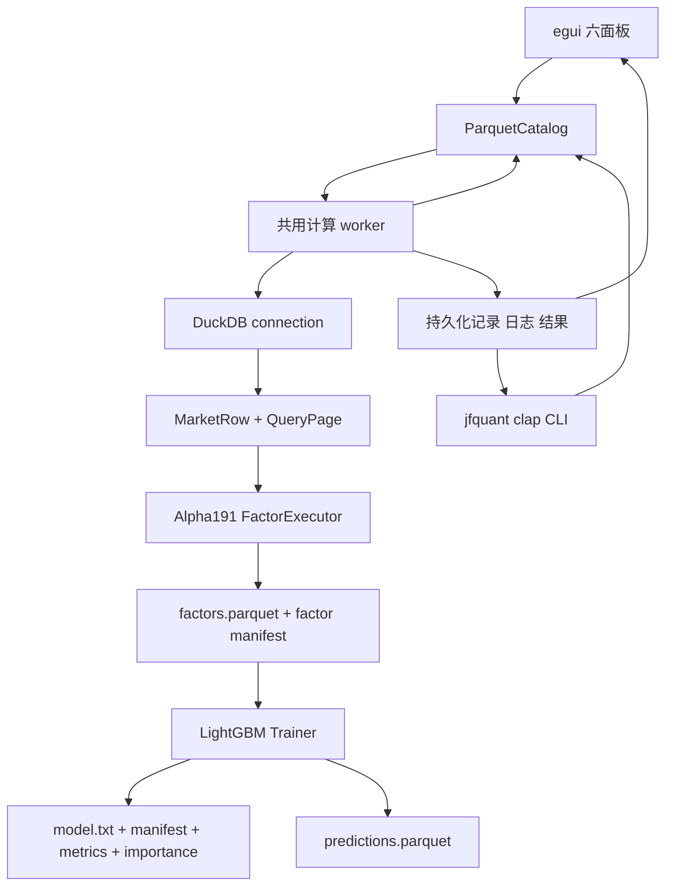
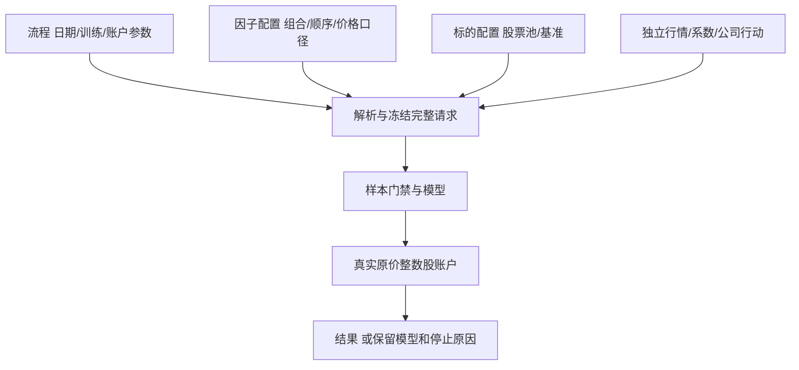

# JFQuant Analytics

开发导航：[Crates分层与逐目录文档](crates/README.md)。

本项目是一个 macOS 优先的本地量化分析平台：App 和独立 jfquant CLI 共用工作区服务，进行数据获取、DuckDB 查询、GTJA191/Alpha158 因子计算、LightGBM 训练与年度研究。原生句柄留在服务计算 worker；客户端只交换数据。

## 分层架构



## Crate 职责

| 层级 | crate | 责任 | 关键接口 |
|---|---|---|---|
| 1 | `analytics-core` | 无后端依赖的领域类型和请求契约 | `MarketRow`、`PageRequest`、`ModelManifest` |
| 2 | `analytics-storage` | Parquet/schema 校验、独立行情下载与格式读取 | `ParquetCatalog`、`acquisition`、`QlibDataset` |
| 3 | `analytics-engine` | DuckDB 查询、keyset 分页、市场数据 as-of join | `QueryEngine`、`DuckDbEngine` |
| 4 | `analytics-factor` | GTJA191 / Alpha158 公式注册、解析、面板执行、因子缓存 | `FactorRegistry`、`FactorExecutor` |
| 5 | `analytics-ml` | LightGBM FFI、流水线编排、年度滚动研究 | `Trainer`、`Predictor`、`pipeline`、`backtest` |
| 6 | `analytics-workflow` | 工作区、模板、共用 worker、本地服务及持久化任务 | `TaskRequest`、`Client`、`Workspace` |
| 7 | `analytics-desktop` | 六面板 UI、主题及服务客户端适配 | `WorkerCommand`、`WorkerEvent` |
| 8 | `analytics-cli` | 独立 clap CLI 和 AI JSON 接口 | `jfquant` |

每个 crate 的接口清单、数据流、构建和验收命令分别记录在对应目录的 `README.md`。模块级说明位于 Rust 源文件的 `//!` 文档，公共类型和函数使用 rustdoc 说明错误、取消、线程和数据格式约束。

## 数据目录约定

| 路径 | 内容 |
|---|---|
| `data/market` | 标准化行情 Parquet，要求见 `analytics-storage` |
| `data/universe` | 历史股票池 Parquet，含 `instrument_id`、`universe_id`、`trade_date`、`is_member` |
| `.jfquant/runs/UUID` | 共用后台按任务生成的记录、因子缓存、模型、manifest、指标和预测 |
| `.jfquant/templates` | 用户保存的流程及独立factors/targets配置 |

生成数据、模型文件、动态库和临时产物不提交到 Git；`.gitignore` 已排除这些路径。

## 构建命令矩阵

### 无原生 LightGBM 环境

```bash
cargo fmt --all -- --check
cargo nextest run -p analytics-core -p analytics-storage -p analytics-engine -p analytics-factor -p analytics-ml
cargo clippy -p analytics-core -p analytics-storage -p analytics-engine -p analytics-factor -p analytics-ml --all-targets -- -D warnings
RUSTDOCFLAGS="-D warnings" cargo doc -p analytics-core -p analytics-storage -p analytics-engine -p analytics-factor -p analytics-ml --no-deps
```

这些命令覆盖五个默认无 native feature 的组件。App、CLI、workflow 及 workspace 级别检查需要完整原生开发环境。

### 完整原生环境

```bash
brew install lightgbm
export LIGHTGBM_LIB_DIR=/path/to/lightgbm/lib
export DYLD_LIBRARY_PATH="$LIGHTGBM_LIB_DIR:/path/to/openmp/lib:${DYLD_LIBRARY_PATH}"
export DUCKDB_DOWNLOAD_LIB=1

cargo check -p analytics-desktop --all-targets
cargo test -p analytics-desktop
cargo test -p analytics-ml --features lightgbm-native,duckdb-native
cargo build -p analytics-desktop -p analytics-cli
cargo run -p analytics-desktop
```

`LIGHTGBM_LIB_DIR` 必须包含 `lib_lightgbm.dylib`；`DUCKDB_DOWNLOAD_LIB=1` 允许 DuckDB crate 在开发期下载匹配的预编译库。完整配置和 VS Code 调试环境见 [.vscode/README.md](.vscode/README.md)。

本机 Homebrew 安装的默认路径是 `$(brew --prefix lightgbm)/lib`，OpenMP 路径是 `$(brew --prefix libomp)/lib`。

## 独立 CLI 与 AI 调用

安装 DMG 后直接使用包内 jfquant；可按 [CLI README](crates/cli/README.md)建立用户级 PATH 链接，无需 Cargo、Codex、Python、Homebrew 或打开 GUI。

```bash
/Applications/JFQuant.app/Contents/MacOS/jfquant --help
jfquant workspace create "$HOME/JFQuantWorkspace"
export JFQUANT_WORKSPACE="$HOME/JFQuantWorkspace"
jfquant data check-updates
jfquant research demo
jfquant jobs wait TASK_UUID
jfquant jobs results TASK_UUID
jfquant query run --sql 'SELECT 42 AS answer'
jfquant factors run --request pipeline.json
```

长任务默认立即返回 task_id，stdout 只输出 JSON。通过 jobs status/wait/logs/cancel/results 管理任务，关闭客户端不会终止任务。一个工作区同时执行一个计算任务，忙碌返回当前 ID；run --request JSON 使用与 App 相同的请求及签名规则。

## 文档验收

```bash
RUSTDOCFLAGS="-D warnings" cargo doc --workspace --no-deps
cargo test --doc --workspace --exclude analytics-desktop
```

文档警告视为错误；公共 API、manifest、公式版本和异步任务协议变更必须同步更新所属 crate README。

## 独立下载与年度滚动回测

```bash
jfquant data download --tag 2026-10-12
jfquant jobs wait DOWNLOAD_TASK_UUID
jfquant data versions
jfquant templates default --output .jfquant/templates/default.json
jfquant research check --template .jfquant/templates/default.json --market MARKET_VERSION --actions ACTION_VERSION
jfquant research run --template .jfquant/templates/default.json --market MARKET_VERSION --actions ACTION_VERSION
```

版本 ID 来自工作区数据列表；公司行动获取及补充见 CLI README。底层模块的开发验证与公共接口记录在组件 README。

此研究入口使用 JFQuant 现有因子和 LightGBM 设施，补充独立下载、年度切分和组合收益评估。没有使用 JFQlib 的运行设施或缓存。公开包采用 Qlib 二进制**格式**，由本项目 Rust 读取器解析，无 Python Qlib 依赖。下载校验见 [storage README](crates/storage/README.md)，5年训练/1年验证/次年测试、成本假设、产物与局限见 [ml README](crates/ml/README.md)。

所选快照覆盖至2026-10-12；历史中证500成分始于2007年，样本外评估始于2013年。Alpha191注册191项，v4隔离12条公式/初值歧义项，另排除缺三因子输入的Alpha030，当前研究选择178项；不能将此结果称为完整2000—2026年或191项严格参考实现回测。开发构建对因子计算和 ml 热路径分别启用 opt-level=3/2，不改变其他依赖的开发优化级别。

A股市场规则由 `analytics-core::market_rules` 统一预设：最新经手费、证管费、过户费、卖出印花税及可自定义的账户佣金。默认全佣万2.5、每笔最低5元、初始资金100万元；回测全区间使用同一最新快照，不还原历史费率，不再输出多档单边成本。账户佣金、资金和税率在App或完整研究模板中配置；模板validate后用research run执行。规则来源、费率口径、JSON格式见 [core README](crates/core/README.md)，执行快照、schema 12与复现命令见 [ml README](crates/ml/README.md)。

默认回测使用不复权价格、整数股、T+1及跨年持续的现金/分红/送转账本；来源冲突或训练价量无法对账时停止训练；实际账户缺必要到账日/上市日时停止回测。公开动作获取和缺失统计见[storage README](crates/storage/README.md)，191项逐条审计和验证边界见[FACTOR_AUDIT.md](crates/factor/FACTOR_AUDIT.md)。旧v3复权碎股结果仅作历史存档，不能作为本版真实股份收益。补齐公开动作的下载命令见storage README；仓库不提交数据、模型或临时输出。

## 为什么建设本地研究平台

把已研究过的流程沉淀为App和CLI都能重复执行的能力，运行不需要Codex或开发工具。动态股票池、数据版本、来源证据和完整运行快照用于回答“这次模型用的是什么”，不是要求普通股票先做身份登记。

工作流8只保存日期、训练、账户参数及引用；[独立因子和标的配置](crates/workflow/templates/README.md)可任意组合，单独保存/载入，避免因子×指数重复文件。默认GTJA191 v4/178项，另有固定Qlib定义的Alpha158/158项。三档样本模式和verified/provider训练价格口径分别选择，默认仍严格检查并核对复权依据。



使用供应商价量训练不证明真实权益已补齐；账户执行仍检查实际订单、持仓和结算，缺成交价拒单、关键持仓资料缺失停止，不能以无成交冒充效果。独立系数与原Qlib组合视图保留原文件，原factor恢复原价，新factor派生研究价量，不能互换。详见[storage](crates/storage/README.md)、[ML](crates/ml/README.md)和[设计决定](crates/workflow/DECISIONS.md)。

当前服务10、采集7、准入5、训练产物2、结果12，工作流/解析模板8；profile各1，系数bundle/组合视图各1。未改变的数据格式保持原版本。旧文件和日志保留，不自动转换。生成数据、证据、模型、运行记录和App/DMG不提交。另一台Apple Silicon/macOS14实机验收仍待完成。
