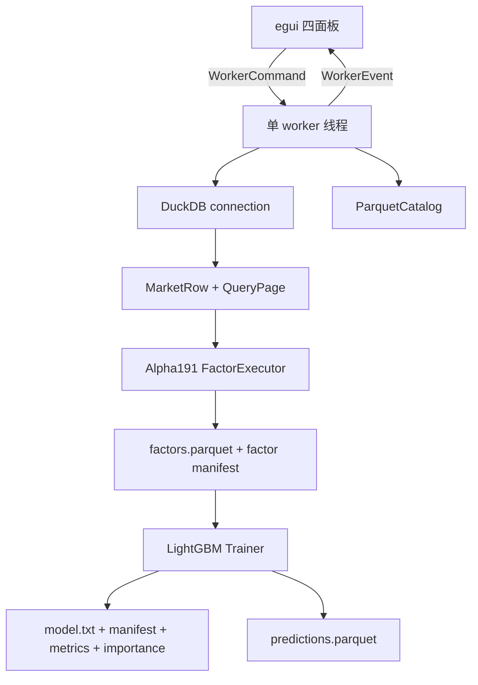

# JFQuant Analytics

本项目是一个 macOS 优先的本地量化分析工作台：从 Parquet 行情和历史股票池读取数据，经 DuckDB 查询、Alpha191 因子计算和 LightGBM 训练，最后写出带 manifest 的模型、指标和预测结果。数据、DuckDB 连接、因子执行和 LightGBM 句柄都留在本地 worker；egui 线程只负责界面和消息传递。

## 分层架构



## Crate 职责

| 层级 | crate | 责任 | 关键接口 |
|---|---|---|---|
| 1 | `analytics-core` | 无后端依赖的领域类型和请求契约 | `MarketRow`、`PageRequest`、`ModelManifest` |
| 2 | `analytics-storage` | Parquet footer 扫描和行情 schema 校验 | `ParquetCatalog`、`validate_required_market_columns` |
| 3 | `analytics-engine` | DuckDB 查询、keyset 分页、市场数据 as-of join | `QueryEngine`、`DuckDbEngine` |
| 4 | `analytics-factor` | Alpha191 公式注册、解析、面板执行、因子缓存 | `FactorRegistry`、`FactorExecutor` |
| 5 | `analytics-ml` | LightGBM FFI、流水线编排、模型产物 | `Trainer`、`Predictor`、`pipeline` |
| 6 | `analytics-desktop` | worker 协议、四面板 UI、主题和交互状态 | `WorkerCommand`、`WorkerEvent` |

每个 crate 的接口清单、数据流、构建和验收命令分别记录在对应目录的 `README.md`。模块级说明位于 Rust 源文件的 `//!` 文档，公共类型和函数使用 rustdoc 说明错误、取消、线程和数据格式约束。

## 数据目录约定

| 路径 | 内容 |
|---|---|
| `data/market` | 标准化行情 Parquet，要求见 `analytics-storage` |
| `data/universe` | 历史股票池 Parquet，含 `instrument_id`、`universe_id`、`trade_date`、`is_member` |
| `.jfquant/runs/latest` | 默认因子缓存、模型、manifest、指标和预测输出 |
| `.jfquant/runs/retrain` | 建模面板从已有因子缓存重训的输出 |

生成数据、模型文件、动态库和临时产物不提交到 Git；`.gitignore` 已排除这些路径。

## 构建命令矩阵

### 无原生 LightGBM 环境

```bash
cargo fmt --all -- --check
cargo test --workspace --exclude analytics-desktop
cargo clippy --workspace --all-targets -- -D warnings
RUSTDOCFLAGS="-D warnings" cargo doc --workspace --no-deps
```

这些命令覆盖 core、storage、engine、factor 和默认无 native feature 的 ml。桌面 app 当前按计划启用 DuckDB 与 LightGBM 原生 feature，因此没有 `lib_lightgbm` 时只做 `cargo check` 的源码检查或跳过 app 链接。

### 完整原生环境

```bash
brew install lightgbm
export LIGHTGBM_LIB_DIR=/path/to/lightgbm/lib
export DYLD_LIBRARY_PATH="$LIGHTGBM_LIB_DIR:/path/to/openmp/lib:${DYLD_LIBRARY_PATH}"
export DUCKDB_DOWNLOAD_LIB=1

cargo check -p analytics-desktop --all-targets
cargo test -p analytics-desktop
cargo test -p analytics-ml --features lightgbm-native,duckdb-native
cargo run -p analytics-desktop
```

`LIGHTGBM_LIB_DIR` 必须包含 `lib_lightgbm.dylib`；`DUCKDB_DOWNLOAD_LIB=1` 允许 DuckDB crate 在开发期下载匹配的预编译库。完整配置和 VS Code 调试环境见 [.vscode/README.md](.vscode/README.md)。

本机 Homebrew 安装的默认路径是 `$(brew --prefix lightgbm)/lib`，OpenMP 路径是 `$(brew --prefix libomp)/lib`。

## CLI 流水线

```bash
LIGHTGBM_LIB_DIR=/path/to/lightgbm/lib \
DYLD_LIBRARY_PATH=/path/to/lightgbm/lib:/path/to/openmp/lib \
DUCKDB_DOWNLOAD_LIB=1 \
cargo run -p analytics-ml --features lightgbm-native,duckdb-native --example factor_pipeline -- \
  --market data/market --universe data/universe \
  --universe-id csi500 --start 2020-01-01 --end 2025-12-31 \
  --factor alpha_001 --factor alpha_002 --output .jfquant/runs/latest
```

## 文档验收

```bash
RUSTDOCFLAGS="-D warnings" cargo doc --workspace --no-deps
cargo test --doc --workspace --exclude analytics-desktop
```

文档警告视为错误；公共 API、manifest、公式版本和异步任务协议变更必须同步更新所属 crate README。
