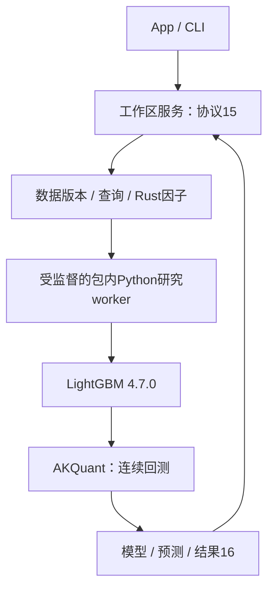

当前采集体系：HiThink（Rust REST主源）、通达信（Python SDK备用）、独立巨潮公告。服务协议18、采集协议12、来源策略2；接口、价格口径、构建和验收见[采集组件](crates/storage/collectors/README.md)。

# JFQuant Analytics

macOS 优先的本地量化研究平台。Rust App 和独立 `jfquant` CLI 共用工作区服务：
数据采集、DuckDB 查询和 GTJA191／Alpha158 因子保留 Rust 实现；Python LightGBM
负责模型训练与预测，AKQuant 0.3.66 负责连续账户回测。用户无需外部 Python。



## 组件

| crate | 职责 |
|---|---|
| analytics-core | 无后端依赖的请求、manifest、日期、股票池、数据事件与规则配置 |
| analytics-storage | 行情与事件采集、Parquet和格式读取、来源及不可变版本 |
| analytics-engine | worker 内 DuckDB 查询、分页和导出 |
| analytics-factor | GTJA191／Alpha158 定义、执行、null 语义和参考测试 |
| analytics-workflow | 工作区服务、任务、配置、Rust研究编排及Python监督 |
| analytics-desktop | egui 产品界面 |
| analytics-cli | 独立命令行与JSON接口 |

逐组件文档见 [crates/README.md](crates/README.md)。研究后端协议、构建和能力边界见
[研究worker](crates/workflow/research/README.md)。已删除独立 ml crate、Rust LightGBM
FFI、自建账户模拟及到账／上市日精细权益账本；本轮不迁移因子执行器，不增加实盘。

## 使用与构建

```bash
# 开发环境；运行安装包不需要这些工具。
crates/app/packaging/build-collector.sh
export DUCKDB_DOWNLOAD_LIB=1
cargo build -p analytics-desktop -p analytics-cli
cargo run -p analytics-desktop

jfquant workspace create "$HOME/JFQuantWorkspace"
export JFQUANT_WORKSPACE="$HOME/JFQuantWorkspace"
jfquant research demo
jfquant jobs wait TASK_UUID
jfquant jobs results TASK_UUID
```

一个工作区同时执行一个计算任务。关闭客户端不终止服务任务；取消先协作退出，
无法退出时终止研究进程组。数据、模型、日志和运行产物保留在工作区，不提交Git。

因子、标的和工作流独立保存。工作流格式10、服务协议18、模型manifest2、独立训练
描述3、结果16；采集与行情格式保持原版本。旧文件不自动转换或删除，旧状态与日志
可读，旧结果不得以新回测口径展示。

## 回测口径与兼容

日终信号，下一日线开盘成交；模型分折训练，账户跨年连续。分红和拆股使用AKQuant
除权除息日语义，不区分登记、到账和上市日；已识别不支持事件警告并跳过，普通未决问题仍阻断。
费用仅展示上游合计。交易单位采用板块增量，独立最低申报量及每日涨跌停规则不模拟。
这些结果不能标为原精细真实权益账本。具体边界见研究worker README。

因子缓存、模型和回测分别签名。账户参数不进入因子计算，模型参数变化不重算已验证
因子；依赖、特征顺序、公式版本和样本掩码均纳入适当阶段的复现记录。

## 验收

```bash
cargo fmt --all -- --check
DUCKDB_DOWNLOAD_LIB=1 cargo nextest run --workspace
DUCKDB_DOWNLOAD_LIB=1 cargo clippy --workspace --all-targets -- -D warnings
DUCKDB_DOWNLOAD_LIB=1 RUSTDOCFLAGS="-D warnings" cargo doc --workspace --no-deps
PYTHONPATH=crates/workflow/research target/collector-build/python/bin/python3 -B -m unittest discover -s crates/workflow/research/tests
crates/app/packaging/package-macos.sh
```

打包通过锁定wheel获取LightGBM和AKQuant，只编译OpenMP辅助库。包内Python全部Mach-O
对象通过arm64、macOS14、依赖路径审核。另一台干净Apple Silicon/macOS14设备的
安装、离线读取及取消验收需要在实际设备执行，不能由本机测试代替。
