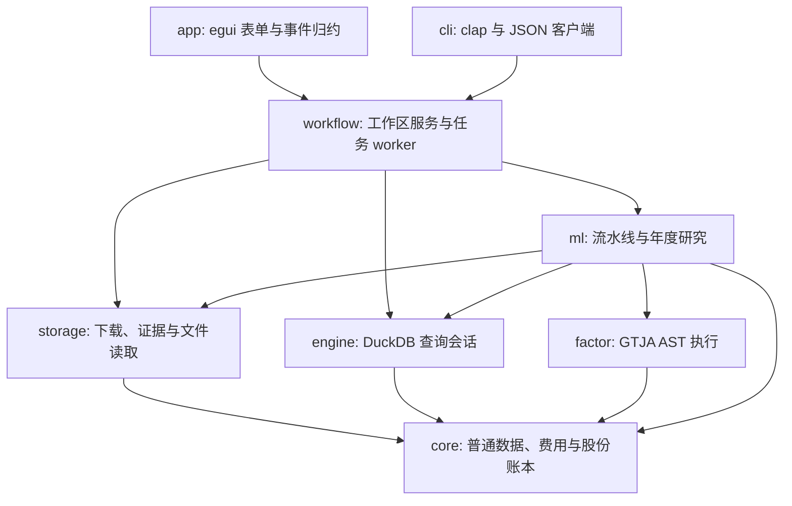

# Crates 导航与协作边界

本目录是 JFQuant 的八个 Rust 组件。日常研究通过 App 或独立 `jfquant` 完成；Cargo 用于开发构建和验收。各组件根 README 说明公共契约，子目录 README 说明模块实现、夹具或产物，沿目录树即可定位具体工作。

## 从需求找到组件

| 需求 | 组件与下一层文档 |
|---|---|
| App 表单、状态、错误和结果展示 | [app](app/README.md) → [src](app/src/README.md)；发布用 [packaging](app/packaging/README.md) |
| 命令、JSON 输出、退出码、AI 调用 | [cli](cli/README.md) → [src](cli/src/README.md)；进程验收用 [tests](cli/tests/README.md) |
| 请求类型、费用、真实股数和公司行动权益 | [core](core/README.md) → [src](core/src/README.md) |
| DuckDB 查询、分页、导出和行情连接 | [engine](engine/README.md) → [src](engine/src/README.md) |
| GTJA 公式、AST、缺失值和隔离原因 | [factor](factor/README.md) → [src](factor/src/README.md)、[testdata](factor/testdata/README.md)、[examples](factor/examples/README.md) |
| LightGBM、Parquet 流水线、年度账户研究 | [ml](ml/README.md) → [src](ml/src/README.md)、[backtest](ml/src/backtest/README.md)、[examples](ml/examples/README.md) |
| 行情获取、证据、公司行动解析与恢复 | [storage](storage/README.md) → [src](storage/src/README.md)、[corporate_actions](storage/src/corporate_actions/README.md) |
| 工作区、模板、记录、公共任务服务 | [workflow](workflow/README.md) → [src](workflow/src/README.md)、[templates](workflow/templates/README.md) |

## 依赖方向与运行路径

图中的实线表示领域调用主路径，不是全部 Cargo 直接依赖。App/CLI 也引用底层类型进行表单或参数转换；业务执行、记录生命周期与原生句柄归公共后台。



同一工作区只有一个计算任务；App/CLI 可同时连接。控制请求读取普通数据，DuckDB/LightGBM 句柄在计算线程内创建、使用和销毁。客户端退出不取消已提交任务。下载和研究均用统一 `TaskContext` 检查取消与报告进度。

## 变更必须保留的契约

研究结果 schema 4、服务协议 2、模板/工作区/数据版本 schema 1 是不同契约。当前研究只接受不复权整数股撮合、真实公司行动、跨年持续账户；缺项会在训练前阻止执行。因子公式 v4 注册 191 项，隔离 12 项；年度研究还缺 Alpha030 的真实三因子输入，默认 178 项。

更改公共字段或异步阶段时，同步更新组件和相关子目录 README；更改公式时新增独立 fixture/golden 并更新公式版本及审计范围；更改特征顺序、费用或输入版本时必须让冻结签名反映变化。不能通过修改旧 manifest 绕过版本检查。

## 开发与验收

以下命令从仓库根目录执行。首次准备原生依赖的命令、CMake 前提和固定版本见 [打包文档](app/packaging/README.md)。已构建 macOS 14 原生库时：

```bash
export DUCKDB_DOWNLOAD_LIB=1
export LIGHTGBM_LIB_DIR="$PWD/target/native-macos14/install/lib"
export DYLD_LIBRARY_PATH="$PWD/target/debug/deps:$LIGHTGBM_LIB_DIR"
cargo build -p analytics-desktop -p analytics-cli
cargo nextest run --workspace --profile ci
cargo clippy --workspace --all-targets -- -D warnings
RUSTDOCFLAGS="-D warnings" cargo doc --workspace --no-deps
cargo test --workspace --doc
cargo fmt --all -- --check
git diff --check
```

没有原生库时可分别检查 `core`、`storage`、`factor` 和默认 feature 的 `engine`、`ml`；完整 App/CLI/workflow 验收需要原生库，不能把非原生检查当完整验收。

所有包含源文件的目录都维护 README 和对应 Mermaid 图；空目录不是组件。文档应解释调用或验证关系，不复制整个父级 README。数据、证据、模型、日志、运行记录、安装包和文档渲染产物只写 `data/`、`.jfquant/`、`target/`，不提交 Git。另一台 Apple Silicon/macOS 14 实机验收仍单独待完成。

## 逐目录文档验收

2026-10-13：25个有效目录均有README，30张Mermaid图通过实际解析与SVG渲染；本仓库Markdown的200条本地链接（含19条标题锚点）检查通过，61条文档CLI示例替换UUID占位符后通过包内clap帮助解析。源码目录说明接口/线程边界，夹具说明生成与验证范围，模板和打包说明冻结版本、产物及验收。渲染器、SVG/PNG预览和临时检查报告只保存在忽略的target/，不增加运行依赖。

本次为文档变更，未改变163项nextest已验收的业务实现；另一台Apple Silicon/macOS 14实机验收继续待完成。
