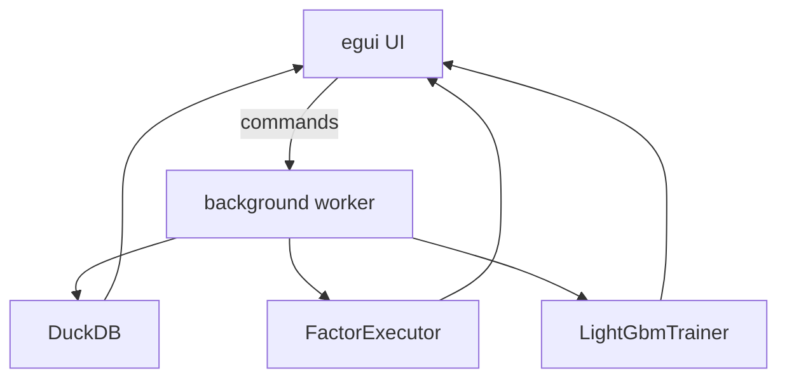

# app

macOS-first egui shell for data management, SQL, Alpha191 factors, and LightGBM training.

The factor tab captures market and historical-universe paths, date bounds, selected factor IDs, and an output directory. The same request shape is consumed by the `factor_pipeline` worker command; long-running execution remains outside the egui frame loop.

