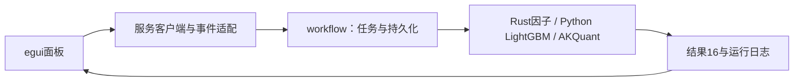

当前采集体系：HiThink（Rust REST主源）、通达信（Python SDK备用）、独立巨潮公告。服务协议19、采集协议12、来源策略2；接口、价格口径、构建和验收见[采集组件](../storage/collectors/README.md)。

# analytics-desktop

macOS优先的egui桌面客户端，提供数据、查询、因子、建模、研究和运行记录界面。
所有计算通过同一工作区服务，App不持有DuckDB、LightGBM或Python对象。



公共边界为`WorkerCommand`、`WorkerEvent`及workflow中的请求类型。日期、因子和标的
配置独立编辑；任务开始时冻结，关闭界面不终止后台。界面支持进度、取消、重试、
仅训练和使用已有模型回测，展示训练产物与回测停止原因。

当前服务16、工作流10、训练描述3、模型manifest2、结果16。旧格式不自动转换，
状态和日志仍可查看。研究页展示AKQuant事件日口径及执行费用合计，不展示已删除的
精细权益账本，不提供不支持的净佣、配股认购或个人分红扣税控件。

```bash
crates/app/packaging/build-collector.sh
DUCKDB_DOWNLOAD_LIB=1 cargo build -p analytics-desktop -p analytics-cli
DUCKDB_DOWNLOAD_LIB=1 cargo run -p analytics-desktop
DUCKDB_DOWNLOAD_LIB=1 cargo nextest run -p analytics-desktop
```

验收包括真实egui交互、App与CLI共用任务、取消、错误、配置保存与旧格式拒绝。
测试使用包内研究运行时，无Rust LightGBM链接或Homebrew运行依赖。
[打包说明](packaging/README.md)描述自包含Apple Silicon/macOS14构建；另一台干净实机
安装验收仍需实际执行。[后端口径](../workflow/research/README.md)列出明确能力边界。

## 研究结果状态（格式15）

研究前置检查失败与账户未完成分别展示；提示以阶段产物为准，不再声称失败时一定已有账户记录。未执行账户的收益字段为空，不渲染为零收益；完成但无成交时展示有效信号、成交回报和拒单回报。与CLI共用workflow结构化状态及结果校验。验收：`DUCKDB_DOWNLOAD_LIB=1 cargo test -p analytics-desktop`。

公司行动页支持输入一个或多个证据任务UUID，提交共用`ReconcileActions`任务；核对结果是新数据版本。
结果16对未模拟特殊事件显示“回测完成，含未模拟事件”，并保留未解决普通问题的阻断状态。
核对规则、格式6与复现命令见storage/workflow组件README。验收包含公共任务、结果警告与旧格式隔离。

原生刷新现在以3个证券工作线程获取行情和公司行动，沿用监督进程、检查点、取消及完整发布校验。后端`RefreshRequest`允许1—8线程及显式跨任务分片复用；公共`RefreshCoverage`只读RPC可读取进度、历史成员覆盖及候选可用池，报告不自动授权训练或改变股票池。CLI命令及完整验收见[工作流README](../workflow/README.md)。服务协议19。

“更新行动”按钮使用同一Rust动作分片流程，保持当前登记行情，重新获取事件；不读废弃动作版本作为补采输入。


Packaged CLI acceptance also invokes `research verify --task <UUID>` after the train/backtest fixture: the Rust closing ledger must replay consistently and valuation-only rows must have zero fills. Python supplies upstream fills and terminal account observations; Rust owns closing valuation, event exposure and result verification. See the workflow research README for the accounting contract.
