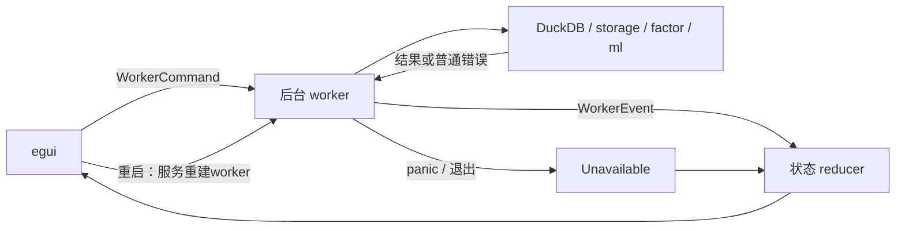
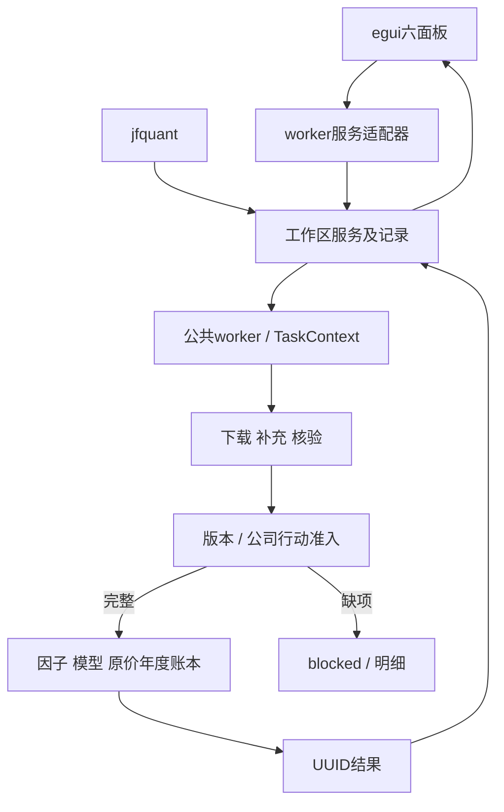
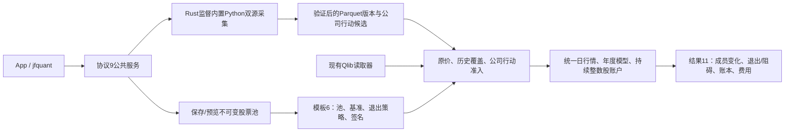
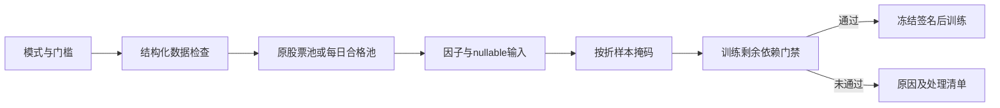

# analytics-desktop

目录导航：[全部组件](../README.md) · [src：界面状态、面板与服务事件](src/README.md) · [packaging：原生依赖、App/CLI打包与安装验收](packaging/README.md)

## 职责

macOS-first egui shell for local Parquet analysis, SQL, Alpha191 factors, and LightGBM training. UI state is kept in state.rs, visual rules in theme.rs, workbench views in panels.rs and platform views in platform.rs. worker.rs adapts the shared analytics-workflow service; native execution and task lifecycle are owned by the backend.

## 层级结构

| 模块 | 责任 |
|---|---|
| main.rs | 创建 eframe、安装主题、布局导航/顶部/中央/底部 |
| theme.rs | system light/dark preference、语义色、间距、CJK font |
| state.rs | 表单状态、校验、分页 cursor、WorkerEvent reducer |
| panels.rs | 数据、查询、因子、建模四个面板 |
| worker.rs | 公共后台服务适配器；不持有DuckDB/LightGBM句柄 |
| platform.rs | 工作区、数据版本、研究流程和运行记录界面 |
| analytics-ml::pipeline | 组合市场加载、因子、训练、预测 |

## Worker 协议

| 方向 | 消息 | 作用 |
|---|---|---|
| UI -> worker | ExecuteWorkflow / CancelTask | 模板化数据/研究请求及远端任务取消 |
| UI -> worker | ScanDataset | Parquet footer 扫描 |
| UI -> worker | DescribeQuery | 查询 schema |
| UI -> worker | RunQuery | 临时结果快照上的隐藏行号分页 |
| UI -> worker | ExportQuery | Parquet/CSV 导出 |
| UI -> worker | RunPipeline | 完整因子训练流水线 |
| UI -> worker | TrainFromCache | 从已有因子缓存重训 |
| worker -> UI | WorkflowFinished | 版本、运行记录及研究/数据结果 |
| worker -> UI | Started/Progress/Finished/Failed | 任务生命周期 |
| worker -> UI | Unavailable | 后台退出、panic 或启动失败；禁用新任务，提示重启 |
| worker -> UI | DatasetScanned/QueryDescribed/QueryPaged/Exported | 数据 payload；扫描结果携带实际 root，避免被运行中编辑的路径误标注 |
| worker -> UI | PipelineFinished/TrainingFinished | 产物、metrics、importance、预测预览 |

服务worker线程独占DuckDB和LightGBM句柄。UI只发送request和读取plain-data event；本机取消标记由适配器转换为RPC，CLI提交的任务也可远端取消。任务事件带 UUID，reducer 会忽略过期 payload。

`WorkerHandle::send` 返回 `Result<(), String>`，命令通道断开时由面板统一显示后台不可用提示。UI 同时检测事件通道断开，结束当前任务等待、将错误路由到所属面板并清除取消句柄；重复断开不重复写日志。

发送成功后 UI 立即登记任务并禁用任务按钮，不等待异步 `Started` 到达，防止快速重复点击入队。后台 `Started` 只更新同一任务的状态文字，不清空已有进度。

## 后台异常与恢复

| 错误类型 | 行为与恢复方式 |
|---|---|
| SQL、文件 I/O、Parquet/schema、因子、训练返回 `Err` | 回传 `Failed`，显示对应面板错误，后台继续接收任务；修改输入后重试 |
| 任务中的 Rust unwinding panic | 任务边界捕获，回传包含原因的 `Failed`；停止接收任务，在所属线程释放原生句柄，再回传 `Unavailable` |
| 任务边界以外的后台 panic | 线程入口捕获，回传 `Unavailable`；存在活动任务时按其类型显示错误并结束等待 |
| 线程启动失败、命令发送失败、事件通道断开 | 显示后台不可用，禁用扫描/执行/Describe/分页/导出/因子运行/训练操作 |

后台不可用时，顶部提供“重启后台”。点击后重新连接服务，故障时重建服务worker，并替换UI命令/事件通道，清除不可用状态、分页游标与取消句柄；旧事件接收端被丢弃，不能污染新的任务。原有 SQL、路径、参数和已显示的结果保留，需要重新执行操作。后台不可用期间仍可切换面板和编辑表单；迟到的任务事件不会使已停止的后台重新变成“运行中”。

两层 panic 边界使用 `catch_unwind`/`AssertUnwindSafe`，捕获后不继续使用可能已不一致的 mutable/native 状态。普通错误仍使用 `Result` 传播。此兜底针对 Rust 的 unwinding panic，不覆盖 `panic=abort`、原生库段错误、OOM/系统强制终止或 UI 线程 panic；Rust panic hook 仍会输出诊断，调试器的 Rust panic 断点仍可暂停。[Rust catch_unwind 文档](https://doc.rust-lang.org/std/panic/fn.catch_unwind.html)说明了捕获边界。

恢复不会自动回滚或删除任务失败前写出的文件；重新运行因子/训练前请检查原输出目录，或指定新的输出目录。

## 四个面板

1. 数据管理：扫描文件、行数、列数、schema；对选中文件运行标准行情 schema 校验。
2. 查询工作台：SQL editor、Describe、100/500/2000 行分页、排序列、下一页 cursor、Parquet/CSV 导出。
3. 因子工作台：路径、universe、日期和 191 因子搜索/多选；运行流水线并显示迭代日志和产物。
4. 建模：选择 factors.parquet、设置迭代/学习率/叶节点/早停参数，查看 metrics、feature importance 和 predictions 预览。

### 查询与分页

首次执行将完整查询结果及隐藏行号保存在 DuckDB 连接的临时表中，后续页面在同一快照上使用行号游标。默认按所有结果列升序排序；选择排序列时该列优先，其余列用于同值排序，NULL 始终排在末尾。重复排序值、完全相同的行、NULL、中文/空格列名均可翻页；隐藏行号不出现在结果表和导出中。列名冲突时自动调整隐藏行号名称。

修改 SQL、每页行数、排序列或有效排序方向后，旧游标禁用，需重新执行查询；后台也校验游标所属的查询。开始新查询会清空旧结果和旧游标，查询失败不会继续显示旧结果。排序列可选“（未选择）”恢复默认，原排序列不存在时提供错误提示。重启后台也使旧游标失效。

临时快照保证源文件变化和 `random()` 等表达式不会在翻页时改变结果；新查询替换旧快照，后台退出时释放快照。代价是首次执行需要计算和保存完整结果，大数据查询建议显式限定日期、列和 `LIMIT`。导出按编辑器 SQL 重新执行，导出结果可能因源数据或随机表达式变化而不同于快照。SQL/导出/扫描当前不支持取消，取消按钮禁用并显示提示；因子流水线和训练支持协作式取消。

执行查询、Describe 和导出失败时，worker 通过 `Failed` 事件回传错误，查询面板顶部显示红色错误区域和可选择复制的原始诊断。找不到 Parquet 文件时提供检查路径/准备行情数据的提示；重试任务开始后清除旧错误。SQL 语法错误或文件缺失不终止 worker，可以修改 SQL 后继续执行。VS Code 的桌面启动配置会在启动前禁用 C++ throw/catch 断点，避免 DuckDB 内部已捕获的异常阻断错误回传；保留 Rust 源码和 panic 断点，详见 [.vscode README](../../.vscode/README.md)。

训练表单要求学习率为有限正数，迭代次数/叶节点/叶内样本数为正整数，叶节点至少为 2；早停留空关闭，非空值必须是 u32。过期任务的失败或完成事件不会改变当前任务状态或取消句柄。

取消提示依据 pipeline 的 `Cancelled` 类型或 LightGBM 的确切训练取消错误生成，不按任意错误中的 `cancelled` 子串判断；例如不存在的 `cancelled_table` 仍显示原始 SQL 错误。

## 数据流



## 视觉约定

- 主题跟随系统明暗模式。
- 8pt 间距、统一 6px 控件圆角、8px 窗口圆角。
- 蓝色表示主操作，绿色表示成功，琥珀表示提醒，红色表示错误。
- 数值、SQL、路径和 factor ID 使用等宽字体。
- 左侧导航、顶部任务栏、中央工作区、底部状态栏固定分工；日志折叠在底部。
- 数据表格采用条纹行和横向滚动，避免列内容互相遮挡。

## 构建与环境

默认依赖已在 Cargo.toml 中启用 analytics-engine 的 duckdb-native，以及 analytics-ml 的 lightgbm-native、duckdb-native。

桌面构建脚本从 Cargo `OUT_DIR` 定位当前 target/profile 的 `deps`，使用 libduckdb-sys 在该目录复制的匹配 DuckDB 库，不递归搜索下载缓存。相对/自定义 `CARGO_TARGET_DIR` 和交叉目标/profile 的路径都由 `OUT_DIR` 决定；也可显式设置包含实际动态库文件的 `DUCKDB_LIB_DIR`。空值对本地路径助手视为未设置，但上游 libduckdb-sys 将空 `DUCKDB_LIB_DIR` 当成显式路径，所以下载模式应 `unset DUCKDB_LIB_DIR`。

`build.rs`、`build_support.rs` 与 ml 的 `native_paths.rs` 负责库路径；app 和 ml 共用 LightGBM 探测，优先显式目录，再尝试 `brew --prefix lightgbm`、标准路径与当前用户 Homebrew 路径，不包含开发者个人绝对路径。显式目录缺少库文件时构建直接报错。macOS 写入绝对路径及 `@executable_path/deps` / `@executable_path` rpath，Linux 写入路径及 `$ORIGIN` 相对 rpath；Windows 不输出 Unix 链接选项，原生构建/运行验收目前限本机 macOS。

在本机已安装依赖或下载库的布局中，直接运行 desktop 无需额外 `DYLD_LIBRARY_PATH`；分发程序仍需打包原生库和 OpenMP 依赖，不能只复制可执行文件。

    export LIGHTGBM_LIB_DIR=/path/to/lightgbm/lib
    export DYLD_LIBRARY_PATH=$LIGHTGBM_LIB_DIR:/path/to/openmp/lib:$DYLD_LIBRARY_PATH
    export DUCKDB_DOWNLOAD_LIB=1
    unset DUCKDB_LIB_DIR
    brew install lightgbm
    cargo check -p analytics-desktop --all-targets
    cargo build -p analytics-desktop -p analytics-cli
    cargo run -p analytics-desktop

没有 lib_lightgbm.dylib 时可以编译源码依赖，但最终链接和运行会失败；完整无原生检查见根 README。

## 自动化交互测试（nextest）

`src/interaction_tests.rs` 使用真实 egui 控件和鼠标/键盘事件，无需打开系统窗口；worker 测试在独立线程运行真实 DuckDB 与 LightGBM，数据和模型写入 `tempfile` 临时目录。

| 测试层 | 覆盖范围 |
|---|---|
| egui 交互 | 四面板导航、日志展开/收起、SQL 编辑、按钮点击、真实查询缺失文件/语法/表名错误显示及修正后恢复、Describe/导出错误及重试、panic 提示与重启后的真实查询恢复、命令/事件通道断开、全部任务按钮禁用、旧事件隔离、分页大小/排序/格式选择、文件选择与 schema 警告、因子筛选/全选/清空/勾选、训练参数、取消、明暗主题渲染 |
| 状态与校验 | SQL/日期/超参校验、分页累积与 schema 替换、错误路由、过期事件、任务完成、日志容量 |
| 真实 worker | Describe、升降序连续分页、NULL 与数值/日期类型、CSV/Parquet 导出及扫描、含引号 SQL/路径、缺失 Parquet glob 错误与失败恢复、扫描/导出/流水线/训练 I/O 失败后的复用、六类任务 panic 与任务外 panic、不同 panic 内容、取消、完整因子训练与缓存重训、指标/重要性/预测预览 |
| 分页与提交回归 | 默认 600 条重复行连续翻页、重复/NULL 排序键、中文列名/隐藏列冲突、源文件删除后翻页、随机表达式快照、修改查询禁用旧游标、失败查询清空旧结果、入队即禁用重复提交、basename 导出 |
| 原生库构建 | 实际编译并运行构建脚本，验证当前 target/profile、相对 target 配置、旧架构缓存隔离、无效显式目录拒绝、Homebrew 路径探测助手 |

```bash
cargo install cargo-nextest --locked
export DUCKDB_DOWNLOAD_LIB=1
# LightGBM 已安装时自动探测；自定义安装可设置 LIGHTGBM_LIB_DIR。
cargo nextest run -p analytics-desktop
cargo nextest run -p analytics-desktop -E 'test(interaction_tests::)'
# 故障注入与后台恢复（仅 test 构建含注入命令）
cargo nextest run -p analytics-desktop -E 'test(panic) | test(channel) | test(unavailable_worker) | test(file_scan_export)'
cargo nextest run --workspace --profile ci
```

VS Code 任务 `Rust: desktop interaction tests (nextest)` 运行同一套桌面测试。nextest 配置位于 `.config/nextest.toml`，默认不在首次失败时中止，超时会终止测试；CI 的 JUnit 报告在 `target/nextest/ci/junit.xml`，不提交生成文件。

这些测试验证交互逻辑和后台真实产物；构建脚本回归用例需要 `rustc` 在 PATH 中。macOS 原生窗口、系统外观跟随、字体视觉效果及实际数据规模下的体验仍需以下手动验收。

## 手动验收项目

- 切换 macOS 浅色/深色外观，重启 app 后主题跟随系统。
- 数据管理扫描 data/market，选中文件检查 footer schema 和行情契约提示。
- 查询工作台执行 SQL，选择排序列，连续点击下一页，导出 CSV 与 Parquet。
- 因子工作台选择至少一个因子，运行真实数据，观察加载、因子、训练和写出阶段。
- 建模面板从 factors.parquet 重训，查看 metrics、importance 和预测表。
- 任务运行中点击取消，确认 worker 回报失败/取消，界面恢复空闲。
- 操作失败后错误显示在所属面板；后台不可用时显示重启入口，重启后可重新查询且不会接收旧后台事件。
- 显式配置不含库文件的 LightGBM 目录，确认构建错误指出配置问题；不设置环境变量时确认自动探测生效。完全缺少 native library 时程序无法链接或加载，不能依赖界面显示启动前错误。

## 验收命令

    cargo fmt --all -- --check
    cargo check -p analytics-desktop --all-targets
    RUSTDOCFLAGS="-D warnings" cargo doc --workspace --no-deps

在设置好 LightGBM 动态库的机器上补跑：

    DUCKDB_DOWNLOAD_LIB=1 cargo nextest run -p analytics-desktop
    cargo build -p analytics-desktop -p analytics-cli
    cargo run -p analytics-desktop

## 本地研究平台与公共后台

保留数据、查询、因子、建模四工作台，新增研究流程及运行记录。首次启动在顶部选择工作区（推荐~/JFQuantWorkspace），保存于~/Library/Application Support/JFQuant/preferences.json；之后所有相对数据/产物路径从工作区解析，不依赖仓库或cwd。运行中禁用重复提交及切换工作区，参数/模板可编辑和保存，输入JSON不执行脚本。

数据管理保留Parquet扫描，并提供候选版本检查、独立下载、登记、行情/公司行动列表、失败重试、日期补充和完整性明细。研究流程选择版本、日期、178项可用v4因子、滚动/训练/组合/资金/费用配置；模板默认5年训练、1年验证、次年测试，前50、每5交易日调仓、100万元和最新默认费率。12项公式隔离及缺真实三因子输入的030不能进入模板。使用Qlib二进制读取器，不转换全量行情为Parquet。

行情和公司行动复核内容/来源/证据哈希，训练复权或来源不可信时显示逐项问题并停止训练；实际账户缺执行依据时停止回测并保留模型，不推猜日期或切换旧近似。原价、整数股、T+1、分红送转与跨年账本由同一ml/core模块处理。运行记录显示阶段、日志、错误、冻结参数、产物和年度收益/IC/净值/费用；只读登记当前schema11严格结果；旧格式读取显示unsupported_result_format，旧文件不删除。

App和独立jfquant连接同一工作区Unix socket服务，服务持锁并恢复interrupted记录；同时一个计算任务且无队列。界面显示CLI任务进度、结果、取消，业务与记录生命周期全在workflow。SQL快照按query_id隔离，其他客户端的SQL payload不覆盖App分页。关闭App不取消任务；首次前台CLI等待中断也不会SIGINT到服务，自动启动服务使用独立进程组。普通错误可重试，panic退役worker并在线程内销毁句柄。



data/、.jfquant/、target/内生成行情、缓存、模型、日志、run、原生库及安装包不提交Git；内置模板、采集实现、CLI、测试和打包脚本提交。目录/版本/记录/模板JSON契约及TaskRequest见[workflow README](../workflow/README.md)，日常命令和退出码见[CLI README](../cli/README.md)。开发启动须先同时构建App与CLI，或通过JFQUANT_CLI_BIN指定已安装的jfquant；VS Code任务已同步。底层native_smoke仅供开发FFI验收。

## 自包含macOS内部试用包

目标Apple Silicon、macOS 14及以上。packaging脚本、Info.plist和INSTALL.txt位于组件旁；所有源码下载、依赖库、签名App和DMG只生成到target。程序运行无需Codex、Cargo、外部Python、Homebrew或DYLD环境变量；联网调用macOS自带/usr/bin/curl。

```bash
# 仅开发构建电脑需要Rust、Command Line Tools、CMake和git。
brew install cmake ninja
crates/app/packaging/build-native.sh
crates/app/packaging/package-macos.sh
crates/app/packaging/verify-bundle.sh target/distribution/JFQuant.app
codesign --verify --deep --strict target/distribution/JFQuant.app
```

build-native.sh固定LightGBM v4.6.0/LLVM OpenMP 20.1.8，重建arm64/macOS 14依赖；JFQUANT_NATIVE_BUILD_ROOT覆盖构建目录。package-macos.sh以独立Cargo target构建release App和jfquant，携带DuckDB 1.5.6、LightGBM、OpenMP及许可证，清除开发绝对路径并重写包内install name/rpath，核对架构和最低系统版本后本地签名。生成target/distribution/JFQuant.app及JFQuant-macos14-arm64.dmg和SHA256。安装包拖到Applications，升级不覆盖工作区；本地签名未做Developer ID/Apple公证，可信内部包首次打开方式见INSTALL.txt，不自动降低系统安全设置。

程序--self-check OUTPUT在独立worker执行真实DuckDB查询、LightGBM小训练/24行预测。packaging/verify-cli.sh清空开发环境验收帮助、严格合成年度研究、标准因子流水线及停服后离线读取。合成输入通过“创建合成演示数据”或research demo生成，显式synthetic_fixture，1年训练/1年验证、2009—2010两年样本外、alpha_002、完整支付/上市日期；不代表真实市场收益。标准模板仍保持178项真实研究参数，合成输入与公开公司行动不能混用。

## 当前接口验收

egui覆盖版本更新、重复点击防护、取消、错误、模板保存、缺项明细、完整合成研究、结果加载和重启后历史。真实服务测试覆盖CLI任务显示/取消、标准请求双方完整结果和年度账本一致；旧结果显示格式错误并禁止展示其净值，其他记录继续正常读取。App不提供旧口径执行或旧命令适配，下载恢复使用标准请求和验证检查点。

服务协议9，研究结果schema11；程序更新不改用户工作区。若旧服务仍在运行，先完成活动任务并通过原版本CLI停止空闲服务，再打开新版，协议不自动降级。另一台Apple Silicon/macOS 14实机安装、数据更新及离线查看验收仍待完成。


## 动态股票池与 Python 采集接口

当前模板schema 6、研究结果schema11、服务协议9；公式仍为v4。模板增加 `pool_version`、`benchmark` 和 `pool_exit_policy`；默认 `builtin:csi500` / `SH000905`，沪深300模板使用 `builtin:csi300` / `SH000300`。自选和集合组合引用不可变pool版本，冻结成员区间、人工日期调整及输入哈希；模型manifest和缓存签名包含这些研究输入。原schema结果明确拒绝，历史状态和日志仍可查看，不转换旧文件。



`pools create/validate/import/export/list/versions/preview` 使用公共定义及解析器；`data collect --provider akshare|yfinance --kind market|actions` 提交后台任务，使用 jobs wait 显式等待。`run --request` 可提交完整公共请求。App提供来源、采集日期/证券、股票池JSON编辑、日期预览、退出策略及失败采集恢复按钮。包内Python和依赖只用于采集，不需要外部Python；日常操作不调用Cargo。

```bash
jfquant templates default --universe csi300 --output csi300-template.json
jfquant pools validate --definition pool.json
jfquant pools create --definition pool.json
jfquant pools preview pool-0123456789abcdef --market market-0123456789abcdef --date 2026-10-12
jfquant data collect --provider akshare --start 2004-01-01 --end 2026-10-13 --instruments SH600000,SZ000001,SH000300 --benchmarks SH000300
jfquant data collect --kind actions --provider akshare --start 2004-01-01 --end 2026-10-13 --instruments SH600000,SZ000001
jfquant research demo-parquet
```

示例ID须换为实际版本。下载可恢复验证过的证券；重新提交时参数必须与owner一致。临时/缺失输入不会自动换源、补字段或启动训练。原价撮合不使用Yahoo拆股调整价；指数历史成员缺失停止训练，支付/上市日期在真实账户执行时校验。2010样本外的5+1窗口需要2004—2009完整历史池及行情，不能以当前成分回填。

开发验收先运行 `crates/app/packaging/build-collector.sh`，再执行workspace nextest、严格Clippy/Rustdoc和格式检查。解释器、依赖、数据、模型、缓存、日志、运行记录及DMG均留在忽略目录。另一台Apple Silicon/macOS14实机验收待完成。

打包拒绝高于 macOS 14.0 的最低版本，包括14.0.1与14.1；Python原生审核实际解析依赖目标，拒绝缺失库和越出包内的路径。审核回归由nextest集成运行，无需联网。

## 独立系数与研究输入

数据面板显示并冻结新浪独立系数或Yahoo候选。共同后台以原价及F/F0生成价量，核验训练、验证、预热和测试历史；撮合使用真实量/股数。公式与178特征顺序不变，缓存和模型因输入签名变化重算。错误逐证券展示factor_basis_issues、adjustment_issues及affected_factor_ids；实际账户仍要求完整支付/上市资料。规范4、报告10经服务9执行，不转换旧文件。

## 日期编辑与事件审查

研究面板提供单次/滚动/手动多折选择、日期控件、可选验证、步长单位、扩展训练及自动数据末日；高级JSON编辑保留未完成输入，点击应用后校验。预览研究日程由后台显示实际每折日期、预热和样本数，补采所需公司行动/获取实施公告使用相同模板。

事件审查按证券加载原事件、稳定哈希、来源错误和公告候选，复制核实后的逐字段引用到修订请求，提交后产生新动作版本。可用现金配股策略可在界面切换为明确放弃；不主动行使现金选择权。未知来源映射、日期、资格和估值仍显示数据未就绪，关闭界面不取消后台任务。

## 为什么需要本组件

研究操作不应依赖Codex或Cargo。App把数据更新、参数编辑、证据核验、任务和结果变成用户可操作的流程。业务仍在共享后台，界面展示失败原因、缺项和未执行检查，不把底层调试异常当成用户结果。

设计依据：2026-10-14接受的当前组件职责、可复现实验与用户研究需求、组件接口及测试。未在代码或证据中确认的历史取舍不推定为既有设计理由；来源、法规或数据格式变化时重新评估。

## 三级研究模式：为什么允许筛选

决定日期2026-10-14，依据是用户接受的三级模式计划。正常预热空值、来源缺失和错误数据是不同问题：全部拒绝会浪费可用样本，全部放行又会混淆因子和真实权益。默认严格检查；另外提供“允许部分数据缺失”和“只用数据合格的股票”。模式是研究输入的一部分，不能作为训练失败后自动切换的兜底。

第二档保持原成员，纯缺失传播null；第三档派生每日合格成员，不改原始成员或证据。不能看到后来缺价而倒删早期股票。账户仍采用原价、整数股、T+1和连续权益；未裁定冲突、损坏、基准缺项及剩余必要依赖仍阻断。默认有效因子比例0表示至少一项有效，最低有标签样本1只表示可执行，不表示样本在统计上充分。所选因子整列无有效值不会被自动删除。

研究面板用“1. 严格检查”“2. 允许部分数据缺失”“3. 只用数据合格的股票”，并说明默认只排除完全无效样本。筛选门槛只在放宽档显示；模板保存实际参数。研究页顶部优先显示问题列表，支持证券/原因/类别搜索和处理方式筛选，展开证据和受影响因子，也可导出完整JSON。检查失败与排除分开显示，通过项不标成阻断。

结果显示每日证券数量、逐折训练/验证/预测样本数量及排除范围。第三档始终说明经过筛选；查看历史调用同一schema11校验，不掩盖旧格式或签名错误。egui测试操作真实下拉框，确认发送公共请求及原因明细可见。



## 2026-10-14：直接代码读取与分阶段研究

为什么调整：普通市场代码无需先登记身份；独立目录、审核和权威名录下载增加了研究前置负担。特殊历史代码仍需在快照内明确区间，不能将旧证券行情或权益接到另一证券。训练使用价量和标签，到账／交付资料只在实际账户执行时检查。

当前格式：模板6、需求3、准入4、股票池3、公司行动4、规范行情5、系数3、采集6、服务9、研究结果11；快照内来源映射1、训练产物1。工作区和任务记录1、GTJA191公式v4及默认178项顺序保持。旧格式明确拒绝，不自动转换。

界面移除身份管理和目录选择。研究面板提供“仅训练模型”、训练任务ID及“使用已有模型回测”；原“执行年度研究”为两阶段组合。界面展示事实状态，无有效交易和未完成回测不得当作策略收益验收通过。


验收：nextest覆盖来源日期边界、三档掩码、训练／回测分离及模型保留；Clippy、Rustdoc、格式、组件文档和包内CLI共同检查。生成数据、模型、运行记录和安装包不提交。另一台Apple Silicon/macOS14实机验收继续待完成。
