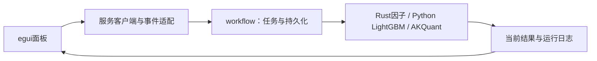

当前采集体系：HiThink（Rust REST主源）、通达信（Python SDK备用）、独立巨潮公告。服务协议27、采集协议13、来源策略2；接口、价格口径、构建和验收见[采集组件](../storage/collectors/README.md)。

# analytics-desktop

macOS优先的egui桌面客户端，提供数据、查询、因子、建模、研究和运行记录界面。
所有计算通过同一工作区服务，App不持有DuckDB、LightGBM或Python对象。



公共边界为`WorkerCommand`、`WorkerEvent`及workflow中的请求类型。日期、因子和标的
配置独立编辑；任务开始时冻结，关闭界面不终止后台。界面支持进度、取消、重试、
仅训练和使用已有模型回测，展示训练产物与回测停止原因。

当前服务25、工作流10、训练描述4/5、模型manifest3、结果19。旧结果不按当前口径解释，
状态和日志仍可查看。研究页展示AKQuant事件日口径及执行费用合计，不展示已删除的
精细权益账本，不提供不支持的净佣、配股认购或个人分红扣税控件。

```bash
crates/app/packaging/build-collector.sh
DUCKDB_DOWNLOAD_LIB=1 cargo build -p analytics-desktop -p analytics-cli
DUCKDB_DOWNLOAD_LIB=1 cargo run -p analytics-desktop
DUCKDB_DOWNLOAD_LIB=1 cargo nextest run -p analytics-desktop
```

验收包括真实egui交互、App与CLI共用任务、取消、错误、配置保存与旧格式拒绝。
测试使用包内研究运行时，无Rust LightGBM链接或Homebrew运行依赖。
[打包说明](packaging/README.md)描述自包含Apple Silicon/macOS14构建；另一台干净实机
安装验收仍需实际执行。[后端口径](../workflow/research/README.md)列出明确能力边界。

## 研究结果状态（格式15）

研究前置检查失败与账户未完成分别展示；提示以阶段产物为准，不再声称失败时一定已有账户记录。未执行账户的收益字段为空，不渲染为零收益；完成但无成交时展示有效信号、成交回报和拒单回报。与CLI共用workflow结构化状态及结果校验。验收：`DUCKDB_DOWNLOAD_LIB=1 cargo test -p analytics-desktop`。

公司行动页支持输入一个或多个证据任务UUID，提交共用`ReconcileActions`任务；核对结果是新数据版本。
当前结果对未模拟特殊事件显示“回测完成，含未模拟事件”，并保留未解决普通问题的阻断状态。
核对规则、格式6与复现命令见storage/workflow组件README。验收包含公共任务、结果警告与旧格式隔离。

原生刷新现在以3个证券工作线程获取行情和公司行动，沿用监督进程、检查点、取消及完整发布校验。后端`RefreshRequest`允许1—8线程及显式跨任务分片复用；公共`RefreshCoverage`只读RPC可读取进度、历史成员覆盖及候选可用池，报告不自动授权训练或改变股票池。CLI命令及完整验收见[工作流README](../workflow/README.md)。服务协议27。

“更新行动”按钮使用同一Rust动作分片流程，保持当前登记行情，重新获取事件；不读废弃动作版本作为补采输入。


Packaged CLI acceptance also invokes `research verify --task <UUID>` after the train/backtest fixture: the Rust closing ledger must replay consistently and valuation-only rows must have zero fills. Python supplies upstream fills and terminal account observations; Rust owns closing valuation, event exposure and result verification. See the workflow research README for the accounting contract.

公司行动详情复用`InspectActions`，按钮“加载事件、结构化字段与公告证据”无需公告manifest即可查询结构化字段。审计JSON支持版本2结构化引用和旧版本1公告引用；不提供配股认购控件，也不将字段补齐显示为已模拟配股。验收：`DUCKDB_DOWNLOAD_LIB=1 cargo test -p analytics-desktop structured_action_inspection`。

研究页“配股与预测复用”使用已发布预测任务ID，提供参与/放弃、首日/截止日及部分认购/全额或放弃/停止三种资金策略；默认放弃认购；主动选择参与时，默认首日一次、部分认购。调用共享 BacktestPredictions，不重训模型。

界面依赖使用 egui/eframe/egui_extras 0.37.0、rfd 0.17.2；临时状态使用显式全局 ID，局部筛选键沿用 UI scope。验收覆盖中文标签、滚动布局、日期校验、异步任务与配股默认放弃。

## 因子组与有效性测试

因子页提供只读Alpha158/GTJA191组，以及复制、改名、编辑说明、筛选、保存、删除自定义组；
“应用到研究配置”只替换因子选择，保留日期和股票池。修改内置组必须先复制。
“因子有效性测试”独立发送服务协议27的EvaluateFactors任务，支持进度和取消；默认5日、5分层、
30个日内有效样本。报告展示覆盖率、配对率、有效天数、IC、RankIC、RankIC IR、正RankIC比例、
高减低收益，展开查看每日统计与分层收益，可导出JSON及逐项加入自定义选择后保存。
结果使用冻结参数，即使表单后来改变也不会改写报告；模型训练仍保留原入口。
统计定义及已知边界见[workflow README](../workflow/README.md#因子组与独立有效性测试2026-10-16)。
验收：`DUCKDB_DOWNLOAD_LIB=1 cargo test -p analytics-desktop`（包含只读保护、复制保存、应用研究、异步测试请求）。

## 新建公式与混合因子组

因子页“新建 / 编辑自定义因子”提供名称、说明、公式、“校验公式”、“保存新修订”和异步“合成样本预览”。
“算子浏览与插入”可搜索GTJA_和QLIB_算子，查看参数、示例、窗口、空值和历史规则；内置算子只读。
预览数据为确定性合成序列，真实有效性仍通过行情和历史股票池运行原评估入口。

在“自定义因子库”编辑或归档因子，点击“加入当前组”；切换内置目录只切换浏览范围，保留已有混合选择。
“特征顺序”支持上下移动；复制内置组后可加入两套内置因子及自定义因子。“更新选中修订”显式采用最新版本，
界面同时显示库中最新修订和组内固定修订。保存组或应用到研究后，训练、报告和旧模型均使用冻结定义。
归档因子及删除组保留历史；原始158/191仍只读。

因子库读写通过协议27共享服务，UI异步同步；计算和预览通过worker任务，支持取消。
验收：`DUCKDB_DOWNLOAD_LIB=1 cargo test -p analytics-desktop`。

## 独立训练与跨池回测

研究页新增“独立训练与跨池回测”。先从当前配置生成训练计划，在“独立训练计划JSON”
设置 A 股票池及 single/manual/rolling 训练/验证窗口；不需要测试日期。
预检后提交独立训练，模型保存为 training.json 5；完成后自动填入训练任务ID。

查询模型可查看拟合截止、可用日期及稳定ID。生成独立回测计划后可单独选择 B 股票池、
行情/公司行动版本，并在“独立回测计划JSON”设置日期和账户参数。
模型选择默认滚动，也可从查询列表固定单个模型。计划支持JSON导入/导出，与CLI共用。
“预检B与模型切换”返回冻结切换计划、证券和数据缺口；两侧补采按钮使用原公司行动采集器。

A/B可重叠，横截面计算互相隔离；B不参与验证或早停。首日没有合法模型则拒绝回测。
账户跨模型连续运行；报告显示曾见/未见标的及同一账户贡献，预测可独立重放。
旧“年度研究/仅训练/已有模型回测”入口保持原配置语义。服务协议27，结果19仅读取当前格式。

```bash
DUCKDB_DOWNLOAD_LIB=1 cargo test -p analytics-desktop independent_training_and_backtest_editors
DUCKDB_DOWNLOAD_LIB=1 cargo run -p analytics-desktop
```

## 工作区界面边界

`platform` 按 workspace/data/research/runs 分页组织。工作区目录、运行结果、日志与
NAV 由后台 `views` 读取并缓存；渲染线程只消费普通数据，过期选择的响应被丢弃。
导入结果通过后台服务执行。见 [面板组件](src/platform/README.md)。

```bash
DUCKDB_DOWNLOAD_LIB=1 cargo nextest run -p analytics-desktop
```

## 组合数据检查

因子页“检查组合数据”使用当前未保存的有序选择、文件、股票池、日期和未来交易日周期。
可选原有三档策略，默认严格。后台显示依赖/输入/因子/样本阶段，结果展示逐因子有效率、
标签配对数、空值连续区间、任务/历史缺失计数及明确的全空因子告警。
通过只代表本页上下文可计算；训练还要求训练标签、样本掩码及最少样本门槛。
选择、公式修订、日期、数据或策略改变会使旧报告过期；文件变化由后台轻量探针提示。
检查与正式任务均由安装包内 Rust worker 执行，取消与报告随任务持久化，不依赖源码目录或外部 Python。
`factor_checks.rs` 负责控件/新鲜度；`input_check` 的两个适配器负责判断与计算。
安装验收：`crates/app/packaging/package-macos.sh`，包含离线混合组合检查与结果复用 smoke。

仅验证原生组合检查可运行：
`crates/app/packaging/verify-input-check.sh /绝对路径/JFQuant.app /绝对路径/验收输出`。
脚本在新目录以 `env -i` 和系统 PATH 启动安装包，使用原生 SQL 生成2030年行情、
混合固定修订及历史成员，检查两次并验证正式诊断缓存命中和停止服务后的离线结果。
此项不调用任何 Python、编译器或源码模块，也可对只读挂载 DMG 中的 App 执行。

研究页新增证据维护面板，对应 CLI 的 `data evidence`：公告 URL 表单、失败批次恢复、原检查点重试、缺口查询、草稿核验与载入。只提交共享后台任务，不在 UI 改写来源或证据。操作流程见 [CLI 与 GUI 共用证据维护](../cli/src/README.md#公司行动证据维护agent-与-gui-共用)。
