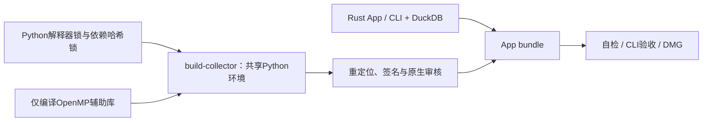

# macOS packaging

AKQuant 0.3.66 使用 PyPI 原始 sdist 和其 Cargo.lock，SHA-256 记录在 `akquant-source.lock.json`；最小原生改动在 `akquant-rights.patch`，领域状态机从 core 源码复制到忽略的构建目录。`build-akquant.sh` 核验所有输入、使用哈希锁定的 maturin 工具构建 macOS14/arm64 wheel，再由 build-collector 安装。运行时自报源码锁哈希，研究 worker 拒绝未打补丁或哈希不符的引擎。保留 MIT 上游许可证；不提交源码展开树、wheel 或动态库。

复现：`bash crates/app/packaging/build-collector.sh`；产物与构建回执位于 `target/akquant-rights-build`。修改状态机或补丁须更新源码锁输入哈希并重建，研究依赖签名同时包含 Python 依赖锁和原生源码锁。

构建自包含Apple Silicon/macOS14的App、独立jfquant及DMG。运行时不调用Cargo、pip、
uv或系统Python。所有依赖、原生对象、签名及安装包生成到忽略的target目录。



```bash
# 构建机需要Rust、Command Line Tools、uv和CMake；用户机器不需要。
crates/app/packaging/build-collector.sh
crates/app/packaging/package-macos.sh
crates/app/packaging/verify-bundle.sh target/distribution/JFQuant.app
codesign --verify --deep --strict target/distribution/JFQuant.app
```

`build-native.sh`只构建LLVM OpenMP 20.1.8，`JFQUANT_NATIVE_BUILD_ROOT`可覆盖构建目录。
LightGBM 4.7.0来自哈希锁定wheel，AKQuant 0.3.66按源码锁构建配股补丁；不携带旧Rust LightGBM依赖。
`build-collector.sh`同步采集与研究Python包，将OpenMP放入包内，修正LightGBM引用。
`rewrite-python.py`移除构建机搜索路径、重定位包内依赖并签名；`verify-python.py`审核
每个Mach-O的arm64切片、macOS最低版本、实际依赖目标及包内路径。

`package-macos.sh`拒绝覆盖正在使用的生成App，构建release App和CLI，复制DuckDB、
共享Python树和许可证，审核并签名后执行自检、verify-cli 和 verify-input-check。结果位于target/distribution。
研究worker协议、取消与功能边界见[研究README](../../workflow/research/README.md)。

本机审核不能替代另一台干净Apple Silicon/macOS14机器的安装、运行、取消及离线读取。
开发签名不等同Developer ID或Apple公证；安装方式见INSTALL.txt。

当前格式及协议以 workflow 常量为准（服务协议43）；打包CLI验收覆盖完整输入/因子/样本检查、模型复用、已发布预测复用和完整结果格式；采集模块改动后必须同步重建共享Python中的采集包。打包必须等待使用开发Python目录的采集任务结束，避免重建运行时影响请求。

打包验收核对当前服务协议／采集16、来源策略2的HiThink默认角色和空执行资料来源，并验证两种私有Key入口、废弃命令拒绝、包内Python及原生研究流程。

`verify-input-check.sh /绝对路径/JFQuant.app /绝对路径/验收输出` 在源码目录外以清空环境
运行包内 CLI；原生 SQL 生成混合内置/自定义组合所需行情和历史成员，完整检查两次，
验证正式评估命中同一上下文产物及停止服务后的报告读取。该脚本不调用 Python、编译器
或源码模块，可直接验证只读挂载 DMG 中的 App。


Packaged CLI acceptance also invokes `research verify --task <UUID>` after the train/backtest fixture: the Rust closing ledger must replay consistently and valuation-only rows must have zero fills. Python supplies upstream fills and terminal account observations; Rust owns closing valuation, event exposure and result verification. See the workflow research README for the accounting contract.

2026-10 依赖基线：maturin 1.15.0、Python 3.12.15/20261013；AKQuant 上游仍为 0.3.66，补丁把原生 Decimal 精确固定到 1.43.0，并包含配套 Cargo.lock 变更。构建先核验上游原始锁，再应用补丁，随后 `--locked` 构建。OpenMP 保持 20.1.8。锁更新后先结束运行时重建，再运行研究测试，避免签名竞争。

## Dependency ownership

AKQuant source receipts now live in `crates/workflow/research/akquant-source.lock.json`.
The research dependency lock is installed alongside the collector lock and copied
into the runtime as `research-requirements.lock`. Build and verify scripts consume
these component-owned resources; no lock is owned by the desktop frontend.

Company-event execution extends the existing private native patch. Build inputs now include `core/src/corporate_account.rs`; it is copied alongside the rights modules, never reimplemented in Python. The final native snapshot is exported after final-day transitions. Update input hashes after formatting source, rebuild runtime, then run Python fixtures and Rust replay before packaging.

指数运行时配置离线验收：`crates/app/packaging/verify-indices.sh "$PWD/target/distribution/JFQuant.app" "$PWD/target/index-runtime-smoke"`。
仅使用包内 CLI/Python，验证离线目录、自定义供应商代码、导入导出和研究模板；无真实网络或凭据需求。
实际指数行情验证另以 `indices verify` 显式运行，记录请求与实际范围，不能用此离线测试证明供应商覆盖。

历史成分离线验收：`bash crates/app/packaging/verify-history.sh "$PWD/target/distribution/JFQuant.app" "$PWD/target/history-runtime-smoke"`。
打包脚本自动调用；仅使用包内 CLI 和运行时，验证完整名单、原子增删、完整性审核、发布、股票池解析、原始下载删除后的冻结副本读取、导入导出及篡改拒绝。测试不证明任何真实指数的连续覆盖；正式材料采集须显式使用 `indices history capture --url ... --document-format pdf`，再审核引用与适用边界。


历史成员补证离线验收：`verify-history.sh`只使用包内CLI和Python。覆盖旧格式与已移除命令拒绝、逐证券关联、PDF内嵌图片提取、人工区域核对、冻结发布、组合池解析、导出导入及篡改拒绝；采集锁新增`pypdf[image]`的Pillow依赖，`verify-bundle.sh`核对包内导入。新历史请求/报告/产物2、服务43，不增加运行时旧格式回退。

## skfolio runtime

Research lock adds skfolio 1.9.4 and exact hashes for scikit-learn, CVXPY-base, CLARABEL and their dependencies. The existing Python Mach-O audit applies to every added extension; licenses are collected with other Python packages. The reviewed native patch adds finalized-context `jfquant_decision_snapshot` and its hash is bound by akquant-source.lock.json. Rebuild with `bash crates/app/packaging/build-collector.sh`; then run `bash crates/app/packaging/package-macos.sh`. Do not copy a running bundle or commit generated wheels/native libraries.

AKQuant生成源码的Cargo.toml显式声明独立workspace，确保干净解压后可复现构建；构建脚本与补丁共同进入source lock。原生上下文快照用于收盘横截面决策，撤单从回调投影中移除后再创建替换订单。


Allocation admission revision packages worker protocol 4 and current App/CLI service 43. Refresh bundled `jfquant_research` when rebuilding; the Rust runtime hash checks all Python modules. No native dependency change is required for this revision. Offline acceptance must also exercise qualified minimum-variance selection, pre-matching blocking, solver tolerance receipts and the append-only decision journal.
