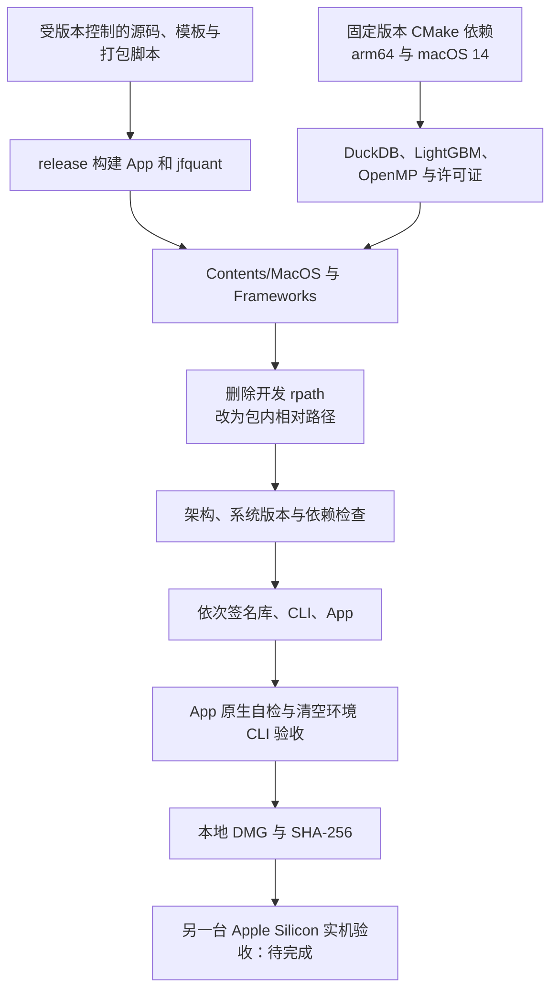
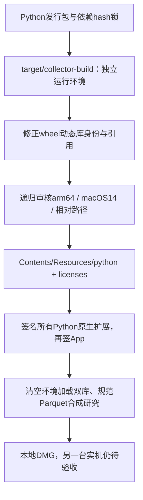
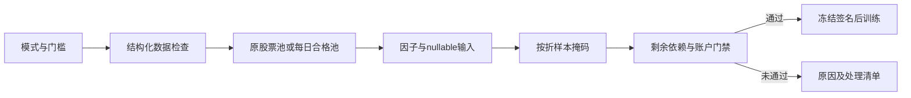

# Apple Silicon App 与 CLI 打包

[上级：analytics-desktop](../README.md) · [源码](../src/README.md) · [安装说明](INSTALL.txt)

本目录是开发期分发工具。目标为 Apple Silicon、macOS 14 及以上内部试用 App/DMG；包内 App 和 `jfquant` 共用 DuckDB、LightGBM、OpenMP。用户运行不用 Cargo、外部Python 或 Homebrew；包内CPython和锁定的AKShare/yfinance用于采集，原公开快照下载继续使用系统curl。

## 文件与发布顺序

| 文件 | 输入与职责 |
|---|---|
| [build-native.sh](build-native.sh) | 固定 LightGBM v4.6.0、OpenMP/LLVM CMake 20.1.8；用 CMake 生成 arm64、macOS 14 原生依赖 |
| [package-macos.sh](package-macos.sh) | release 构建 App/CLI、装入依赖和许可证、改写动态库路径、本地签名、自检、生成 DMG 与 SHA-256 |
| [verify-bundle.sh](verify-bundle.sh) | 检查程序/库包含 arm64、最低系统要求不高于 14、依赖没有开发机绝对路径 |
| [verify-cli.sh](verify-cli.sh) | 清空开发环境运行 CLI 帮助、原生自检、正式合成研究、Parquet 流水线、停服后结果读取 |
| [Info.plist](Info.plist) | App 身份、主程序、最低 macOS 版本 |
| [INSTALL.txt](INSTALL.txt) | 随 DMG 分发的首次打开、工作区和 CLI 完整路径说明 |



## 构建命令与输出

从仓库根目录执行，构建机需 Rust、Command Line Tools、CMake、git、curl；首次获取固定依赖需要网络。这些是开发机前提，不是运行机前提。

```bash
crates/app/packaging/build-native.sh
crates/app/packaging/package-macos.sh
crates/app/packaging/verify-bundle.sh "$PWD/target/distribution/JFQuant.app"
codesign --verify --deep --strict "$PWD/target/distribution/JFQuant.app"
```

`JFQUANT_NATIVE_BUILD_ROOT` 可指定开发期原生构建目录，默认 `target/native-macos14`。打包脚本设置 `MACOSX_DEPLOYMENT_TARGET=14.0`、`LIGHTGBM_LIB_DIR`、`CARGO_TARGET_DIR=target/package-macos14`，并使用 `DUCKDB_DOWNLOAD_LIB=1` 获取匹配动态库。

输出为 `target/distribution/JFQuant.app`、`JFQuant-macos14-arm64.dmg` 和 `.dmg.sha256`。App 原生自检位于 `self-check`，CLI 验收位于 `cli-check`；都是忽略的本地产物。脚本替换生成的 bundle，不覆盖用户工作区。

## 安装与独立 CLI

把 App 拖入 Applications；首次打开按 [INSTALL.txt](INSTALL.txt) 允许可信内部包。当前为本地签名，未做 Developer ID 签名或 Apple 公证，不要求关闭 Gatekeeper。

```bash
/Applications/JFQuant.app/Contents/MacOS/jfquant --help
/Applications/JFQuant.app/Contents/MacOS/jfquant --workspace "$HOME/JFQuantWorkspace" jobs list
mkdir -p "$HOME/.local/bin"
ln -s /Applications/JFQuant.app/Contents/MacOS/jfquant "$HOME/.local/bin/jfquant"
```

符号链接需目标名尚不存在；脚本不自动修改 shell 配置，是否将 `.local/bin` 加入 PATH 由用户决定。更新程序前让旧服务任务结束，用原版本 CLI 停止空闲服务，再打开新版本；协议 7 不向旧服务降级。

## 验收边界

包内自检验证真实原生查询、训练/预测、两年合成账本、正式特征顺序和离线持久化。合成输入明示身份，不能代替公开数据完整性验证。另一台无开发环境/无 Homebrew 的 Apple Silicon Mac 上安装、更新数据、运行合成研究、离线读取结果及 macOS 14 兼容性仍待实机验收。不要将本机自检写成实机验收完成。

## 内置采集环境

`build-collector.sh` 下载SHA256锁定的独立CPython3.12.15，并用开发期uv按hash锁安装35个依赖；运行时不使用uv/pip。`rewrite-python.py` 将wheel安装时的原生库身份和引用改为loader相对路径；`verify-python.py` 逐个审核arm64 Mach-O、最低系统版本和包内依赖。`collect-python-licenses.py` 收集发行包notice和METADATA，CPython许可证单独复制；随后按原生对象、CLI和App顺序签名。



构建新增uv这一开发机工具。`JFQUANT_COLLECTOR_RUNTIME` 只用于debug构建指定本地解释器；发布包不查找外部解释器。包内CLI独立调用采集，不启动GUI。解释器及依赖不进入Git，只有锁、采集代码、打包/检查脚本和组件文档提交。DLL审核按arm64切片检查，忽略Mach-O库自身身份而不误判为外部依赖；裸或开发机绝对路径的实际依赖仍拒绝。

## 双源采集阶段本机验收记录（历史）

自审后187项workspace nextest通过、0跳过，其中集成运行11项Python契约/本地HTTP测试及3项打包加载命令fixture。严格Clippy、Rustdoc、doctest、Rust/Python格式、差异及组件文档链接检查通过；每层有效组件目录均有README和Mermaid。Python环境89个原生对象通过arm64及macOS14检查，App/DMG已重建并通过签名和清空环境的包内CLI合成研究、流水线及离线读取验收。

公开源抽查：AKShare和yfinance分别成功获取SH600000、SZ000001及SH000300短区间数据；包内CLI在清空环境后成功调用内置AKShare采集SH600000。下载成功与研究就绪分开，Yahoo仍保留split_adjusted_candidate标记。复查2010—2026沪深300的5+1窗口：要求从2004-01-02覆盖，实际历史池始于2005-04-08，且所需历史中含未解释临时代码SHT00018。请求明确返回blocked（CLI退出码3）和问题清单，在因子缓存/训练前停止；没有生成真实收益报告，也不猜代码映射或历史成员。

验证记录、数据和包位于忽略的target/.jfquant/data目录。另一台无开发环境Apple Silicon/macOS14实机验收待完成；本次未提交或推送。

打包环境只复用由同一解释器归档SHA256创建的目录；发行锁改变后重新展开。原生审核同时检查 LC_BUILD_VERSION 与 LC_VERSION_MIN_MACOSX，拒绝最低版本高于14.0.0、包外/断开符号链接和找不到的 loader/executable/rpath 依赖，忽略库自身身份。`test_packaging.py` 使用加载命令 fixture 验证上述拒绝路径，由App nextest测试集成运行，也可执行 `target/collector-build/python/bin/python3 -I -B -m unittest discover -s crates/app/packaging -p test_packaging.py`。

内置adjustment.py安全读取固定新浪地址，不使用SDK的eval路径。代码签名包括六个模块，更改后先Ruff格式化，再重建环境和Rust。服务7、采集4、规范4、报告9；更新前用原版本停止空闲服务，不强杀活动研究。包内自检使用显式系数合成数据、核验价量哈希；另一台实机仍待完成。

## 显式系数接入阶段本机复验（历史）

196项workspace nextest通过、0跳过（集成15项Python测试及3项打包fixture），严格Clippy、Rustdoc、doctest、Rust/Python格式与差异检查通过。28层有效组件目录的README、Mermaid与本地链接完整。规范行情4/研究schema9通过包内CLI合成研究、原生流水线、来源清单哈希及服务重启后离线结果比较；App交互和Qlib/Parquet账户一致性由nextest覆盖。App/DMG重新生成，签名和89个Python原生对象审核通过，安装包仅为本地生成产物。

包内CLI联网抽查：AKShare原价/供应商报价与独立新浪系数采集SH600000、SZ000001，保留29/33条完整日期系数、HTTP证据和首个原价锚点。SH600000的2026-07-16分红（前收盘9.31元、每股0.42元），SZ000001的2026-09-24分红（前收盘11.60元、每股0.249元），观测系数比分别约1.047244094488193、1.021936393269316；与事件公式相对误差均小于1e-14，未放宽0.2%阈值。这是两条事件的独立来源抽查，不能代替全部历史权益、支付/上市日期准入。

本机系统代理曾导致Eastmoney连接失败，任务保持failed且不发布快照；抽查在显式设置该子进程`NO_PROXY='*'`后使用相同白名单源完成，没有修改系统代理或换源。复现可在网络允许直连时用`NO_PROXY='*' jfquant --workspace WORKSPACE data collect --provider akshare --adjustment-source sina-hfq --start 2026-07-01 --end 2026-10-13 --instruments SH600000,SZ000001`，然后jobs wait、jobs results查看本工作区证据。

后续复采时Eastmoney仍出现间歇断连，任务再次明确failed且没有发布新版本，先前的成功版本和证据可只读查看。公网可用性单独记录，不以本地fixture通过宣称数据源稳定，也不自动换源。

包内CLI重新检查2010—2026沪深300：仍要求2004-01-02历史，股票池实际始于2005-04-08，SHT00018仍无法解释，明确blocked/退出码3且不生成因子缓存或训练。验证记录、证据、样本和安装包留在忽略的target目录。另一台无开发环境Apple Silicon/macOS14验收待完成。

## 日期调度与完整事件版本

当前包同时携带服务7、模板5、公司行动3、规范行情4、采集4及研究schema9实现。pypdf5.9.0随35项hash锁依赖内置，六个采集模块签名共同核验。verify-cli.sh继续在清空开发环境下验证原生自检、当前格式合成研究、来源哈希、流水线和离线结果；另一台Apple Silicon/macOS14实机仍待完成。旧格式不转换，更新前停止空闲旧服务，不能强杀活动研究。

## 2026-10-14 任意日期版最终复验

上一阶段记录：213项workspace nextest全通过、0跳过，包含20项Python契约/本地HTTP测试及3项打包fixture。严格Clippy、Rustdoc、doctest、Rust/Python格式、差异检查通过；28层有效组件目录（含crates根导航）均有README、Mermaid及有效本地链接。日期及特殊权益手算、App/CLI共用研究、Qlib/规范Parquet一致性由nextest覆盖；修订必须改变事件并保存原值及完整实施证据，不能仅清除失败。

本机重建JFQuant.app和JFQuant-macos14-arm64.dmg，codesign深层严格校验通过；89个Python原生对象满足arm64/macOS14审核。清空环境下包内CLI完成帮助、原生自检、规范行情合成研究、任意日期无验证集研究、因子流水线及服务重启后离线结果读取。DMG SHA256：`794ae1cab4ff4916a6dd51a11924aee6c5ddbdb9110ba43a725b65d6afdfd949`。安装包/日志位于忽略的target/distribution和target/collector-build，不提交。

同版包内CLI复核所选Qlib快照的沪深300默认日程：15折，2012首测；首折实际训练2006-01-04—2010-12-31、验证2011-01-04—2011-12-30，最后测试结束2026-10-12。756日预热开始2002-11-20，成员覆盖前截面仍未知；949项历史证券中SHT00018缺身份依据，prepare-data明确blocked、wait退出3，requirements/readiness保留，不生成缓存/训练/真实收益。没有将旧格式1行动文件转换为2，也不能据此声称其他历史行动已通过准入。

公告联网抽查通过内置运行环境获取巨潮SH600000实施PDF及3份HTTP响应：代码联合官方机构ID查询；解析版本cninfo-candidates-v2产生登记/除息/发放日期和每股原始金额引用，保留含税/其他持有人金额候选，仍需审阅。这里只验证单份证据获取与提取，未完成949只全历史补采。项目工作区空闲服务已正常停止；另一台Apple Silicon/macOS14实机验收待完成。

## 为什么需要本组件

把开发机验证转化为独立可运行的软件。运行时不依赖用户的Homebrew、Python或Cargo。打包固定原生库和采集环境，递归检查架构、最低系统版本、路径和签名；本机包验证不能证明另一台macOS14已通过，实机验收单独记录。

设计依据：2026-10-14接受的证券身份与完整准入计划、组件接口及测试。未在代码或证据中确认的历史取舍不推定为既有设计理由；来源、法规或数据格式变化时重新评估。


## 证券身份与完整准入阶段本机验收（2026-10-14）

Why：只有源码测试不足以证明安装包能独立运行，因此在仅HOME和系统PATH环境下验证包内CLI，并保留另一台macOS14实机验证为独立事项。

该阶段契约为模板4、身份目录1、股票池2、动作3、行情4、系数2、采集4、服务6、结果8。230项nextest通过，包含20项Python测试及3项打包fixture；Clippy、Rustdoc、doctest、格式、差异及28层README/Mermaid/why/链接检查通过。App/DMG重建，包内身份目录、原生自检、合成研究、无验证日期研究、流水线和服务重启后离线结果验证通过。原生对象签名/架构/macOS14目标检查保留。

真实沪深300检查继续blocked、wait退出3，不发布factor-cache或训练真实模型。已保存上港两个证券的身份／承继证据，历史SHT00018成员记录在终止上市后仍存在，继续要求独立成员修订依据；新证券22条分红候选缺到账日期及完整类别审核。安装包、采集证据及运行记录属于本地产物，不提交；另一台Apple Silicon/macOS14实机验收待完成。

本次DMG SHA256：`7b7f5a5388b66bcc4c9d1ddba7dd236de281c577cd843b39a7c3b96390a0ca7f`。包内SDK在仅HOME／系统PATH环境成功加载并执行日线采集协议；公开Eastmoney行情接口分别在系统代理及显式直连重试中连接失败，任务保存逐证券错误与同请求检查点，未发布行情快照。该联网失败不计为下载验收成功；分红候选及身份原文的成功抽查另存本项目证据记录。没有修改系统代理或自动切换供应商。

## 三级研究模式：为什么允许筛选

决定日期2026-10-14，依据是用户接受的三级模式计划。正常预热空值、来源缺失和错误数据是不同问题：全部拒绝会浪费可用样本，全部放行又会混淆因子和真实权益。默认严格检查；另外提供“允许部分数据缺失”和“只用数据合格的股票”。模式是研究输入的一部分，不能作为训练失败后自动切换的兜底。

第二档保持原成员，纯缺失传播null；第三档派生每日合格成员，不改原始成员或证据。不能看到后来缺价而倒删早期股票。账户仍采用原价、整数股、T+1和连续权益；未裁定冲突、损坏、基准缺项及剩余必要依赖仍阻断。默认有效因子比例0表示至少一项有效，最低有标签样本1只表示可执行，不表示样本在统计上充分。所选因子整列无有效值不会被自动删除。

verify-cli.sh在清空环境后逐一执行strict、allow_missing、qualified_only合成研究，检查实际策略与准入schema2；再执行原生流水线和服务重启后离线读取。包内CLI、App共用服务协议7及结果9。运行：`crates/app/packaging/package-macos.sh`。脚本只替换target内生成包；不能强杀活动任务，打包前确认服务空闲。另一台Apple Silicon/macOS14实机仍待验收。



## 三级模式最终本机验收（2026-10-14）

245项workspace nextest全部通过、0跳过；Clippy `-D warnings`、Rustdoc `-D warnings`、doctest、Rust格式、19个Python文件的Ruff检查及差异检查通过。28层有效组件目录的why、Mermaid和本地链接检查通过。自查补齐可能已持有证券成交量缺失的训练前门禁，三档均阻断；正常零成交量停牌仍按既有规则处理。

最终包已重新构建并通过深层严格签名校验；89个Python原生对象通过arm64、macOS14目标和依赖路径检查。清空开发环境下，包内CLI的strict、allow_missing和qualified_only合成研究均成功，结果为schema9、准入2；原生自检、身份读取、无验证集日期研究、因子流水线及服务重启后离线结果读取通过。合格股票模式结果明确标注“经数据筛选的研究股票池”。

本次DMG SHA256：`2a163b7e24f5cde505079d9f61ceb21017ae847703a432601d102fe16b103769`。App、DMG、检查日志和研究记录位于忽略的target目录。真实公开数据的身份、成员及公司行动缺项继续独立阻断；另一台Apple Silicon/macOS14实机验收仍待完成。

复现（开发构建环境）：

```sh
export DUCKDB_DOWNLOAD_LIB=1
export LIGHTGBM_LIB_DIR="$PWD/target/native-macos14/install/lib"
cargo nextest run --workspace
cargo clippy --workspace --all-targets -- -D warnings
RUSTDOCFLAGS="-D warnings" cargo doc --workspace --no-deps
cargo test --workspace --exclude analytics-desktop --doc
cargo fmt --all -- --check
uvx ruff check crates/storage/collectors crates/app/packaging crates/ml/examples/plot_research.py
uvx ruff format --check crates/storage/collectors crates/app/packaging crates/ml/examples/plot_research.py
crates/app/packaging/package-macos.sh
git diff --check
```
