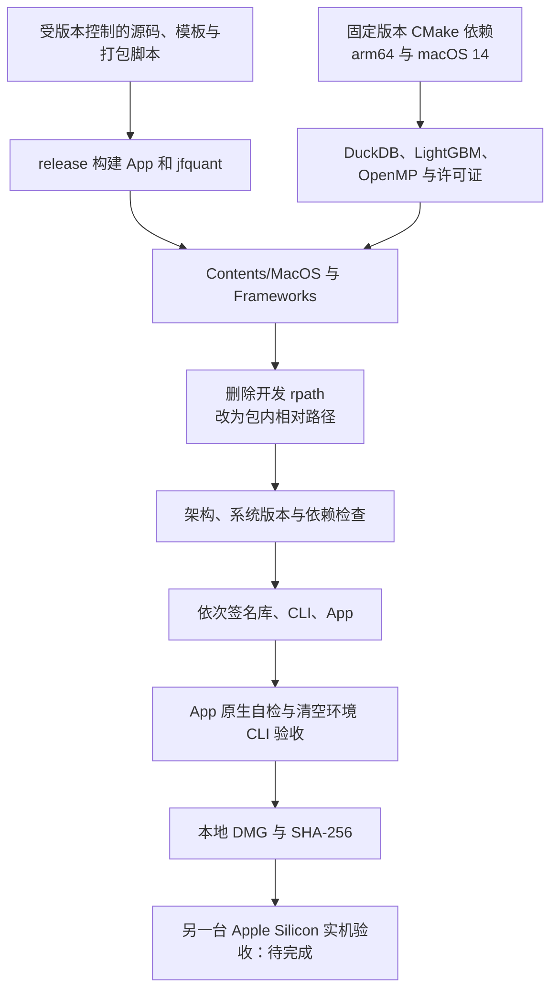

# Apple Silicon App 与 CLI 打包

[上级：analytics-desktop](../README.md) · [源码](../src/README.md) · [安装说明](INSTALL.txt)

本目录是开发期分发工具。目标为 Apple Silicon、macOS 14 及以上内部试用 App/DMG；包内 App 和 `jfquant` 共用 DuckDB、LightGBM、OpenMP。用户运行不用 Cargo、Python 或 Homebrew，下载使用系统 curl。

## 文件与发布顺序

| 文件 | 输入与职责 |
|---|---|
| [build-native.sh](build-native.sh) | 固定 LightGBM v4.6.0、OpenMP/LLVM CMake 20.1.8；用 CMake 生成 arm64、macOS 14 原生依赖 |
| [package-macos.sh](package-macos.sh) | release 构建 App/CLI、装入依赖和许可证、改写动态库路径、本地签名、自检、生成 DMG 与 SHA-256 |
| [verify-bundle.sh](verify-bundle.sh) | 检查程序/库包含 arm64、最低系统要求不高于 14、依赖没有开发机绝对路径 |
| [verify-cli.sh](verify-cli.sh) | 清空开发环境运行 CLI 帮助、原生自检、正式合成研究、Parquet 流水线、停服后结果读取 |
| [Info.plist](Info.plist) | App 身份、主程序、最低 macOS 版本 |
| [INSTALL.txt](INSTALL.txt) | 随 DMG 分发的首次打开、工作区和 CLI 完整路径说明 |



## 构建命令与输出

从仓库根目录执行，构建机需 Rust、Command Line Tools、CMake、git、curl；首次获取固定依赖需要网络。这些是开发机前提，不是运行机前提。

```bash
crates/app/packaging/build-native.sh
crates/app/packaging/package-macos.sh
crates/app/packaging/verify-bundle.sh "$PWD/target/distribution/JFQuant.app"
codesign --verify --deep --strict "$PWD/target/distribution/JFQuant.app"
```

`JFQUANT_NATIVE_BUILD_ROOT` 可指定开发期原生构建目录，默认 `target/native-macos14`。打包脚本设置 `MACOSX_DEPLOYMENT_TARGET=14.0`、`LIGHTGBM_LIB_DIR`、`CARGO_TARGET_DIR=target/package-macos14`，并使用 `DUCKDB_DOWNLOAD_LIB=1` 获取匹配动态库。

输出为 `target/distribution/JFQuant.app`、`JFQuant-macos14-arm64.dmg` 和 `.dmg.sha256`。App 原生自检位于 `self-check`，CLI 验收位于 `cli-check`；都是忽略的本地产物。脚本替换生成的 bundle，不覆盖用户工作区。

## 安装与独立 CLI

把 App 拖入 Applications；首次打开按 [INSTALL.txt](INSTALL.txt) 允许可信内部包。当前为本地签名，未做 Developer ID 签名或 Apple 公证，不要求关闭 Gatekeeper。

```bash
/Applications/JFQuant.app/Contents/MacOS/jfquant --help
/Applications/JFQuant.app/Contents/MacOS/jfquant --workspace "$HOME/JFQuantWorkspace" jobs list
mkdir -p "$HOME/.local/bin"
ln -s /Applications/JFQuant.app/Contents/MacOS/jfquant "$HOME/.local/bin/jfquant"
```

符号链接需目标名尚不存在；脚本不自动修改 shell 配置，是否将 `.local/bin` 加入 PATH 由用户决定。更新程序前让旧服务任务结束，用原版本 CLI 停止空闲服务，再打开新版本；协议 2 不向旧服务降级。

## 验收边界

包内自检验证真实原生查询、训练/预测、两年合成账本、正式特征顺序和离线持久化。合成输入明示身份，不能代替公开数据完整性验证。另一台无开发环境/无 Homebrew 的 Apple Silicon Mac 上安装、更新数据、运行合成研究、离线读取结果及 macOS 14 兼容性仍待实机验收。不要将本机自检写成实机验收完成。
