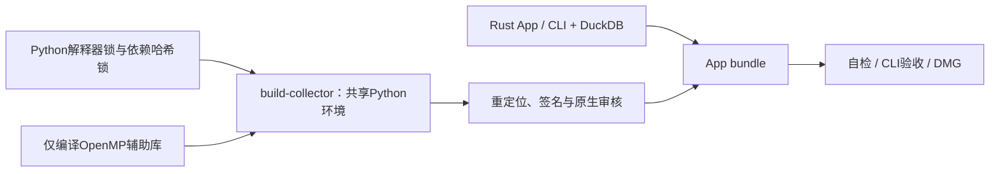

# macOS packaging

构建自包含Apple Silicon/macOS14的App、独立jfquant及DMG。运行时不调用Cargo、pip、
uv或系统Python。所有依赖、原生对象、签名及安装包生成到忽略的target目录。



```bash
# 构建机需要Rust、Command Line Tools、uv和CMake；用户机器不需要。
crates/app/packaging/build-collector.sh
crates/app/packaging/package-macos.sh
crates/app/packaging/verify-bundle.sh target/distribution/JFQuant.app
codesign --verify --deep --strict target/distribution/JFQuant.app
```

`build-native.sh`只构建LLVM OpenMP 20.1.8，`JFQUANT_NATIVE_BUILD_ROOT`可覆盖构建目录。
LightGBM 4.7.0与AKQuant 0.3.66来自哈希锁定wheel，不编译或携带旧Rust LightGBM依赖。
`build-collector.sh`同步采集与研究Python包，将OpenMP放入包内，修正LightGBM引用。
`rewrite-python.py`移除构建机搜索路径、重定位包内依赖并签名；`verify-python.py`审核
每个Mach-O的arm64切片、macOS最低版本、实际依赖目标及包内路径。

`package-macos.sh`拒绝覆盖正在使用的生成App，构建release App和CLI，复制DuckDB、
共享Python树和许可证，审核并签名后执行自检和verify-cli。结果位于target/distribution。
研究worker协议、取消与功能边界见[研究README](../../workflow/research/README.md)。

本机审核不能替代另一台干净Apple Silicon/macOS14机器的安装、运行、取消及离线读取。
开发签名不等同Developer ID或Apple公证；安装方式见INSTALL.txt。

研究结果格式16／服务协议16：打包CLI验收覆盖静态准入、模型复用和完整结果格式；研究worker与依赖锁保持不变；采集模块改动后必须同步重建共享Python中的采集包。打包必须等待使用开发Python目录的采集任务结束，避免重建运行时影响请求。
