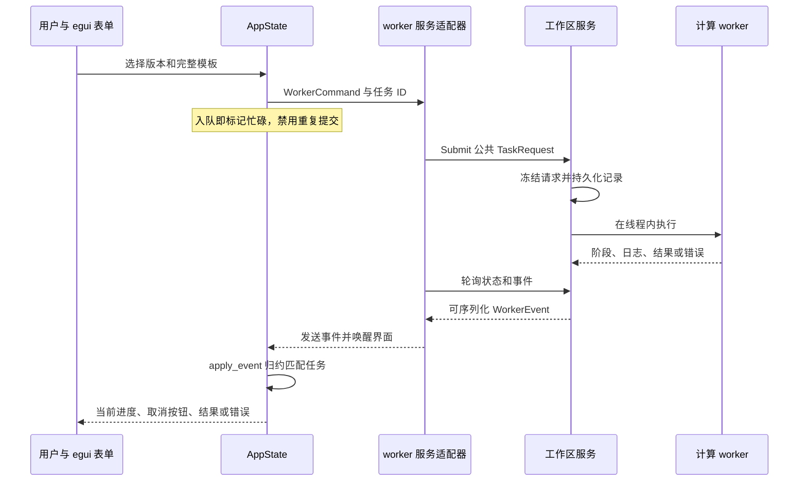
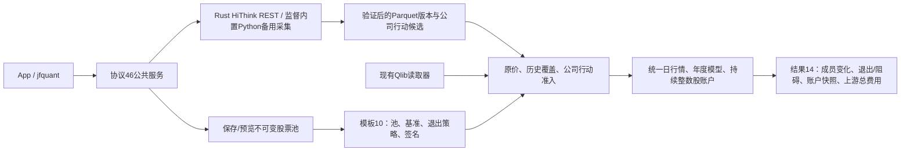
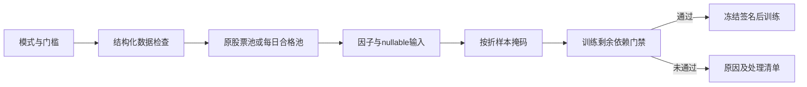
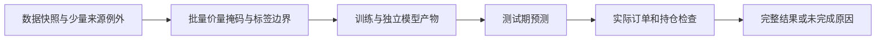
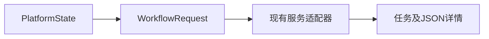
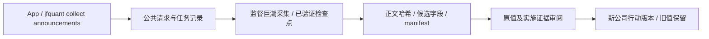

## 当前采集契约（2026-10-15）

HiThink 为默认主源，由 Rust 直接调用 REST；通达信备用，维持内置 Python `tdxaidata==1.2.2`；巨潮公告使用独立 `cninfo` 来源。旧来源依赖、配置、权限检查及历史兼容入口已移除；旧数据不迁移、不删除，重新配置来源并采集。

公共来源为 `hithink|tdxaidata|cninfo`，复权选项为 `hithink-forward|tdx-forward|none`。服务协议46、采集协议16、来源策略2；HiThink 行情格式6，通达信格式5与 Qlib 读取保留。HiThink 训练选择供应商口径（`price_basis=provider`），前复权 OHLC、原始股数及人民币成交额、VWAP null；回测使用原价。训练缓存与 manifest 冻结口径、来源和证据哈希，特征顺序及公式版本保持。

接口、凭据、覆盖范围与复现命令见[采集组件](../../storage/collectors/README.md)。当前成分不能回填历史，下载成功不代表研究或账户资料完整。

# App 源码：表单、状态与服务事件

[上级：analytics-desktop](../README.md) · [打包与安装](../packaging/README.md) · [公共后台](../../workflow/src/README.md)

本目录将普通任务数据接入 egui。它保留数据、查询、因子、建模四工作台，增加研究与运行记录；计算流程和原生句柄属于 workflow，界面不持有 DuckDB connection 或 LightGBM booster。

## 文件与修改入口

| 文件 | 职责与边界 |
|---|---|
| [main.rs](main.rs) | App 创建、每帧事件接收、面板导航、后台重连；`--self-check` 调用公共原生自检 |
| [panels.rs](panels.rs) | 四工作台表单、按钮状态、查询分页、模型预览；构造 `WorkerCommand` |
| [platform.rs](platform.rs) | 工作区选择/偏好、数据版本、研究模板、运行历史、格式校验与净值展示 |
| [state.rs](state.rs) | `AppState`、表单校验和 `apply_event`；只归约匹配任务 ID 的事件 |
| [worker.rs](worker.rs) | egui repaint 与 workflow 服务 bridge 的适配；测试可使用进程内 worker |
| [theme.rs](theme.rs) | 语义颜色、样式与中文字体；不参与业务判断 |
| [interaction_tests.rs](interaction_tests.rs) | 鼠标/键盘驱动的 egui harness、真实 worker 和 App/服务交互 |
| [build_tests.rs](build_tests.rs) | 构建脚本环境、库路径和错误配置回归 |

## 一次研究如何显示进度



CLI 提交的全局任务可在 App 显示并取消；其他客户端的 SQL 页面不替换本 App 的分页和 cursor。停止等待或关闭界面不终止服务中的任务。表单重试清除对应错误，后台 panic 后显示不可用并通过服务重启。

## 结果与恢复边界

`platform.rs` 用公共 `Workspace::results` 与 `backtest::validate_result` 校验研究结果。旧 schema 或近似口径显示 `unsupported_result_format`，不展示其收益/净值；状态与日志仍可读取。只读导入也先校验，失败不创建记录。

下载恢复从标准请求取得原任务 UUID；不会转换旧兼容请求。中断研究通过新记录重新运行，账户快照产物不是训练断点。所有相对输入从选定工作区解析，偏好保存在用户 Application Support 下。

## 开发验收

从仓库根目录执行；完整环境配置见 [Crates 导航](../../README.md#开发与验收)。

```bash
cargo nextest run -p analytics-desktop -E 'test(interaction_tests::)'
cargo nextest run -p analytics-desktop -E 'test(worker::tests::) | test(build_tests::)'
cargo clippy -p analytics-desktop --all-targets -- -D warnings
```

修改按钮/事件时检查入队后的禁用、busy 拒绝、取消、错误位置、迟到事件隔离以及重启后历史。研究表单变更必须同时核对 CLI 提交的冻结模板、特征顺序、连续账户和上游总费用；当前合成数据验证两年样本外连续账户，不代表真实收益。

## 动态股票池与 Python 采集接口

当前模板schema 12、研究结果schema22、服务协议46；GTJA191公式为v5。解析后配置包含 `pool_version`、`benchmark` 和 `pool_exit_policy`（磁盘保存于TargetProfile）；默认 `builtin:csi500` / `SH000905`，沪深300模板使用 `builtin:csi300` / `SH000300`。自选和集合组合引用不可变pool版本，冻结成员区间、人工日期调整及输入哈希；模型manifest和缓存签名包含这些研究输入。原schema结果明确拒绝，历史状态和日志仍可查看，不转换旧文件。




示例ID须换为实际版本。下载可恢复验证过的证券；重新提交时参数必须与owner一致。临时/缺失输入不会自动换源、补字段或启动训练。原价撮合不使用Yahoo拆股调整价；指数历史成员缺失停止训练，回测按上游除权除息日处理分红与拆股，已知不支持事件阻断。2010样本外的5+1窗口需要2004—2009完整历史池及行情，不能以当前成分回填。

开发验收先运行 `crates/app/packaging/build-collector.sh`，再执行workspace nextest、严格Clippy/Rustdoc和格式检查。解释器、依赖、数据、模型、缓存、日志、运行记录及DMG均留在忽略目录。另一台Apple Silicon/macOS14实机验收待完成。

`interaction_tests::packaging_load_command_rejection_fixtures` 通过内置解释器运行打包加载命令 fixture，验证严格macOS14.0边界、旧Mach-O版本命令、rpath目标缺失与路径越界。

[schedule_ui.rs](schedule_ui.rs)只编辑公共Schedule，完整合法日期立即更新共享模型，非法输入保留、显示错误并阻止运行/保存；不在UI计算日历。platform.rs提供日期预览表、需求补采、原事件/哈希/公告候选查看及修订JSON入口，统一提交WorkflowRequest；DuckDB/LightGBM仍留在worker内。交互测试覆盖日程请求及重复点击防护，原后台合成研究测试继续覆盖跨折账户和CLI结果一致。

## 为什么需要本组件

界面状态必须与后台事实保持一致。任务进度和结果来自公共服务；UI不持有DuckDB或LightGBM句柄。日期、来源和证据配置在提交前校验，重复点击与忙碌状态由统一任务控制，重启后从持久记录恢复展示。

设计依据：2026-10-14接受的当前组件职责、可复现实验与用户研究需求、组件接口及测试。未在代码或证据中确认的历史取舍不推定为既有设计理由；来源、法规或数据格式变化时重新评估。

## 三级研究模式：为什么允许筛选

决定日期2026-10-14，依据是用户接受的三级模式计划。正常预热空值、来源缺失和错误数据是不同问题：全部拒绝会浪费可用样本，全部放行又会混淆因子和真实权益。默认严格检查；另外提供“允许部分数据缺失”和“只用数据合格的股票”。模式是研究输入的一部分，不能作为训练失败后自动切换的兜底。

第二档保持原成员，纯缺失传播null；第三档派生每日合格成员，不改原始成员或证据。不能看到后来缺价而倒删早期股票。账户仍采用原价、整数股、T+1和连续权益；未裁定冲突、损坏、基准缺项及剩余必要依赖仍阻断。默认有效因子比例0表示至少一项有效，最低有标签样本1只表示可执行，不表示样本在统计上充分。所选因子整列无有效值不会被自动删除。

[quality_ui.rs](quality_ui.rs)只渲染公共策略、数量与原因表，不计算资格或决定是否放行。platform.rs把模板传给服务；原因表放在研究页顶部，避免发生错误后仍需翻过整页参数。交互测试真实点击三档及原因折叠栏；测试禁用动画以确定性验证文字，产品保留正常动画。



## 2026-10-14：直接代码读取与分阶段研究

为什么调整：普通市场代码无需先登记身份；独立目录、审核和权威名录下载增加了研究前置负担。特殊历史代码仍需在快照内明确区间，不能将旧证券行情或权益接到另一证券。训练使用价量和标签，到账／交付资料只在实际账户执行时检查。

当前服务43、研究worker4、模板12、结果22、采集16、因子目录2、GTJA191公式v5（默认190项）。具体数据格式以所属组件的序列化类型与验证器为准；正常入口拒绝旧协议及旧格式，升级仅通过显式本地迁移执行。特征顺序、公式版本和来源哈希仍随产物冻结。

界面移除身份管理和目录选择。研究面板提供“仅训练模型”、训练任务ID及“使用已有模型回测”；原“执行年度研究”为两阶段组合。界面展示事实状态，无有效交易和未完成回测不得当作策略收益验收通过。



验收：nextest覆盖来源日期边界、三档掩码、训练／回测分离及模型保留；Clippy、Rustdoc、格式、组件文档和包内CLI共同检查。生成数据、模型、运行记录和安装包不提交。另一台Apple Silicon/macOS14实机验收继续待完成。

## 表单不是第二套后台

platform.rs仅选择价格口径、因子profile和标的profile；panels.rs选择流水线family；quality_ui.rs显示Warn事实。保存/载入调用workflow profiles，避免GUI与CLI产生不同签名。 完整接口、why、边界和验收见[组件契约](../README.md)。

数据面板的“采集分红资料（巨潮优先）”提交既有公共任务，不在UI拼接金额或猜日期。默认历史下载与研究补采走相同后台；训练与执行分别提示，避免把补账户资料误写成必须重训。


## 来源设置为何仍经公共后台

`platform.rs`只维护来源选择、密码输入及策略编辑；保存、预览、刷新和小样本检查统一发送workflow请求。行情、日历、成员及行动默认HiThink第一，通达信备用，完整执行资料来源为空，忙碌时禁止重复提交；返回的实际来源、能力缺口和新版本显示在同一任务详情中，UI不自行把失败改为通过。



公共参数、结果位置和复现方式见[App README](../README.md)。新增默认值/密码Debug回归，不以UI按钮存在代替真实联网验收。

## 按缺口补采实施证据


`factor_groups.rs`提供只读内置组、自定义副本管理和有效性报告视图；`panels.rs`发送独立
EvaluateFactors后台任务，`state.rs`只接收当前活动任务的FactorsEvaluated结果。
保存组保持特征顺序；报告展示冻结参数和null统计；完整口径见[组件说明](../README.md)。

`custom_factors.rs`实现公式编辑、算子目录浏览、异步库RPC和预览任务适配；真实计算不在UI线程中运行。
`factor_groups.rs`保存/归档组使用同一共享RPC，管理固定修订和显式特征顺序；研究页显示已冻结的组合。

## 独立训练与模型回测

研究页分别编辑TrainingPlan与BacktestPlan，JSON可导入导出；B行情、池和模型选择独立，默认滚动。模型查询结果保留在平台状态，训练完成自动填ID；全部任务经共享服务，UI不持有原生句柄。报告显示分组贡献与冻结切换计划；研究页整体支持滚动。运行 `DUCKDB_DOWNLOAD_LIB=1 cargo test -p analytics-desktop independent_training_and_backtest_editors` 验证真实egui操作。

研究页“证据维护：公告留存、批次恢复与修订草稿”由 `platform/evidence.rs` 维护：选定 PDF 的公开 URL、证券、文档ID、披露日、标题和实施分类表单；原批次恢复与检查点重试；全局/单证券缺口；可编辑骨架及已有修订的核验迁移。全部发送 `WorkflowRequest::Evidence`，不在 GUI 采集、改哈希或解除准入。报告可将 manifest 或 draft_request 显式载入现有编辑器，再经原修订入口发布。交互验收覆盖共享状态与草稿请求。

公司行动当前阻断、历史失败和覆盖审核入口见 [platform](platform/README.md)；客户端仅展示共享任务报告，不自行判断历史覆盖。

The Storage navigation target renders shared workspace capacity reports, selection and permanent-deletion previews through `platform/storage`; the reducer invalidates stale asynchronous run views after task completion. [Storage panel responsibilities](platform/README.md).


证据优化预览使用`MigrationPreview.members_database`及计划ID定位完整成员；界面复制计划ID。
元数据加载仍在worker内进行，服务协议47。迁移、备份、恢复和验收见
[组件README](../README.md#sqlite元数据与迁移预览协议47)。
