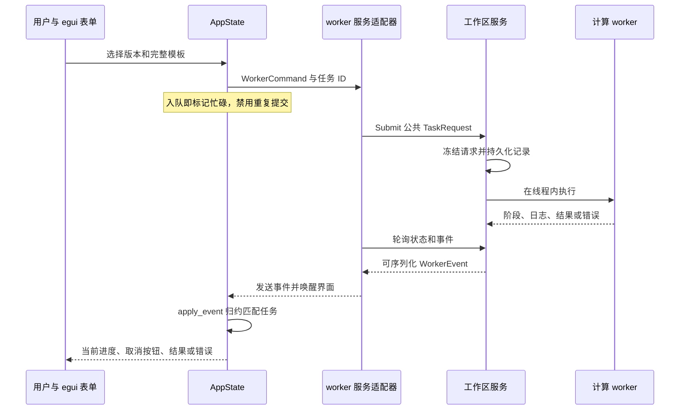
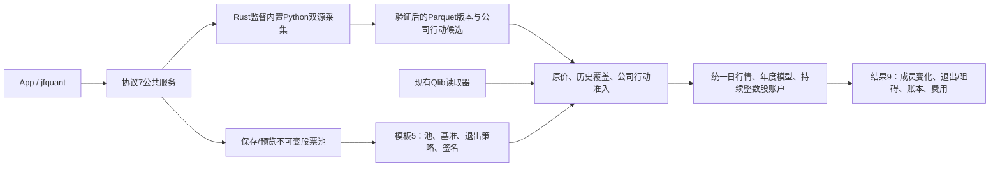
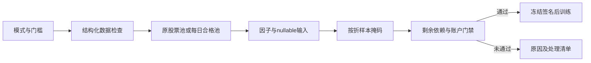

# App 源码：表单、状态与服务事件

[上级：analytics-desktop](../README.md) · [打包与安装](../packaging/README.md) · [公共后台](../../workflow/src/README.md)

本目录将普通任务数据接入 egui。它保留数据、查询、因子、建模四工作台，增加研究与运行记录；计算流程和原生句柄属于 workflow，界面不持有 DuckDB connection 或 LightGBM booster。

## 文件与修改入口

| 文件 | 职责与边界 |
|---|---|
| [main.rs](main.rs) | App 创建、每帧事件接收、面板导航、后台重连；`--self-check` 调用公共原生自检 |
| [panels.rs](panels.rs) | 四工作台表单、按钮状态、查询分页、模型预览；构造 `WorkerCommand` |
| [platform.rs](platform.rs) | 工作区选择/偏好、数据版本、研究模板、运行历史、格式校验与净值展示 |
| [state.rs](state.rs) | `AppState`、表单校验和 `apply_event`；只归约匹配任务 ID 的事件 |
| [worker.rs](worker.rs) | egui repaint 与 workflow 服务 bridge 的适配；测试可使用进程内 worker |
| [theme.rs](theme.rs) | 语义颜色、样式与中文字体；不参与业务判断 |
| [interaction_tests.rs](interaction_tests.rs) | 鼠标/键盘驱动的 egui harness、真实 worker 和 App/服务交互 |
| [build_tests.rs](build_tests.rs) | 构建脚本环境、库路径和错误配置回归 |

## 一次研究如何显示进度



CLI 提交的全局任务可在 App 显示并取消；其他客户端的 SQL 页面不替换本 App 的分页和 cursor。停止等待或关闭界面不终止服务中的任务。表单重试清除对应错误，后台 panic 后显示不可用并通过服务重启。

## 结果与恢复边界

`platform.rs` 用公共 `Workspace::results` 与 `backtest::validate_result` 校验研究结果。旧 schema 或近似口径显示 `unsupported_result_format`，不展示其收益/净值；状态与日志仍可读取。只读导入也先校验，失败不创建记录。

下载恢复从标准请求取得原任务 UUID；不会转换旧兼容请求。中断研究通过新记录重新运行，股份账本产物不是训练断点。所有相对输入从选定工作区解析，偏好保存在用户 Application Support 下。

## 开发验收

从仓库根目录执行；完整环境配置见 [Crates 导航](../../README.md#开发与验收)。

```bash
cargo nextest run -p analytics-desktop -E 'test(interaction_tests::)'
cargo nextest run -p analytics-desktop -E 'test(worker::tests::) | test(build_tests::)'
cargo clippy -p analytics-desktop --all-targets -- -D warnings
```

修改按钮/事件时检查入队后的禁用、busy 拒绝、取消、错误位置、迟到事件隔离以及重启后历史。研究表单变更必须同时核对 CLI 提交的冻结模板、特征顺序、年度账本和费用；当前合成数据验证两年样本外连续账户，不代表真实收益。

## 动态股票池与 Python 采集接口

当前模板schema 5、研究结果schema 9、服务协议7；公式仍为v4。模板增加 `pool_version`、`benchmark` 和 `pool_exit_policy`；默认 `builtin:csi500` / `SH000905`，沪深300模板使用 `builtin:csi300` / `SH000300`。自选和集合组合引用不可变pool版本，冻结成员区间、人工日期调整及输入哈希；模型manifest和缓存签名包含这些研究输入。原schema结果明确拒绝，历史状态和日志仍可查看，不转换旧文件。



`pools create/validate/import/export/list/versions/preview` 使用公共定义及解析器；`data collect --provider akshare|yfinance --kind market|actions` 提交后台任务，使用 jobs wait 显式等待。`run --request` 可提交完整公共请求。App提供来源、采集日期/证券、股票池JSON编辑、日期预览、退出策略及失败采集恢复按钮。包内Python和依赖只用于采集，不需要外部Python；日常操作不调用Cargo。

```bash
jfquant templates default --universe csi300 --output csi300-template.json
jfquant pools validate --definition pool.json
jfquant pools create --definition pool.json
jfquant pools preview pool-0123456789abcdef --market market-0123456789abcdef --date 2026-10-12
jfquant data collect --provider akshare --start 2004-01-01 --end 2026-10-13 --instruments SH600000,SZ000001,SH000300 --benchmarks SH000300
jfquant data collect --kind actions --provider akshare --start 2004-01-01 --end 2026-10-13 --instruments SH600000,SZ000001
jfquant research demo-parquet
```

示例ID须换为实际版本。下载可恢复验证过的证券；重新提交时参数必须与owner一致。临时/缺失输入不会自动换源、补字段或启动训练。原价撮合不使用Yahoo拆股调整价；缺支付/上市日期或指数历史成员仍阻止研究。2010样本外的5+1窗口需要2004—2009完整历史池及行情，不能以当前成分回填。

开发验收先运行 `crates/app/packaging/build-collector.sh`，再执行workspace nextest、严格Clippy/Rustdoc和格式检查。解释器、依赖、数据、模型、缓存、日志、运行记录及DMG均留在忽略目录。另一台Apple Silicon/macOS14实机验收待完成。

`interaction_tests::packaging_load_command_rejection_fixtures` 通过内置解释器运行打包加载命令 fixture，验证严格macOS14.0边界、旧Mach-O版本命令、rpath目标缺失与路径越界。

来源选择同时设置adjustment_source：AKShare固定新浪系数，Yahoo固定none候选；GUI展示来源并调用公共请求校验。后台返回逐证券错误及受影响因子，GUI不自行计算价量或豁免公司行动。

[schedule_ui.rs](schedule_ui.rs)只编辑公共Schedule，完整合法日期立即更新共享模型，非法输入保留、显示错误并阻止运行/保存；不在UI计算日历。platform.rs提供日期预览表、需求补采、原事件/哈希/公告候选查看及修订JSON入口，统一提交WorkflowRequest；DuckDB/LightGBM仍留在worker内。交互测试覆盖日程请求及重复点击防护，原后台合成研究测试继续覆盖跨折账户和CLI结果一致。

## 为什么需要本组件

界面状态必须与后台事实保持一致。任务进度和结果来自公共服务；UI不持有DuckDB或LightGBM句柄。日期、身份和证据配置在提交前校验，重复点击与忙碌状态由统一任务控制，重启后从持久记录恢复展示。

设计依据：2026-10-14接受的证券身份与完整准入计划、组件接口及测试。未在代码或证据中确认的历史取舍不推定为既有设计理由；来源、法规或数据格式变化时重新评估。

## 三级研究模式：为什么允许筛选

决定日期2026-10-14，依据是用户接受的三级模式计划。正常预热空值、来源缺失和错误数据是不同问题：全部拒绝会浪费可用样本，全部放行又会混淆因子和真实权益。默认严格检查；另外提供“允许部分数据缺失”和“只用数据合格的股票”。模式是研究输入的一部分，不能作为训练失败后自动切换的兜底。

第二档保持原成员，纯缺失传播null；第三档派生每日合格成员，不改原始成员或证据。不能看到后来缺价而倒删早期股票。账户仍采用原价、整数股、T+1和连续权益；未裁定冲突、损坏、基准缺项及剩余必要依赖仍阻断。默认有效因子比例0表示至少一项有效，最低有标签样本1只表示可执行，不表示样本在统计上充分。所选因子整列无有效值不会被自动删除。

[quality_ui.rs](quality_ui.rs)只渲染公共策略、数量与原因表，不计算资格或决定是否放行。platform.rs把模板传给服务；原因表放在研究页顶部，避免发生错误后仍需翻过整页参数。交互测试真实点击三档及原因折叠栏；测试禁用动画以确定性验证文字，产品保留正常动画。


