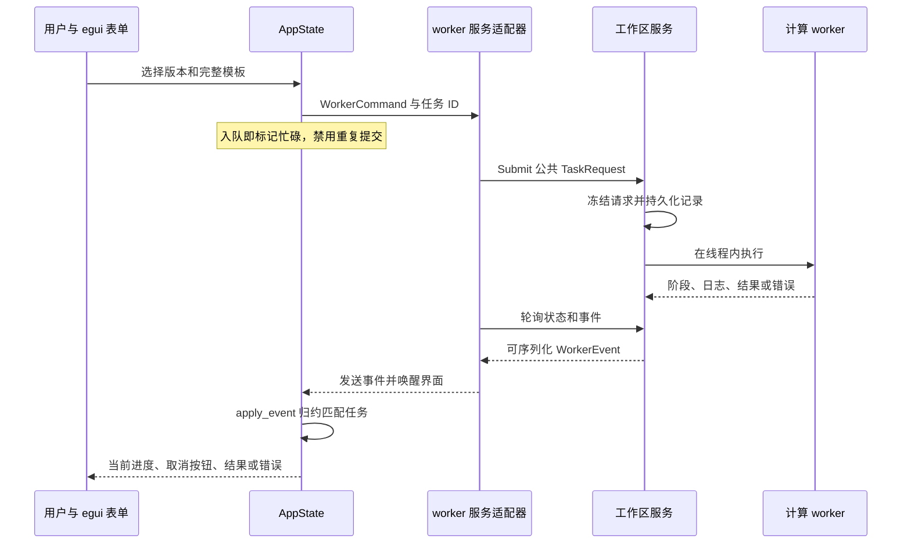

# App 源码：表单、状态与服务事件

[上级：analytics-desktop](../README.md) · [打包与安装](../packaging/README.md) · [公共后台](../../workflow/src/README.md)

本目录将普通任务数据接入 egui。它保留数据、查询、因子、建模四工作台，增加研究与运行记录；计算流程和原生句柄属于 workflow，界面不持有 DuckDB connection 或 LightGBM booster。

## 文件与修改入口

| 文件 | 职责与边界 |
|---|---|
| [main.rs](main.rs) | App 创建、每帧事件接收、面板导航、后台重连；`--self-check` 调用公共原生自检 |
| [panels.rs](panels.rs) | 四工作台表单、按钮状态、查询分页、模型预览；构造 `WorkerCommand` |
| [platform.rs](platform.rs) | 工作区选择/偏好、数据版本、研究模板、运行历史、格式校验与净值展示 |
| [state.rs](state.rs) | `AppState`、表单校验和 `apply_event`；只归约匹配任务 ID 的事件 |
| [worker.rs](worker.rs) | egui repaint 与 workflow 服务 bridge 的适配；测试可使用进程内 worker |
| [theme.rs](theme.rs) | 语义颜色、样式与中文字体；不参与业务判断 |
| [interaction_tests.rs](interaction_tests.rs) | 鼠标/键盘驱动的 egui harness、真实 worker 和 App/服务交互 |
| [build_tests.rs](build_tests.rs) | 构建脚本环境、库路径和错误配置回归 |

## 一次研究如何显示进度



CLI 提交的全局任务可在 App 显示并取消；其他客户端的 SQL 页面不替换本 App 的分页和 cursor。停止等待或关闭界面不终止服务中的任务。表单重试清除对应错误，后台 panic 后显示不可用并通过服务重启。

## 结果与恢复边界

`platform.rs` 用公共 `Workspace::results` 与 `backtest::validate_result` 校验研究结果。旧 schema 或近似口径显示 `unsupported_result_format`，不展示其收益/净值；状态与日志仍可读取。只读导入也先校验，失败不创建记录。

下载恢复从标准请求取得原任务 UUID；不会转换旧兼容请求。中断研究通过新记录重新运行，股份账本产物不是训练断点。所有相对输入从选定工作区解析，偏好保存在用户 Application Support 下。

## 开发验收

从仓库根目录执行；完整环境配置见 [Crates 导航](../../README.md#开发与验收)。

```bash
cargo nextest run -p analytics-desktop -E 'test(interaction_tests::)'
cargo nextest run -p analytics-desktop -E 'test(worker::tests::) | test(build_tests::)'
cargo clippy -p analytics-desktop --all-targets -- -D warnings
```

修改按钮/事件时检查入队后的禁用、busy 拒绝、取消、错误位置、迟到事件隔离以及重启后历史。研究表单变更必须同时核对 CLI 提交的冻结模板、特征顺序、年度账本和费用；当前合成数据验证两年样本外连续账户，不代表真实收益。
