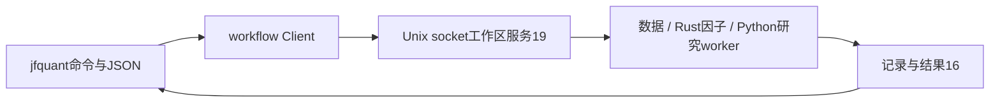

当前采集体系：HiThink（Rust REST主源）、通达信（Python SDK备用）、独立巨潮公告。服务协议36、采集协议15、来源策略2；接口、价格口径、构建和验收见[采集组件](../storage/collectors/README.md)。

# analytics-cli / jfquant

## MSCI 官方收盘采集

配置可填写 `{"msci":"746059"}` 映射，明确 CNY、price 与官方代码。目录中口径未确认的身份不可重定义，可沿用具体变体 `msci_a50_cny_price`。使用 `indices validate/import` 保存新版本后执行：

```sh
jfquant --workspace "$JFQUANT_WORKSPACE" indices collect-msci "$INDEX_VERSION" --calendar-market "$MARKET_VERSION" --start 2021-09-17 --end 2026-10-12
jfquant --workspace "$JFQUANT_WORKSPACE" jobs wait "$TASK_ID"
```

命令显式联网并返回后台任务ID，参考市场日历必须覆盖请求；无需 Python 或密钥。仅提供指数收盘，历史成员与股票行情仍执行原准入检查。列表、结构校验、配置导入保持离线。验收：`DUCKDB_DOWNLOAD_LIB=1 cargo test -p analytics-cli msci --lib`。

独立clap命令行客户端，和App共用同一工作区服务。stdout只输出JSON，长任务立即返回
`task_id`；jobs命令用于等待、读取状态、日志、结果和取消。无需打开GUI或运行Codex。



```bash
crates/app/packaging/build-collector.sh
DUCKDB_DOWNLOAD_LIB=1 cargo build -p analytics-cli
jfquant workspace create "$HOME/JFQuantWorkspace"
export JFQUANT_WORKSPACE="$HOME/JFQuantWorkspace"
jfquant research demo
jfquant jobs wait TASK_UUID
jfquant jobs results TASK_UUID
jfquant templates default --output recipe.json
jfquant research check --template recipe.json --market MARKET_VERSION --actions ACTION_VERSION
jfquant research train --template recipe.json --market MARKET_VERSION --actions ACTION_VERSION
jfquant research backtest --training TRAINING_TASK_UUID --actions ACTION_VERSION
jfquant query run --sql 'SELECT 42 AS answer'
```

`research run`执行完整研究；`train`和`backtest`分别运行独立阶段。因子、标的与工作流
仍可独立保存和引用，参数格式以`--help`及内置模板为准。`run --request`接受与App相同
的公共请求，不执行任意Python脚本。

研究使用包内LightGBM和AKQuant，不再链接Rust LightGBM。分红、拆股采用事件日口径，
仅报告执行费用合计；已识别特殊事件警告并跳过，继续发布含披露的收益；普通事件实质冲突或映射失败保留模型并返回阻断诊断。
无有效交易与数据阻断分别展示。详细能力边界见[研究worker](../workflow/research/README.md)。

退出码：成功0，参数错误2，数据阻断3，忙碌4，等待超时124，取消130，其他失败1。
关闭客户端不终止后台，取消由同一服务执行。安装包CLI位于
`/Applications/JFQuant.app/Contents/MacOS/jfquant`，无需Cargo、外部Python或Homebrew。

```bash
DUCKDB_DOWNLOAD_LIB=1 cargo nextest run -p analytics-cli
DUCKDB_DOWNLOAD_LIB=1 cargo clippy -p analytics-cli --all-targets -- -D warnings
```

验收覆盖CLI与App公共结果、训练复用、格式隔离、取消、服务恢复及离线读取。
生成数据、模型、日志、凭据及安装包不提交。命令定义和接口目录见[src/README.md](src/README.md)。

`research backtest --training <ID> --actions <ID> --template <PATH>` 可复用模型并更改账户参数。
可选模板仅覆盖资金、费用、持仓数、调仓周期和退池策略，不改变模型或训练窗口。

## 回测复用与前置阻断

`research backtest --training ID --actions VERSION` 在因子/预测前完成静态执行准入，失败清单包含阶段、证券、日期和稳定错误码。`stages.json` 和预测清单区分已完成产物；结果格式16中的未执行折指标为null。命中模型与输入均相同的预测缓存时直接执行账户，费用与持仓数量调整不重训。历史任务日志仍可读，旧结果不按新格式解释。

验收：`DUCKDB_DOWNLOAD_LIB=1 cargo test -p analytics-cli`；真实复现命令及缓存数据流见workflow README。

`data reconcile-actions --actions VERSION --evidence-task UUID [--evidence-task UUID] --market VERSION`
重放已保存证据，发布保留当前格式的公司行动版本；可省略证据任务或行情，缺失依据保持未解决。
App调用同一`ReconcileActions`任务。`jobs results`提供普通问题数、未模拟事件警告数与核对回执路径。
特殊事件不弹确认；回测成功仍输出收益和`skipped_events`，普通冲突仍返回数据阻断。

## 原生证券分片与覆盖

`data refresh --workers 3` 使用Rust公共分片获取（1—8，默认3）；`--resume TASK`恢复相同计划，`--reuse-shards-from TASK`复用完成且窗口匹配的分片。复用后采集器重新核验身份和所有哈希。CLI不自行搬运或拼接两家行情。

`data coverage --refresh TASK [--inspect-bars]`是可在采集中调用的只读RPC。输出来源计数、缺失证券、剩余数；可选输出逐日/年度历史成员覆盖。`research_ready=null`，正常准入仍必需。全部行情查询完成后才提议明确减去缺失证券的股票池定义，调用者显式保存后才能使用，结果须披露可用样本偏差。

```sh
jfquant data coverage --refresh TASK_ID --inspect-bars
jfquant data refresh --template workflow.json --market MARKET_ID --workers 3 --reuse-shards-from TASK_ID
DUCKDB_DOWNLOAD_LIB=1 cargo test -p analytics-cli
```

服务协议31；升级时先等待或取消旧版本任务，再停止旧服务。旧协议客户端不能连接新协议服务。采集协议15，当前公司行动发布格式10／修订5；特征顺序和公式版本未改变。

分区位于不同本地工作区时，可用`--sources-manifest sources.json`汇总覆盖，或`--reuse-shards-manifest sources.json`复用；JSON数组元素为当前工作区任务UUID字符串，或`{"workspace":"/absolute/workspace","task_id":"UUID"}`。只读验证原生任务、同一不可变基础数据/窗口/基准及证券子集；不修改来源工作区。尚有分区待检查的证券不被误列为缺失。复用仍由采集器重新验证全部身份及哈希。

完整通达信检查点恢复由Rust监督器直接验证原始完成记录并重建派生元数据，不启动空待下载Python请求；原日历/完成证据保留。回归fixture验证无进程启动、日历不变及证据篡改拒绝。

仅补行动：`jfquant data refresh --mode actions --template workflow.json --market MARKET_ID --workers 3 --reuse-shards-from SOURCE_TASK`。该模式保持行情不变，覆盖报告将行情标为not_requested。


`jfquant research verify --task <UUID>`通过只读`VerifyResearch` RPC调用Rust结果一致性复核，覆盖收益复利、逐日权益、费用对账和估值行无成交；返回产物哈希及仍未模拟的事件计数，不修改任务或重训。`jfquant data inspect-actions --actions <id> --instrument SH600000`新增`stock_status`，展示已验证的停牌日期和能力/证据范围；null或空记录不代表完整历史或从未停牌。接口实现与验收见[工作流README](../workflow/README.md)。

`data inspect-actions --actions VERSION --instrument SH600030`沿用异步任务，`jobs wait TASK_UUID`的`results.details.structured_fields`给出GP41/43与配股参考的字段证据及缺口；旧数据未采字段为null。`data revise-actions`支持版本2结构化引用，完整请求契约见[公司行动README](../storage/src/corporate_actions/README.md)。

已发布预测对照入口：`jfquant research replay-predictions --source SUCCESSFUL_BACKTEST_UUID --actions ACTION_VERSION --participation abandon --attempt first_day --insufficient-cash partial`。可选 participate、last_day、all_or_abandon、stop；默认放弃认购；主动选择参与时，默认首日一次、现金内部分认购。该入口验证原任务及预测身份，不加载旧模型，不重训。参与认购时，实际持仓条款不全则停止并输出字段缺口。

依赖升级后的 `research verify` 保持旧 SHA-256 身份核验；`research replay-predictions` 可复用旧环境发布的预测并记录新执行环境，旧模型直接复用仍受依赖签名检查。默认配股策略继续为 abandon。

## 单因子有效性批量测试

`jfquant --workspace /path/to/workspace factors evaluate --request evaluation.json` 提交服务协议36
的独立测试任务，后续沿用jobs查询、取消和结果读取。请求示例（路径相对工作区）：

```json
{
  "input": {
    "factor_set": "alpha158",
    "market_path": "data/market",
    "universe_path": "data/universe",
    "universe_id": "csi500",
    "date_range": {"start": "2020-01-01", "end": "2025-12-31"},
    "factor_ids": ["alpha158_001_KMID"],
    "output_dir": ".jfquant/runs"
  },
  "horizon": 5,
  "quantiles": 5,
  "min_samples": 30
}
```

服务会把输出固定在本次任务目录；无需训练参数。报告的统计口径和null规则见
[workflow](../workflow/README.md)。构建及验收：
`DUCKDB_DOWNLOAD_LIB=1 cargo test -p analytics-cli`。

## 自定义公式与算子目录（协议29）

```bash
jfquant --workspace /path/to/workspace factors operators --query QLIB_MEAN
jfquant --workspace /path/to/workspace factors library
jfquant --workspace /path/to/workspace factors validate --definition draft.json
jfquant --workspace /path/to/workspace factors save --definition draft.json
jfquant --workspace /path/to/workspace factors preview --definition draft.json
jfquant --workspace /path/to/workspace factors archive --id custom_<UUID>
jfquant --workspace /path/to/workspace factors save-group --definition group.json
jfquant --workspace /path/to/workspace factors archive-group --id <组UUID>
```

`draft.json`示例：

```json
{
  "id": null,
  "expected_revision": null,
  "name": "20日动量",
  "description": "复权收盘价的20条观测变化",
  "formula": "CLOSE / GTJA_DELAY(CLOSE,20) - 1"
}
```

保存返回`saved_factor`和最新库列表。修改时使用返回ID和expected_revision；保存产生新修订。
Preview返回异步任务ID，沿用jobs wait/results/cancel，结果明确为合成样本。

混合评估/流水线请求在input/PipelineRequest中增加`factor_refs`；每项为
`{"source":"builtin","factor_set":"alpha158","id":"alpha158_001_KMID","formula_version":"qlib-alpha158-b87a2c2+jfquant-units-v1"}`
或`{"source":"custom","definition":<saved_factor对象>}`。其ID顺序必须与factor_ids完全一致。
自定义组的profile使用格式2及同样的factor_refs；请保留完整保存响应中的定义与哈希。
旧factor_set/factor_ids请求继续支持，原始因子目录不可通过库接口覆盖。

验收：`DUCKDB_DOWNLOAD_LIB=1 cargo test -p analytics-cli custom_formula_library_mixed_evaluation_training_and_revision_receipts`。

## 独立模型训练与 B 股票池回测

新命令使用服务协议31；保留原 `research train/backtest/run` 的配置与执行方式。
新训练计划格式1没有测试日期；回测计划独立指定 B、日期和行情。
App研究页“独立训练与跨池回测”可导入、编辑和导出相同 JSON。

```bash
# recipe.json 为已有研究配置；导出后编辑 fit.json 的 A 池和训练/验证日程。
jfquant templates fit --template recipe.json --output fit.json
jfquant research fit-inputs --plan fit.json --market A_MARKET --actions A_ACTIONS
jfquant research fit --plan fit.json --market A_MARKET --actions A_ACTIONS
jfquant jobs wait TRAIN_TASK_UUID
jfquant research models --training TRAIN_TASK_UUID

# 生成后编辑 B.json 的 pool_version；账户参数取自 recipe.json。
jfquant templates model-backtest --template recipe.json --training TRAIN_TASK_UUID \
  --market B_MARKET --actions B_ACTIONS --start 2020-01-01 --end 2021-12-31 --output B.json
jfquant research backtest-inputs --plan B.json
jfquant research model-backtest --plan B.json
jfquant jobs wait BACKTEST_TASK_UUID
jfquant jobs results BACKTEST_TASK_UUID
```

上述异步命令返回 `task_id`，预检/模型查询也通过 `jobs wait` 读取。
`fit-inputs` 和 `backtest-inputs` 添加 `--prepare` 可采集公司行动候选，添加
`--announcements` 改采公告；采集结果仍需原有来源/事件核验，并不自动代表数据就绪。
两侧预检返回证券、历史范围、依赖和质量诊断，用于行情采集；不会隐式覆盖已有行情版本。

`models` 默认 `{"mode":"rolling"}`：每天使用已结束训练/验证且最新的模型；
指定 `{"mode":"single","model_id":"查询所得ID"}` 固定一个模型。
模型切换计划在提交时冻结。更换 B、回测日期不重训，也不要求 A 原行情仍可访问。
首日无可用模型明确拒绝。报告区分“跨池（含曾见）”和“完全未见标的”，并提供同一账户分组贡献。
训练产物5、结果20；旧产物能否独立复用取决于原签名覆盖的样本和日历证据，不自动推断。

## 离线维护

`jfquant --workspace PATH workspace maintain` 输出只读哈希与引用清单；
加 `--apply` 在服务停止且取得独占锁后归档旧任务及共享缓存，保留原始数据和证据。
同一命令恢复中断事务。详情见 [workflow](../workflow/README.md#架构边界与离线维护)。

## 组合数据检查（协议29）

`jfquant factors check --request check.json` 提交完整原生检查；请求为
`{"input":<EvaluationInput>,"horizon":5,"policy":{"strictness":"strict","min_valid_feature_ratio":0,"min_labeled_rows":1}}`。
`input` 与 factors evaluate 共用，包含 factor_set、market_path、universe_path、universe_id、
日期、有序 factor_ids/factor_refs、output_dir；工作区内输出由服务改为任务目录。
policy 可省略（严格默认）。服务提交时冻结 expected_source_stamp，完整字节哈希由 worker 验证；
可选 expected_input_hash 可显式绑定已知内容快照。
使用 `jobs wait/results/logs/cancel`；阻断报告仍可读取 input-check.json，不能视作计算完成。
`factors evaluate` 可选同一 policy，报告格式3附实际范围和计算收据，完整上下文相同时复用检查产物。
research preview/check、fit-inputs 和 backtest-inputs 会执行实际因子和样本检查，无模型拟合或账户回测；
补采选项仍属于准备数据阶段。三档策略、标签边界和基准截尾与正式执行共用。

`data evidence capture|recover|retry|status|draft` 为 Agent 提供可复用补证命令，和 App 共用后台任务。支持按 URL 留存、核验恢复失败批次、按原请求重试、逐证券缺口及已审阅修订迁移预览；正式发布仍经 `data revise-actions`。完整命令、请求格式和限制见 [CLI 组件说明](src/README.md#公司行动证据维护agent-与-gui-共用)。

当前证据驱动的任务准入、历史失败追溯与验证命令见本组件 src 下的 README；公司行动状态按任务实际范围计算，采集失败记录不再等同于当前任务阻断。

## Company-event account policy

Current independent backtest plans use schema 2 and require `execution.corporate_event_policy`. CLI and App use the same worker and policy. Both preflight and execution accept an explicit override:

```bash
jfquant --workspace W research backtest-inputs --plan backtest-B.json --corporate-events research_transitions
jfquant --workspace W research model-backtest --plan backtest-B.json --corporate-events research_transitions
jfquant --workspace W data evidence status --actions ACTION_VERSION --task TERMINAL_TASK_UUID
```

Use `evidence_only` to avoid research transition assumptions. Old plans are rejected; regenerate them, preserving requested dates and model selection. Research transitions do not prove missing earlier coverage. Reports distinguish candidate events, actual exposed securities, fractional loss and synthetic fees; an incomplete preflight is not a published backtest return. Protocol 31 requires updating the service with the CLI.

## Cross-security evidence maintenance

`data evidence combine --manifests A B` creates a verified combined manifest without expanding history coverage. `data evidence draft --actions V --request REVIEW_JSON --task TERMINAL_TASK_UUID` returns all independent proposal problems, an editable event template and a context-bound validation receipt. `status --task` includes an actionable checklist separating coverage from event facts. Revision4 accepts original-document participant proofs; publication and later reads revalidate these proofs. Full commands and schema are in src/README.md and storage corporate_actions/review/README.md.

`data reconcile-actions` 同时导入 `data collect --kind actions --provider tdxaidata` 完成分片中的 GP29 证据；即使该分片没有完整分红交收历史，独立认证的停牌日期仍可用于账户估值，历史失败保持。无须修改行情文件或运行定制数据脚本。

`data inspect-actions` 的 `stock_status.unavailable` 返回离线核对中无法解释的状态响应及原文凭据，和已验证的 `capability` 分开显示；空/错误响应不赋予停牌资格，部分成功可独立发布。

## 停牌证据与行情补录

服务协议31，行动修订5／格式10；旧协议客户端不可连接。`data evidence import-status --actions VERSION --task CAPTURE` 只导入认证GP29状态，不重新协调公司行动。公告区间通过原有 `data evidence draft --actions VERSION --request review.json [--task TASK]` 和 `data revise-actions` 发布，review.suspensions包含 instrument/start/resume/reason/start_evidence/resume_evidence，证据字段为 document_id/quote/unit。

`data evidence draft --market VERSION --request repair.json [--task TASK]` 预览同一行情修订；`data revise-market --market VERSION --request repair.json` 重核验并原子发布。repair 格式1：base_path（工作区相对行情目录）、base_sha256（原目录哈希）、selections，每项含 source_path、source_sha256（补采行情父目录含原文收据的完整树哈希）、instrument、dates、fields。字段为 open/high/low/close/volume/amount；研究和执行都必须可用。候选来源须为登记的原生行情版本，无隐式切源。新版本重新计算完整研究上下文，模型复用仍按原合同。

候选缺口见 execution_quote_diagnostics.json；实际账户缺价见 execution_valuation_gaps.json。前者不代表实际持仓，后者只汇总独立可确定的问题，后续依赖状态明确等待核验。未认证时不发布收益。

人工审核 distribution_conflict 不要求多个来源一致：在修订5事件中使用现金型 Differential，并分别提供 `cash_per_share` 与 `terms.reference.cash` 的字段引用，单位分别为 `gross_CNY_per_CDR`／`reference_CNY_per_CDR`（普通股使用 old_share）。登记日、支付日和问题哈希必须完整匹配，使用现有 draft / revise-actions；不存在跳过证据的强制通过参数。

## Common indices

`jfquant indices` lists catalogue1 without opening a workspace, service or network.
Entries include official code, optional domestic symbol, currency/return basis, publisher
URL, configured quote route and each provider's current-member route. A configured route
is not a successful acquisition or verified historical pool. MSCI China A50 Connect RMB
(746059), CSI A50, CSI2000 and FTSE A50 are visible reference entries with no executable
mapping yet; no ETF or other index is silently substituted.

```sh
jfquant indices
jfquant templates default --universe csi1000 --output csi1000.json
jfquant templates default --universe csia500 --output csia500.json
jfquant templates default --universe star50 --output star50.json
```

Native collection continues through `data collect --benchmarks SYMBOL`; put index quotes
in both instruments and benchmarks. `--universe` uses the exact catalogue ID, and real
training requires that pool's dated membership in the selected market. Unknown or
unmapped IDs return errors. Acceptance:
`DUCKDB_DOWNLOAD_LIB=1 cargo test -p analytics-cli index_catalogue`.

## 不改 Rust 接入指数

`indices` 单独运行离线显示内置目录，不创建工作区；以下维护命令共用 App 后端：

```bash
jfquant --workspace /path/to/research indices list
jfquant --workspace /path/to/research indices validate index.json
jfquant --workspace /path/to/research indices import index.json
jfquant --workspace /path/to/research indices show index-<hash>
jfquant --workspace /path/to/research indices export index-<hash> exported-index.json
jfquant --workspace /path/to/research indices verify index-<hash> --provider hithink --start 2026-10-12 --end 2026-10-16 --current-members
jfquant --workspace /path/to/research jobs wait <task-id>
jfquant --workspace /path/to/research jobs results <task-id>
jfquant --workspace /path/to/research templates default --index-version index-<hash> --output workflow.json
jfquant --workspace /path/to/research data collect --kind market --provider hithink --start 2026-10-12 --end 2026-10-16 --instruments IDX_my_index,SH600000 --benchmarks IDX_my_index --index-config exported-index.json
```

验证返回正常后台任务 ID，可用 `jobs logs/cancel`；保存配置不代表数据就绪。
`validate` 不连接服务。导出目的地必须是不存在的工作区相对文件，不覆盖现有文件或托管状态。
JSON 使用 `IndexConfig` 格式1（App 可生成示例）；禁止附加脚本、密钥或本机运行路径。
目前适配器支持 CNY 价格指数；TDX 使用 SH/SZ/BJ 代码，HiThink 可指定其确切指数代码。
行情、当前成分、历史成员是独立能力，无法通过配置添加新的供应商接口。
验收：`cargo test -p analytics-cli runtime_indices`。

## 通用历史成分重建

`indices history`提交共享后台任务，用`jobs wait ID`读取最终details。草稿、预览、状态离线，只有capture联网。

```sh
target/debug/jfquant --workspace WORKSPACE indices history draft --index INDEX_VERSION --market MARKET_VERSION --start 2021-09-17 --end 2026-10-12
target/debug/jfquant --workspace WORKSPACE indices history preview --index INDEX_VERSION --market MARKET_VERSION --request history.json
target/debug/jfquant --workspace WORKSPACE indices history publish --index INDEX_VERSION --market MARKET_VERSION --request history.json --start PROVEN_START --end PROVEN_END
target/debug/jfquant --workspace WORKSPACE indices history status HISTORY_VERSION
target/debug/jfquant --workspace WORKSPACE indices history export HISTORY_VERSION exported-history
target/debug/jfquant --workspace WORKSPACE indices history import --index INDEX_VERSION --market MARKET_VERSION exported-history/history.json
target/debug/jfquant --workspace WORKSPACE indices history capture --url https://example.org/original.pdf --document-format pdf
```

草稿的details.history_request保存为工作区history.json。原文路径相对工作区；导出后的history.json路径则相对导出目录，import负责重定位。validate与preview共用校验。发布返回pool_definition，经现有pools create保存后用于研究。文件字段id/path/sha256/source_url/format/coverage_source；未知时间使用null，未知边界使用unspecified，不能填造日期。本功能不连接付费MSCI API。

验收：`DUCKDB_DOWNLOAD_LIB=1 cargo test -p analytics-cli history_cli --lib`。
