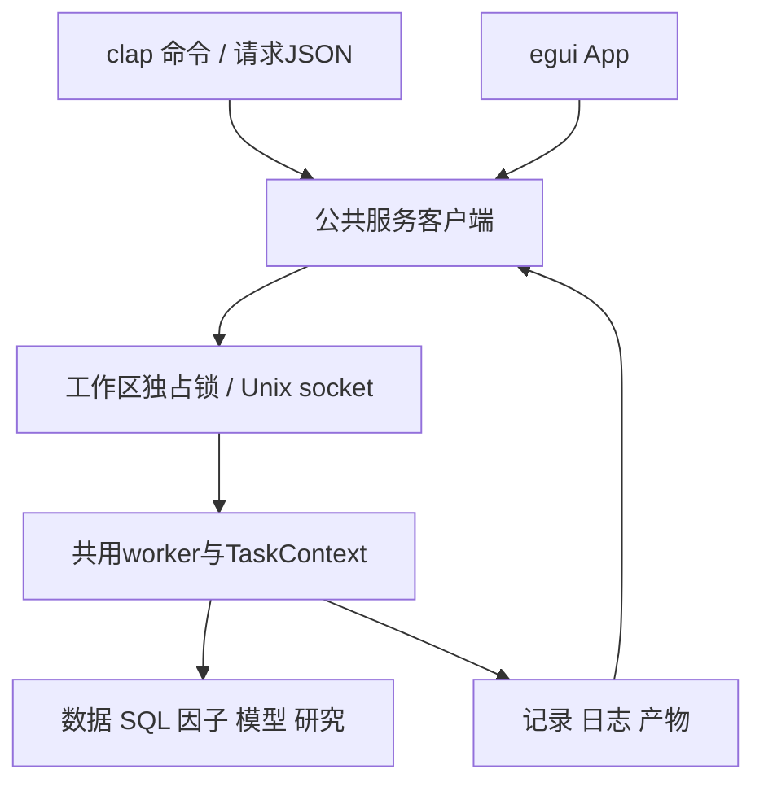
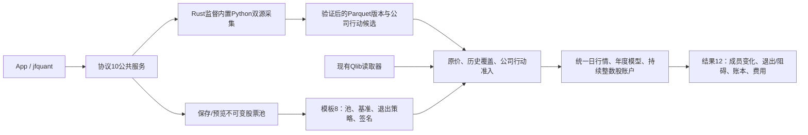
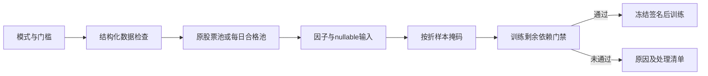
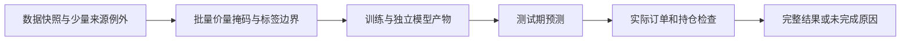

# analytics-cli

目录导航：[全部组件](../README.md) · [src：clap、请求转换、JSON与退出码](src/README.md) · [tests：真实客户端、服务与临时工作区集成](tests/README.md)

## 职责与公共接口

jfquant是与App共用后台的独立终端入口，分发目标Apple Silicon、macOS 14及以上。clap 4的Parser/Subcommand/Args/ValueEnum负责参数、帮助和基础类型；所有业务校验及采集、查询、因子、模型、研究和任务生命周期由analytics-workflow执行，不复制计算或费用逻辑。Cli::try_parse、execute、exit_code和wait用于命令验收；clap类型不进入领域模块。

安装后的完整路径为`/Applications/JFQuant.app/Contents/MacOS/jfquant`，无需Codex、Cargo、外部Python、Homebrew、DYLD设置或打开GUI。用户可自行建立PATH链接，程序不修改shell配置：

```bash
mkdir -p "$HOME/.local/bin"
ln -s /Applications/JFQuant.app/Contents/MacOS/jfquant "$HOME/.local/bin/jfquant"
/Applications/JFQuant.app/Contents/MacOS/jfquant --help
```

工作区优先级为--workspace、JFQUANT_WORKSPACE、App preferences；均缺失或目录不存在时提示选择，不静默创建。所有相对数据/SQL/模板路径从工作区解析，显式绝对输入支持。workspace create PATH显式创建；开发模式JFQUANT_CLI_BIN指定服务二进制，默认查找同目录jfquant及PATH。

## 命令和任务

| 命令组 | 操作 |
|---|---|
| workspace | create、show |
| data | scan、versions、check-updates、download、register、actions、supplement、retry；下载和日期补充接受resume UUID |
| query | describe、run、next、export CSV/Parquet |
| factors | list含隔离原因；run公共PipelineRequest |
| model | train从缓存重训；artifacts读取结果 |
| research | check严格准入；run年度研究；demo完整合成数据 |
| templates | list、default、validate、save、import、export |
| jobs | list、status、wait、logs、cancel、results、import当前格式研究结果只读登记 |
| service | status、空闲stop、故障后restart；内部serve自动启动 |
| run | --request FILE提交公共TaskRequest |
| self-check | --output DIRECTORY原生自检，无GUI |

```bash
jfquant workspace create "$HOME/JFQuantWorkspace"
export JFQUANT_WORKSPACE="$HOME/JFQuantWorkspace"
jfquant data check-updates
jfquant data download --tag 2026-10-12
jfquant jobs wait TASK_UUID --timeout 600
jfquant data versions
jfquant query run --sql 'SELECT 42 AS answer'
jfquant query describe --sql-file query.sql
jfquant query export --sql-file query.sql --output .jfquant/exports/query.parquet
jfquant factors list
jfquant templates default --output .jfquant/templates/default.json
jfquant research demo
jfquant research run --template recipe.json --market MARKET_VERSION --actions ACTION_VERSION
jfquant jobs logs TASK_UUID
jfquant jobs results TASK_UUID
jfquant jobs cancel TASK_UUID
jfquant service status
```

下载、公司行动、登记、演示、流水线、训练和研究默认返回task_id、status=running及wait命令；提交时记录已落盘，接受不代表成功。任务由独立服务执行，关闭App或客户端不取消；显式jobs wait等待，等待超时/中断不取消后台任务。同一工作区只接受一个计算任务，busy返回当前任务ID且无队列；取消在公共检查点生效。异常退出后服务下次启动恢复interrupted，下载可从验证检查点继续，研究使用新UUID重跑。

扫描、查询、Describe、导出等待结果，响应为submission及result；查询独立query_id在submission中，result.results.QueryPaged.page包含columns/rows/next_cursor。每个客户端的原生快照相互隔离，十分钟不使用会话过期；cursor必须原样使用，不从显示列拼装：

```bash
jfquant query run --sql 'SELECT * FROM range(20)' --page-size 5
jfquant query next --query-id QUERY_UUID --cursor-json '[{"Int64":5}]'
```

NULL、重复键保留。普通SQL/I/O错误不退役worker；panic后明确unavailable并重建worker，句柄始终由创建它们的线程销毁。训练依据不可信时停止训练；账户执行依据缺失时回测失败并保留模型；不会自动切换旧近似。

## JSON与退出码

stdout每次只写一个JSON结果或错误，帮助/版本为普通文本，诊断写stderr。--format text以缩进展示相同结果。错误为`{"error":{"code":"busy","message":"…","task_id":"UUID"}}`，没有关联任务时task_id=null。退出码0成功/接受，2参数/工作区选择错误，3数据未就绪，4忙碌，1其他失败，124等待超时，130任务取消。status/results/logs可在之后继续查询。

run --request不执行脚本，JSON直接提交公共协议。示例流水线：

```json
{
  "operation":"pipeline",
  "request":{
    "market_path":"data/market", "universe_path":"data/universe", "universe_id":"csi500",
    "date_range":{"start":"2020-01-01","end":"2025-12-31"},
    "factor_ids":["alpha_001","alpha_002"], "output_dir":".jfquant/runs",
    "training":{"parameters":{"num_iterations":"100","seed":"17"},"early_stopping_rounds":8}
  }
}
```

factors run --request只需上例内层PipelineRequest；model train --cache factors.parquet --config training.json使用training对象，省略配置沿用默认。服务实际输出绑定新UUID，PipelineRequest.output_dir用于直接模块调用，服务提交则统一分配UUID目录，不覆盖已有产物。研究请求为`{"operation":"workflow","request":{"operation":"research","template":完整模板,"market":"版本ID","actions":"版本ID","audit_only":false}}`。特征顺序、版本、签名、模板和费用均由公共校验器冻结，不能只改manifest冒充新版公式。完整协议/状态/文件格式见[workflow README](../workflow/README.md)。



socket仅当前用户可访问，无网络监听端口；协议version=9，连接一条JSON请求/响应。启动竞争由工作区锁解决。服务无请求/任务/有效查询会话十分钟退出，状态和读取任务历史不依赖计算worker持有的原生句柄。

## 开发构建与验收

以下仅供开发构建；安装后的日常操作使用jfquant：

```bash
export DUCKDB_LIB_DIR="$PWD/target/debug/deps"
export DYLD_LIBRARY_PATH="$DUCKDB_LIB_DIR:$(brew --prefix lightgbm)/lib:$(brew --prefix libomp)/lib"
cargo build -p analytics-cli
cargo nextest run -p analytics-cli
cargo clippy --workspace --all-targets --features analytics-ml/lightgbm-native -- -D warnings
crates/app/packaging/package-macos.sh
```

集成测试用临时工作区、本地服务及本地归档，覆盖clap帮助/校验/转换、JSON/退出码、异步任务、busy、取消/等待超时、客户端退出后继续、启动竞争、分页隔离/过期/非有限值/大事件历史、服务崩溃恢复、原生合成研究、严格缺项。正式接口测试比较完整结果/冻结顺序/账本/费用，检查验证归档恢复、busy、证据repair去重后的coverage。旧命令、旧请求和旧口径参数返回参数错误；旧结果读取和导入返回unsupported_result_format且不改源文件。App测试确认双方标准请求的任务/结果同步。

packaging/verify-cli.sh清空开发环境执行帮助、原生自检、标准完整合成研究、正式因子流水线和停服后离线读取；不用外部Python/Homebrew/Cargo。运行记录、socket、日志、数据、模型和安装包不提交Git。另一台Apple Silicon/macOS 14实机验收继续待完成。

服务自动启动时使用独立进程组；首次前台等待被Ctrl+C中断不会把SIGINT送到后台。该行为已用真实前台进程组发送信号并验证已提交任务继续成功的测试覆盖。

研究结果只接受schema12及raw_integer_shares；不提供旧口径执行、重新计费或旧报告格式转换。jobs import先验证当前格式，失败不创建记录；旧文件保留。run --request只接受带operation的TaskRequest，例如{"operation":"workflow","request":{"operation":"create_demo"}}。不接受裸WorkflowRequest或未知参数。unsupported_result_format退出码为1，stdout为错误JSON，诊断写stderr。


## 动态股票池与 Python 采集接口

当前模板schema 8、研究结果schema12、服务协议10；公式仍为v4。解析后配置包含 `pool_version`、`benchmark` 和 `pool_exit_policy`（磁盘保存于TargetProfile）；默认 `builtin:csi500` / `SH000905`，沪深300模板使用 `builtin:csi300` / `SH000300`。自选和集合组合引用不可变pool版本，冻结成员区间、人工日期调整及输入哈希；模型manifest和缓存签名包含这些研究输入。原schema结果明确拒绝，历史状态和日志仍可查看，不转换旧文件。



`pools create/validate/import/export/list/versions/preview` 使用公共定义及解析器；`data collect --provider akshare|yfinance --kind market|actions` 提交后台任务，使用 jobs wait 显式等待。`run --request` 可提交完整公共请求。App提供来源、采集日期/证券、股票池JSON编辑、日期预览、退出策略及失败采集恢复按钮。包内Python和依赖只用于采集，不需要外部Python；日常操作不调用Cargo。

```bash
jfquant templates default --universe csi300 --output csi300-template.json
jfquant pools validate --definition pool.json
jfquant pools create --definition pool.json
jfquant pools preview pool-0123456789abcdef --market market-0123456789abcdef --date 2026-10-12
jfquant data collect --provider akshare --start 2004-01-01 --end 2026-10-13 --instruments SH600000,SZ000001,SH000300 --benchmarks SH000300
jfquant data collect --kind actions --provider akshare --start 2004-01-01 --end 2026-10-13 --instruments SH600000,SZ000001
jfquant research demo-parquet
```

示例ID须换为实际版本。下载可恢复验证过的证券；重新提交时参数必须与owner一致。临时/缺失输入不会自动换源、补字段或启动训练。原价撮合不使用Yahoo拆股调整价；指数历史成员缺失停止训练，支付/上市日期在真实账户执行时校验。2010样本外的5+1窗口需要2004—2009完整历史池及行情，不能以当前成分回填。

开发验收先运行 `crates/app/packaging/build-collector.sh`，再执行workspace nextest、严格Clippy/Rustdoc和格式检查。解释器、依赖、数据、模型、缓存、日志、运行记录及DMG均留在忽略目录。另一台Apple Silicon/macOS14实机验收待完成。

## 显式系数采集

jfquant data collect --provider akshare --adjustment-source sina-hfq --start 2004-01-01 --end 2026-10-13 --instruments SH600000,SH000300 --benchmarks SH000300 提交原价、供应商证据和独立新浪系数。省略选项时AKShare选择sina-hfq，yfinance选择none。未知组合、股票被声明为指数或已知指数未声明角色均失败，不换源。run --request的完整CollectionRequest须含adjustment_source。当前服务10、采集7、规范4、报告10；公式v4和默认178项不变。

## 任意日期与数据修订命令

```bash
jfquant templates default --universe csi300 --output recipe.json
jfquant research preview --template recipe.json --market MARKET_ID
jfquant research prepare-data --template recipe.json --market MARKET_ID
jfquant research prepare-data --template recipe.json --market MARKET_ID --announcements
jfquant data inspect-actions --actions ACTION_ID --instrument SH600000 --evidence-manifest data/EVIDENCE/announcements.json
jfquant data revise-actions --actions ACTION_ID --request review.json
jfquant research run --template recipe.json --market MARKET_ID --actions ACTION_ID \
  --train-start 2006-01-01 --train-end 2010-12-31 \
  --validation-start 2011-01-01 --validation-end 2011-12-31 \
  --test-start 2012-01-01 --test-end 2012-12-31 \
  --step 1 --step-unit years
jfquant jobs wait TASK_UUID
```

省略step为单次区间；--no-validation明确关闭验证集。--expanding扩展训练；--until设置明确滚动截止，省略则取数据最后完整日。--schedule FILE可无损传入single/rolling/manual公共日程，覆盖模板schedule，不解析旧年份参数。prepare-data支持同样日期选项及resume。所有长任务先返回ID，stdout只写JSON；缺项通过jobs results读取，不启动训练。


## 为什么需要本组件

让AI与脚本使用同一平台能力。独立jfquant解析参数并提交公共请求，避免AI绕过App直接拼接业务步骤。默认JSON、稳定错误和任务ID便于自动化；等待超时不取消后台任务，复杂参数通过当前格式请求文件表达。

设计依据：2026-10-14接受的当前组件职责、可复现实验与用户研究需求、组件接口及测试。未在代码或证据中确认的历史取舍不推定为既有设计理由；来源、法规或数据格式变化时重新评估。


## 三级研究模式：为什么允许筛选

决定日期2026-10-14，依据是用户接受的三级模式计划。正常预热空值、来源缺失和错误数据是不同问题：全部拒绝会浪费可用样本，全部放行又会混淆因子和真实权益。默认严格检查；另外提供“允许部分数据缺失”和“只用数据合格的股票”。模式是研究输入的一部分，不能作为训练失败后自动切换的兜底。

第二档保持原成员，纯缺失传播null；第三档派生每日合格成员，不改原始成员或证据。不能看到后来缺价而倒删早期股票。账户仍采用原价、整数股、T+1和连续权益；未裁定冲突、损坏、基准缺项及剩余必要依赖仍阻断。默认有效因子比例0表示至少一项有效，最低有标签样本1只表示可执行，不表示样本在统计上充分。所选因子整列无有效值不会被自动删除。

日常命令使用独立程序，无需Cargo；strictness枚举采用稳定JSON拼写：strict、allow_missing、qualified_only。

```sh
jfquant --workspace "$JFQUANT_WORKSPACE" research preview --template recipe.json --market MARKET_ID --actions ACTIONS_ID --strictness qualified_only
jfquant --workspace "$JFQUANT_WORKSPACE" research check --template recipe.json --market MARKET_ID --actions ACTIONS_ID --strictness allow_missing --min-valid-feature-ratio 0 --min-labeled-rows 1
jfquant --workspace "$JFQUANT_WORKSPACE" jobs wait TASK_ID --timeout 60
jfquant --workspace "$JFQUANT_WORKSPACE" jobs results TASK_ID
jfquant --workspace "$JFQUANT_WORKSPACE" research run --template recipe.json --market MARKET_ID --actions ACTIONS_ID --strictness qualified_only
```

替换版本及任务ID，工作区须已显式创建。显式CLI参数覆盖模板值；最终策略和处理记录从结果admission/quality读取。run --request仍只接收TaskRequest，模板内使用相同quality_policy，不存在另一套宽松请求格式。非法门槛退出2，剩余必要依赖未就绪退出3；提交先返回任务ID。



## 2026-10-14：直接代码读取与分阶段研究

为什么调整：普通市场代码无需先登记身份；独立目录、审核和权威名录下载增加了研究前置负担。特殊历史代码仍需在快照内明确区间，不能将旧证券行情或权益接到另一证券。训练使用价量和标签，到账／交付资料只在实际账户执行时检查。

当前格式：模板8、需求3、准入5、股票池3、公司行动4、规范行情5、系数3、采集7、服务10、研究结果12；快照内来源映射1、训练产物2。工作区和任务记录1、GTJA191公式v4及默认178项顺序保持。旧格式明确拒绝，不自动转换。

```bash
jfquant --workspace "$JFQUANT_WORKSPACE" research train --template recipe.json --market MARKET_ID --actions HISTORY_ACTIONS_ID
jfquant --workspace "$JFQUANT_WORKSPACE" jobs wait TRAIN_JOB_ID --timeout 60
jfquant --workspace "$JFQUANT_WORKSPACE" research backtest --training TRAIN_JOB_ID --actions EXECUTION_ACTIONS_ID
jfquant --workspace "$JFQUANT_WORKSPACE" jobs results BACKTEST_JOB_ID
```



验收：nextest覆盖来源日期边界、三档掩码、训练／回测分离及模型保留；Clippy、Rustdoc、格式、组件文档和包内CLI共同检查。生成数据、模型、运行记录和安装包不提交。另一台Apple Silicon/macOS14实机验收继续待完成。

## 独立保存流程、因子和标的

日常无需Cargo。模板默认导出工作流8及相邻factors/targets内容签名文件，整体携带即可复制给其他工作区；stdout返回解析后的完整请求方便AI，但这个冻结对象不能冒充磁盘模板。显式profile替换先应用，`--factor-set`再重置为该组合完整顺序，`--price-basis`最后覆盖口径。

```bash
jfquant templates default --universe csi300 --output research/workflow.json
jfquant templates factors --template research/workflow.json --output research/factors.json
jfquant templates target --template research/workflow.json --output research/target.json
jfquant templates compose --workflow research/workflow.json --factors research/factors.json --target research/target.json --output research/combined.json
jfquant research train --template research/combined.json --market MARKET_ID --price-basis provider --strictness qualified_only
jfquant research train --template research/combined.json --market MARKET_ID --factor-set alpha158 --price-basis provider
jfquant research check --template research/combined.json --market MARKET_ID --factor-profile research/factors.json --target-profile research/target.json
jfquant factors list --factor-set alpha158
jfquant data collect --kind coefficients --provider akshare --start 2006-01-01 --end 2026-10-12 --instruments SH600018 --adjustment-source sina-hfq
jfquant data collect --kind quotes --provider akshare --start 2006-01-01 --end 2026-10-12 --instruments SH600018
jfquant data compose --market QLIB_VERSION --coefficients COEFFICIENT_VERSION
jfquant research backtest --training TRAINING_JOB_ID --actions ACTION_VERSION
```

provider不要求train/check/preview携带actions，仍保存未对账告警；verified没有必要复权依据就失败。run与backtest要求actions，不能通过供应商训练模式跳过账户权益检查。默认仍GTJA191/verified/strict；Alpha158必须明确选择。JSON stdout、退出码、后台存活和单任务互斥规则保持。
