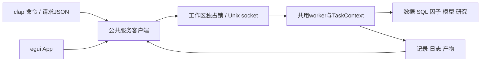

# analytics-cli

## 职责与公共接口

jfquant是与App共用后台的独立终端入口，分发目标Apple Silicon、macOS 14及以上。clap 4的Parser/Subcommand/Args/ValueEnum负责参数、帮助和基础类型；所有业务校验及采集、查询、因子、模型、研究和任务生命周期由analytics-workflow执行，不复制计算或费用逻辑。Cli::try_parse、execute、exit_code和wait用于命令验收；clap类型不进入领域模块。

安装后的完整路径为`/Applications/JFQuant.app/Contents/MacOS/jfquant`，无需Codex、Cargo、Python、Homebrew、DYLD设置或打开GUI。用户可自行建立PATH链接，程序不修改shell配置：

```bash
mkdir -p "$HOME/.local/bin"
ln -s /Applications/JFQuant.app/Contents/MacOS/jfquant "$HOME/.local/bin/jfquant"
/Applications/JFQuant.app/Contents/MacOS/jfquant --help
```

工作区优先级为--workspace、JFQUANT_WORKSPACE、App preferences；均缺失或目录不存在时提示选择，不静默创建。所有相对数据/SQL/模板路径从工作区解析，显式绝对输入支持。workspace create PATH显式创建；开发模式JFQUANT_CLI_BIN指定服务二进制，默认查找同目录jfquant及PATH。

## 命令和任务

| 命令组 | 操作 |
|---|---|
| workspace | create、show |
| data | scan、versions、check-updates、download、register、actions、supplement、retry；下载和日期补充接受resume UUID |
| query | describe、run、next、export CSV/Parquet |
| factors | list含隔离原因；run公共PipelineRequest |
| model | train从缓存重训；artifacts读取结果 |
| research | check严格准入；run年度研究；demo完整合成数据 |
| templates | list、default、validate、save、import、export |
| jobs | list、status、wait、logs、cancel、results、import当前格式研究结果只读登记 |
| service | status、空闲stop、故障后restart；内部serve自动启动 |
| run | --request FILE提交公共TaskRequest |
| self-check | --output DIRECTORY原生自检，无GUI |

```bash
jfquant workspace create "$HOME/JFQuantWorkspace"
export JFQUANT_WORKSPACE="$HOME/JFQuantWorkspace"
jfquant data check-updates
jfquant data download --tag 2026-10-12
jfquant jobs wait TASK_UUID --timeout 600
jfquant data versions
jfquant query run --sql 'SELECT 42 AS answer'
jfquant query describe --sql-file query.sql
jfquant query export --sql-file query.sql --output .jfquant/exports/query.parquet
jfquant factors list
jfquant templates default --output .jfquant/templates/default.json
jfquant research demo
jfquant research run --template recipe.json --market MARKET_VERSION --actions ACTION_VERSION
jfquant jobs logs TASK_UUID
jfquant jobs results TASK_UUID
jfquant jobs cancel TASK_UUID
jfquant service status
```

下载、公司行动、登记、演示、流水线、训练和研究默认返回task_id、status=running及wait命令；提交时记录已落盘，接受不代表成功。任务由独立服务执行，关闭App或客户端不取消；显式jobs wait等待，等待超时/中断不取消后台任务。同一工作区只接受一个计算任务，busy返回当前任务ID且无队列；取消在公共检查点生效。异常退出后服务下次启动恢复interrupted，下载可从验证检查点继续，研究使用新UUID重跑。

扫描、查询、Describe、导出等待结果，响应为submission及result；查询独立query_id在submission中，result.results.QueryPaged.page包含columns/rows/next_cursor。每个客户端的原生快照相互隔离，十分钟不使用会话过期；cursor必须原样使用，不从显示列拼装：

```bash
jfquant query run --sql 'SELECT * FROM range(20)' --page-size 5
jfquant query next --query-id QUERY_UUID --cursor-json '[{"Int64":5}]'
```

NULL、重复键保留。普通SQL/I/O错误不退役worker；panic后明确unavailable并重建worker，句柄始终由创建它们的线程销毁。公司行动缺实际支付/上市日、来源冲突、特殊分配解释失败时research blocked停止在训练前；不会自动切换旧近似。

## JSON与退出码

stdout每次只写一个JSON结果或错误，帮助/版本为普通文本，诊断写stderr。--format text以缩进展示相同结果。错误为`{"error":{"code":"busy","message":"…","task_id":"UUID"}}`，没有关联任务时task_id=null。退出码0成功/接受，2参数/工作区选择错误，3数据未就绪，4忙碌，1其他失败，124等待超时，130任务取消。status/results/logs可在之后继续查询。

run --request不执行脚本，JSON直接提交公共协议。示例流水线：

```json
{
  "operation":"pipeline",
  "request":{
    "market_path":"data/market", "universe_path":"data/universe", "universe_id":"csi500",
    "date_range":{"start":"2020-01-01","end":"2025-12-31"},
    "factor_ids":["alpha_001","alpha_002"], "output_dir":".jfquant/runs",
    "training":{"parameters":{"num_iterations":"100","seed":"17"},"early_stopping_rounds":8}
  }
}
```

factors run --request只需上例内层PipelineRequest；model train --cache factors.parquet --config training.json使用training对象，省略配置沿用默认。服务实际输出绑定新UUID，PipelineRequest.output_dir用于直接模块调用，服务提交则统一分配UUID目录，不覆盖已有产物。研究请求为`{"operation":"workflow","request":{"operation":"research","template":完整模板,"market":"版本ID","actions":"版本ID","audit_only":false}}`。特征顺序、版本、签名、模板和费用均由公共校验器冻结，不能只改manifest冒充新版公式。完整协议/状态/文件格式见[workflow README](../workflow/README.md)。



socket仅当前用户可访问，无网络监听端口；协议version=2，连接一条JSON请求/响应。启动竞争由工作区锁解决。服务无请求/任务/有效查询会话十分钟退出，状态和读取任务历史不依赖计算worker持有的原生句柄。


## 开发构建与验收

以下仅供开发构建；安装后的日常操作使用jfquant：

```bash
export DUCKDB_LIB_DIR="$PWD/target/debug/deps"
export DYLD_LIBRARY_PATH="$DUCKDB_LIB_DIR:$(brew --prefix lightgbm)/lib:$(brew --prefix libomp)/lib"
cargo build -p analytics-cli
cargo nextest run -p analytics-cli
cargo clippy --workspace --all-targets --features analytics-ml/lightgbm-native -- -D warnings
crates/app/packaging/package-macos.sh
```

集成测试用临时工作区、本地服务及本地归档，覆盖clap帮助/校验/转换、JSON/退出码、异步任务、busy、取消/等待超时、客户端退出后继续、启动竞争、分页隔离/过期/非有限值/大事件历史、服务崩溃恢复、原生合成研究、严格缺项。正式接口测试比较完整结果/冻结顺序/账本/费用，检查验证归档恢复、busy、证据repair去重后的coverage。旧命令、旧请求和旧口径参数返回参数错误；旧结果读取和导入返回unsupported_result_format且不改源文件。App测试确认双方标准请求的任务/结果同步。

packaging/verify-cli.sh清空开发环境执行帮助、原生自检、标准完整合成研究、正式因子流水线和停服后离线读取；不用Python/Homebrew/Cargo。运行记录、socket、日志、数据、模型和安装包不提交Git。另一台Apple Silicon/macOS 14实机验收继续待完成。

服务自动启动时使用独立进程组；首次前台等待被Ctrl+C中断不会把SIGINT送到后台。该行为已用真实前台进程组发送信号并验证已提交任务继续成功的测试覆盖。


研究结果只接受schema4及raw_integer_shares；不提供旧口径执行、重新计费或旧报告格式转换。jobs import先验证当前格式，失败不创建记录；旧文件保留。run --request只接受带operation的TaskRequest，例如{"operation":"workflow","request":{"operation":"create_demo"}}。不接受裸WorkflowRequest或未知参数。unsupported_result_format退出码为1，stdout为错误JSON，诊断写stderr。

本次清理验收：163项workspace nextest通过、0跳过；严格Clippy/Rustdoc、doctest、格式和差异检查通过。App/DMG已重建，包内正式研究、因子流水线和离线结果读取验证通过。复现命令见[workflow README](../workflow/README.md#2026-10-13-清理验收记录)，另一台实机验收待完成。
