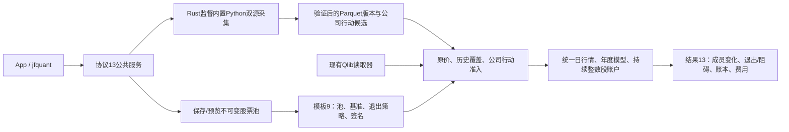
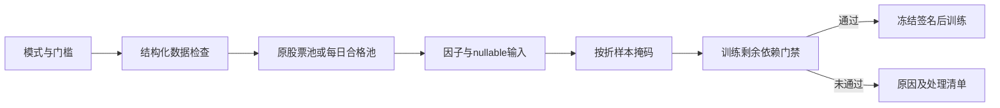
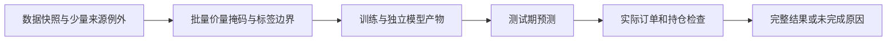
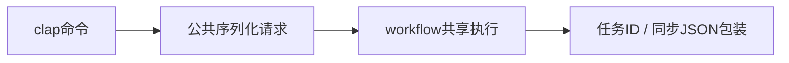
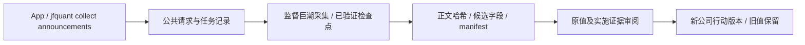

# CLI 源码：解析与公共请求转换

[上级：analytics-cli](../README.md) · [进程级测试](../tests/README.md) · [服务契约](../../workflow/src/README.md)

本目录只实现 `jfquant` 的参数、输出和公共客户端调用。clap 4 的 `Parser/Subcommand/Args/ValueEnum` 不进入领域模块；公式、训练、费用和任务生命周期由公共后台执行。

## 接口与文件

[main.rs](main.rs) 解析 clap、输出帮助/版本或结果、将诊断写 stderr，并按 `exit_code` 退出。[lib.rs](lib.rs) 提供 `Cli`、命令枚举、`execute`、`wait` 和 `exit_code`；SQL 文本/文件、模板和请求 JSON 从选定工作区解析。


`workspace create` 显式建立目录；`self-check` 无需工作区，调用公共原生自检并不启动 GUI。工作区顺序为 `--workspace`、`JFQUANT_WORKSPACE`、App preferences；全部缺失时返回工作区错误，不自动选择仓库目录。

## 转换规则与失败语义

`run --request` 只接受完整 `TaskRequest`，例如外层 `operation=workflow` 加内层研究请求；`factors run --request` 接受内层 `PipelineRequest`。不提供旧命令、裸 `WorkflowRequest` JSON 回退或近似执行口径。基础参数错误由 CLI 拒绝，业务校验由后台执行；已接受不等于已成功。

stdout 只写一个结果 JSON，帮助/版本用普通文本。`--format text` 显示相同数据的缩进形式。错误字段为 `code/message/task_id`；退出码 0 成功或接受、2 参数/工作区错误、3 数据未就绪、4 busy、1 其他失败、124 等待超时、130 任务取消。旧结果格式错误为 `unsupported_result_format`、退出码 1。

```bash
jfquant --workspace "$HOME/JFQuantWorkspace" run --request task.json
jfquant --workspace "$HOME/JFQuantWorkspace" jobs wait TASK_UUID --timeout 600
jfquant --workspace "$HOME/JFQuantWorkspace" jobs results TASK_UUID
```

## 开发验收

从仓库根目录执行，原生环境见 [Crates 导航](../../README.md#开发与验收)。

```bash
cargo build -p analytics-cli
cargo nextest run -p analytics-cli -E 'test(clap_help) | test(removed_entrypoints)'
cargo clippy -p analytics-cli --all-targets -- -D warnings
```

新增命令要验证转换后请求与 App 公共请求一致、JSON 可机器解析、错误码和退出码稳定；异步命令不要自己创建任务记录或实现业务循环。查询后续页必须携带 `query_id` 和原 cursor，不能从显示列重构游标。

## 动态股票池与 Python 采集接口

当前模板schema 9、研究结果schema13、服务协议13；公式仍为v4。解析后配置包含 `pool_version`、`benchmark` 和 `pool_exit_policy`（磁盘保存于TargetProfile）；默认 `builtin:csi500` / `SH000905`，沪深300模板使用 `builtin:csi300` / `SH000300`。自选和集合组合引用不可变pool版本，冻结成员区间、人工日期调整及输入哈希；模型manifest和缓存签名包含这些研究输入。原schema结果明确拒绝，历史状态和日志仍可查看，不转换旧文件。



`pools create/validate/import/export/list/versions/preview` 使用公共定义及解析器；`data collect --provider akshare|yfinance --kind market|actions` 提交后台任务，使用 jobs wait 显式等待。`run --request` 可提交完整公共请求。App提供来源、采集日期/证券、股票池JSON编辑、日期预览、退出策略及失败采集恢复按钮。包内Python和依赖只用于采集，不需要外部Python；日常操作不调用Cargo。

```bash
jfquant templates default --universe csi300 --output csi300-template.json
jfquant pools validate --definition pool.json
jfquant pools create --definition pool.json
jfquant pools preview pool-0123456789abcdef --market market-0123456789abcdef --date 2026-10-12
jfquant data collect --provider akshare --start 2004-01-01 --end 2026-10-13 --instruments SH600000,SZ000001,SH000300 --benchmarks SH000300
jfquant data collect --kind actions --provider akshare --start 2004-01-01 --end 2026-10-13 --instruments SH600000,SZ000001
jfquant research demo-parquet
```

示例ID须换为实际版本。下载可恢复验证过的证券；重新提交时参数必须与owner一致。临时/缺失输入不会自动换源、补字段或启动训练。原价撮合不使用Yahoo拆股调整价；指数历史成员缺失停止训练，支付/上市日期在真实账户执行时校验。2010样本外的5+1窗口需要2004—2009完整历史池及行情，不能以当前成分回填。

开发验收先运行 `crates/app/packaging/build-collector.sh`，再执行workspace nextest、严格Clippy/Rustdoc和格式检查。解释器、依赖、数据、模型、缓存、日志、运行记录及DMG均留在忽略目录。另一台Apple Silicon/macOS14实机验收待完成。

clap CollectionAdjustment解析sina-hfq/none，转换为storage AdjustmentSource后由公共请求验证；AKShare默认sina_hfq，Yahoo默认none，JSON完整请求不补旧格式缺失字段。CLI不自行计算研究价量或对账。

## 日期参数转换

DateOptions仅在clap层，将train/validation/test任意日期、step/step-unit/expanding/until或--schedule JSON转换成同一Schedule；业务边界、日期日历和标签规则在core/workflow/ML。Research的preview/prepare-data/check/run共享转换，data inspect-actions/revise-actions只包装公共请求，不另建采集或账本。CLI测试验证缺参数退出2、日期请求一致、无验证集研究及持久化结果。

## 为什么需要本组件

限制命令解析层的业务职责。clap只承担帮助、参数和基础校验。证券来源映射、来源绑定、日期日程、准入与研究执行调用公共模块；代码复用防止CLI与界面对同一模板得出不同结果。

设计依据：2026-10-14接受的当前组件职责、可复现实验与用户研究需求、组件接口及测试。未在代码或证据中确认的历史取舍不推定为既有设计理由；来源、法规或数据格式变化时重新评估。

## 三级研究模式：为什么允许筛选

决定日期2026-10-14，依据是用户接受的三级模式计划。正常预热空值、来源缺失和错误数据是不同问题：全部拒绝会浪费可用样本，全部放行又会混淆因子和真实权益。默认严格检查；另外提供“允许部分数据缺失”和“只用数据合格的股票”。模式是研究输入的一部分，不能作为训练失败后自动切换的兜底。

第二档保持原成员，纯缺失传播null；第三档派生每日合格成员，不改原始成员或证据。不能看到后来缺价而倒删早期股票。账户仍采用原价、整数股、T+1和连续权益；未裁定冲突、损坏、基准缺项及剩余必要依赖仍阻断。默认有效因子比例0表示至少一项有效，最低有标签样本1只表示可执行，不表示样本在统计上充分。所选因子整列无有效值不会被自动删除。

QualityOptions/StrictnessValue仅负责clap解析，research_template把覆盖值写入公共ResearchQualityPolicy再调用业务校验。preview/check/run和prepare-data共用同一路径，不能在CLI层把失败变成成功。stdout继续只输出JSON，帮助文本展示三个稳定枚举；查看原因通过jobs results。协议13、模板9、结果13，旧格式无回退。



## 2026-10-14：直接代码读取与分阶段研究

为什么调整：普通市场代码无需先登记身份；独立目录、审核和权威名录下载增加了研究前置负担。特殊历史代码仍需在快照内明确区间，不能将旧证券行情或权益接到另一证券。训练使用价量和标签，到账／交付资料只在实际账户执行时检查。

当前格式：模板9、需求3、准入5、股票池3、公司行动5、规范行情5、系数3、采集7、服务11、研究结果13；快照内来源映射1、训练产物2。工作区和任务记录1、GTJA191公式v4及默认178项顺序保持。旧格式明确拒绝，不自动转换。

```bash
jfquant --workspace "$JFQUANT_WORKSPACE" research train --template recipe.json --market MARKET_ID --actions HISTORY_ACTIONS_ID
jfquant --workspace "$JFQUANT_WORKSPACE" jobs wait TRAIN_JOB_ID --timeout 60
jfquant --workspace "$JFQUANT_WORKSPACE" research backtest --training TRAIN_JOB_ID --actions EXECUTION_ACTIONS_ID
jfquant --workspace "$JFQUANT_WORKSPACE" jobs results BACKTEST_JOB_ID
```



验收：nextest覆盖来源日期边界、三档掩码、训练／回测分离及模型保留；Clippy、Rustdoc、格式、组件文档和包内CLI共同检查。生成数据、模型、运行记录和安装包不提交。另一台Apple Silicon/macOS14实机验收继续待完成。

## CLI只解析和组合

QualityOptions接受factor_profile/target_profile、price_basis和factor_set；先读取profile再应用显式标志，交由workflow统一验证。templates factors/target/compose复用公共文件接口，不复制业务流程。 完整接口、why、边界和验收见[组件契约](../README.md)。


## 来源与刷新参数为何只做转换

`SourceCommand`和`RefreshArgs`不持有下载业务：它们转换成`SourceStatus/SaveSourcePolicy/CheckSource/RefreshData/CollectReference`。这样App和AI不会各自决定缺口、换源或完整性；Key配置在连接服务前经安全stdin完成，任务不包含密钥。



命令和输出路径见[CLI README](../README.md)。验收为tests/platform.rs中的默认顺序与刷新预览对照，不依赖公网或Key。

## 按缺口补采实施证据

为什么独立任务：补齐一只股票的支付/上市日不应重取全池或重训模型。`CollectAnnouncements`接收固定AKShare/巨潮来源、证券、日期和可选resume，App和CLI提交同一请求。先验证再接受，失败不登记事件版本；成功返回公告manifest及`candidate_only=true`，必须经`InspectActions/ReviseActions`核对原值哈希、实施字段引用后生成不可变修订。App历史可恢复公告采集。新增请求采用服务协议13。



复现：`jfquant data collect --kind announcements --provider akshare --start 2016-05-01 --end 2017-07-01 --instruments SH600000,SZ000001`，然后`jfquant jobs wait TASK_ID`。候选解析v3支持空格日期、沪市六列换行表和深市起始交易日，矛盾不自动裁决。真实研究本轮不使用Qlib快照；通达信行情完整时不要求其他来源背书，备用来源仅补用途缺口。详见[设计决定](../../workflow/DECISIONS.md)。
