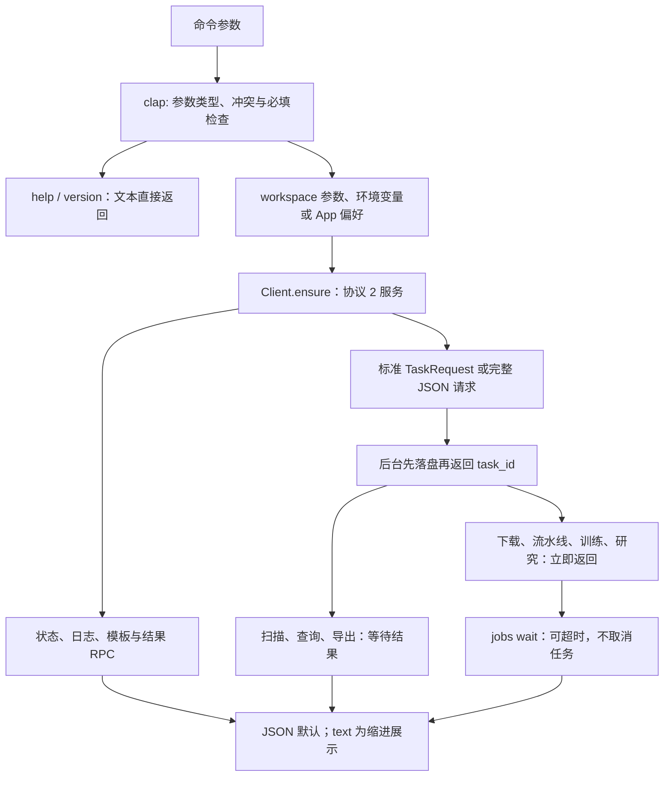

# CLI 源码：解析与公共请求转换

[上级：analytics-cli](../README.md) · [进程级测试](../tests/README.md) · [服务契约](../../workflow/src/README.md)

本目录只实现 `jfquant` 的参数、输出和公共客户端调用。clap 4 的 `Parser/Subcommand/Args/ValueEnum` 不进入领域模块；公式、训练、费用和任务生命周期由公共后台执行。

## 接口与文件

[main.rs](main.rs) 解析 clap、输出帮助/版本或结果、将诊断写 stderr，并按 `exit_code` 退出。[lib.rs](lib.rs) 提供 `Cli`、命令枚举、`execute`、`wait` 和 `exit_code`；SQL 文本/文件、模板和请求 JSON 从选定工作区解析。



`workspace create` 显式建立目录；`self-check` 无需工作区，调用公共原生自检并不启动 GUI。工作区顺序为 `--workspace`、`JFQUANT_WORKSPACE`、App preferences；全部缺失时返回工作区错误，不自动选择仓库目录。

## 转换规则与失败语义

`run --request` 只接受完整 `TaskRequest`，例如外层 `operation=workflow` 加内层研究请求；`factors run --request` 接受内层 `PipelineRequest`。不提供旧命令、裸 `WorkflowRequest` JSON 回退或近似执行口径。基础参数错误由 CLI 拒绝，业务校验由后台执行；已接受不等于已成功。

stdout 只写一个结果 JSON，帮助/版本用普通文本。`--format text` 显示相同数据的缩进形式。错误字段为 `code/message/task_id`；退出码 0 成功或接受、2 参数/工作区错误、3 数据未就绪、4 busy、1 其他失败、124 等待超时、130 任务取消。旧结果格式错误为 `unsupported_result_format`、退出码 1。

```bash
jfquant --workspace "$HOME/JFQuantWorkspace" run --request task.json
jfquant --workspace "$HOME/JFQuantWorkspace" jobs wait TASK_UUID --timeout 600
jfquant --workspace "$HOME/JFQuantWorkspace" jobs results TASK_UUID
```

## 开发验收

从仓库根目录执行，原生环境见 [Crates 导航](../../README.md#开发与验收)。

```bash
cargo build -p analytics-cli
cargo nextest run -p analytics-cli -E 'test(clap_help) | test(removed_entrypoints)'
cargo clippy -p analytics-cli --all-targets -- -D warnings
```

新增命令要验证转换后请求与 App 公共请求一致、JSON 可机器解析、错误码和退出码稳定；异步命令不要自己创建任务记录或实现业务循环。查询后续页必须携带 `query_id` 和原 cursor，不能从显示列重构游标。
