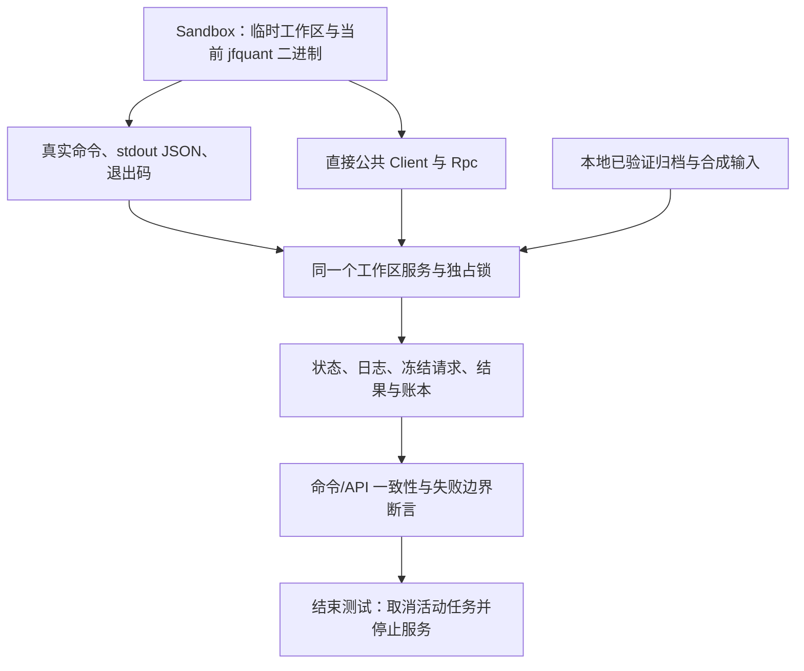
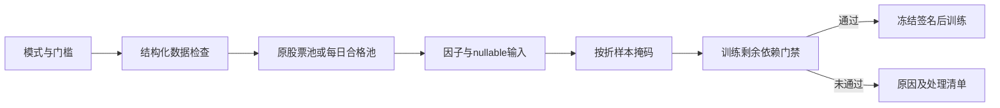
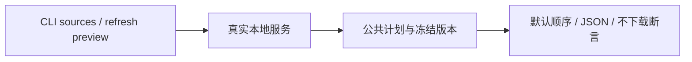

# CLI 进程与服务集成测试

three_factor过滤另覆盖采集命令时间口径、恢复选项和联网前校验；真实源小样本验收
保留在忽略的target目录，不提交数据或原始回执。

三因子验收：`DUCKDB_DOWNLOAD_LIB=1 cargo test -p analytics-cli --test platform three_factor`。
12只显式合成股票的真实CLI提交/等待/发布路径与独立手算收益对照，同时检查旧行情未被修改。

[上级：analytics-cli](../README.md) · [参数转换实现](../src/README.md) · [egui 对接测试](../../app/src/README.md)

[platform.rs](platform.rs) 使用真实 `jfquant` 子进程和临时工作区验证公共后台。测试用 `test-support` 注入暂停，不依赖真实公网下载；数据/公司行动由本项目完整合成构造器或本地归档提供。

## 测试结构



## 场景与排错入口

| 场景 | 证明的行为 |
|---|---|
| clap/旧入口拒绝 | 帮助不用工作区；冲突参数、旧命令/请求拒绝，不启动计算记录 |
| 异步任务/信号 | busy 无队列、wait 超时不中止任务、取消退出 130、首次前台 Ctrl+C 不杀服务 |
| 服务竞争与崩溃 | 多客户端启动只有一个持锁者；异常退出后记录变 interrupted |
| SQL 会话和事件 | 两个 query_id 分页互不影响；NULL/重复值/非有限值、大响应及事件预算可读取 |
| 当前研究与只读导入 | CLI/API 的完整结果、冻结特征顺序、年度账本和费用相同；旧结果拒绝且源文件不变 |
| 数据恢复与废弃入口拒绝 | 标准 download 从完整归档离线恢复、owner 不匹配不发布；旧补采与重试命令拒绝 |
| 正式流水线 | SQL 导出生成 Parquet，因子有序，产物绑定 UUID，不覆盖调用方给出的旧目录 |

失败时先查看测试名、stderr 和错误 JSON。`Sandbox::Drop` 清理服务，进程测试故意 SIGKILL 的范围只限该测试新建服务。不要把网络波动、真实缓存或其他 App 工作区引入测试。

## 运行与扩展

从仓库根目录执行，配置原生环境见 [Crates 导航](../../README.md#开发与验收)。

```bash
cargo nextest run -p analytics-cli --test platform
cargo nextest run -p analytics-cli --test platform -E 'test(startup_race) | test(standard_download)'
cargo nextest run -p analytics-desktop -E 'test(service_client_tasks)'
```

新子命令应在同一临时工作区比较命令与公共 API；测试应证明用户可见结果或错误，不只镜像参数转换。真实公开公司行动的缺项必须被拒绝，不能为让测试成功猜支付日/上市日。另一台 Mac 的安装验收属于 [打包验收](../../app/packaging/README.md)，不能由这些进程测试代替。

新增日期覆盖测试从CLI提交任意训练/回测和无验证集设置，等待后与公共Schedule核对，并验证残缺日期参数退出2。原App/API/CLI一致性测试使用当前模板10、公司行动5及结果14，保留原股数/费用断言；旧请求/旧结果仍不得执行或改写源文件。

## 为什么需要本组件

验证用户可见协议而非只测试内部函数。进程级测试检查JSON、退出码、任务持续运行、取消和App并发访问。身份变更和旧格式拒绝必须从正式命令证明，防止底层接口正确但命令入口绕过准入。

设计依据：2026-10-14接受的当前组件职责、可复现实验与用户研究需求、组件接口及测试。未在代码或证据中确认的历史取舍不推定为既有设计理由；来源、法规或数据格式变化时重新评估。

## 三级研究模式：为什么允许筛选

决定日期2026-10-14，依据是用户接受的三级模式计划。正常预热空值、来源缺失和错误数据是不同问题：全部拒绝会浪费可用样本，全部放行又会混淆因子和真实权益。默认严格检查；另外提供“允许部分数据缺失”和“只用数据合格的股票”。模式是研究输入的一部分，不能作为训练失败后自动切换的兜底。

第二档保持原成员，纯缺失传播null；第三档派生每日合格成员，不改原始成员或证据。不能看到后来缺价而倒删早期股票。账户仍采用原价、整数股、T+1和连续权益；未裁定冲突、损坏、基准缺项及剩余必要依赖仍阻断。默认有效因子比例0表示至少一项有效，最低有标签样本1只表示可执行，不表示样本在统计上充分。所选因子整列无有效值不会被自动删除。

quality_flags_match_public_api_freezing_and_reject_invalid_thresholds依次运行三档CLI与正式公共API，对比完整冻结结果、成员、样本掩码、特征、费用和收益；额外验证非法比例退出2及clap帮助。该验收使用明确标记的完整合成数据，不代表真实市场下载或收益。运行：`cargo nextest run -p analytics-cli quality_flags`。



## 2026-10-14：直接代码读取与分阶段研究

为什么调整：普通市场代码无需先登记身份；独立目录、审核和权威名录下载增加了研究前置负担。特殊历史代码仍需在快照内明确区间，不能将旧证券行情或权益接到另一证券。训练使用价量和标签，到账／交付资料只在实际账户执行时检查。

当前服务43、研究worker4、模板12、结果22、采集16、因子目录2、GTJA191公式v5（默认190项）。具体数据格式以所属组件的序列化类型与验证器为准；正常入口拒绝旧协议及旧格式，升级仅通过显式本地迁移执行。特征顺序、公式版本和来源哈希仍随产物冻结。

```bash
jfquant --workspace "$JFQUANT_WORKSPACE" research train --template recipe.json --market MARKET_ID --actions HISTORY_ACTIONS_ID
jfquant --workspace "$JFQUANT_WORKSPACE" jobs wait TRAIN_JOB_ID --timeout 60
jfquant --workspace "$JFQUANT_WORKSPACE" research backtest --training TRAIN_JOB_ID --actions EXECUTION_ACTIONS_ID
jfquant --workspace "$JFQUANT_WORKSPACE" jobs results BACKTEST_JOB_ID
```


验收：nextest覆盖来源日期边界、三档掩码、训练／回测分离及模型保留；Clippy、Rustdoc、格式、组件文档和包内CLI共同检查。生成数据、模型、运行记录和安装包不提交。另一台Apple Silicon/macOS14实机验收继续待完成。

## 分离配置与来源口径验收

新增split_template_profiles_and_price_basis_flags_share_native_training验证独立导出、compose、profile覆盖和无actions的Alpha158训练；stdout仍为JSON，结果冻结实际顺序。 完整接口、why、边界和验收见[组件契约](../README.md)。


## 来源优先级回归

为什么：命令可以解析成功但并未复用App规则，或JSON断言读错同步包装。`source_priorities_and_refresh_preview_share_the_public_backend_without_credentials`通过真实服务核对HiThink默认角色、通达信备用及空执行资料来源、固定来源和独立workflow读取、预览不下载；配置缺少`--key-stdin`须在启动服务前被clap拒绝。



复现：`cargo nextest run -p analytics-cli`，原生环境参照组件README。联网权限与SDK稳定性不在该离线测试结论内。
