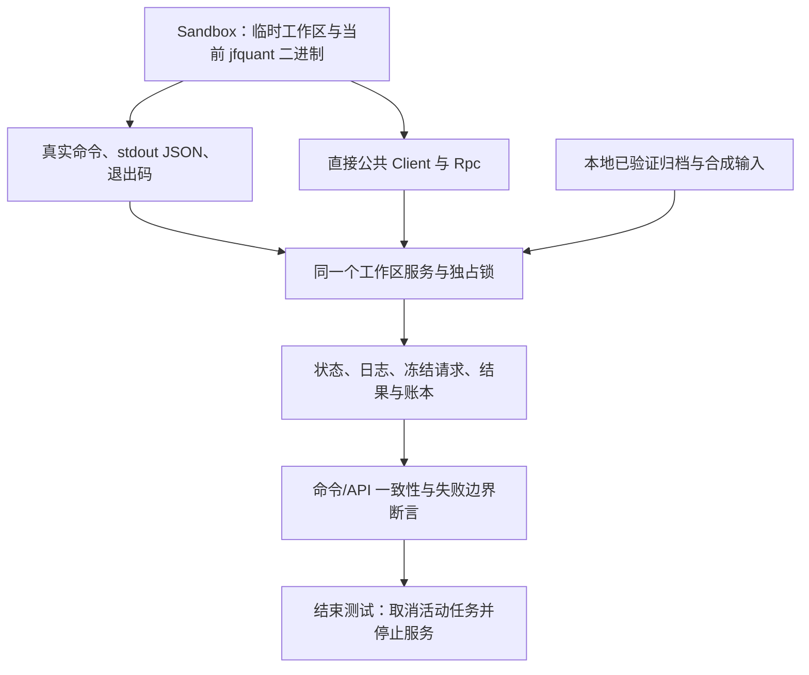

# CLI 进程与服务集成测试

[上级：analytics-cli](../README.md) · [参数转换实现](../src/README.md) · [egui 对接测试](../../app/src/README.md)

[platform.rs](platform.rs) 使用真实 `jfquant` 子进程和临时工作区验证公共后台。测试用 `test-support` 注入暂停，不依赖真实公网下载；数据/公司行动由本项目完整合成构造器或本地归档提供。

## 测试结构



## 场景与排错入口

| 场景 | 证明的行为 |
|---|---|
| clap/旧入口拒绝 | 帮助不用工作区；冲突参数、旧命令/请求拒绝，不启动计算记录 |
| 异步任务/信号 | busy 无队列、wait 超时不中止任务、取消退出 130、首次前台 Ctrl+C 不杀服务 |
| 服务竞争与崩溃 | 多客户端启动只有一个持锁者；异常退出后记录变 interrupted |
| SQL 会话和事件 | 两个 query_id 分页互不影响；NULL/重复值/非有限值、大响应及事件预算可读取 |
| 当前研究与只读导入 | CLI/API 的完整结果、冻结特征顺序、年度账本和费用相同；旧结果拒绝且源文件不变 |
| 数据恢复与证据 repair | 标准 download 从完整归档离线恢复、owner 不匹配不发布；去重仍保留本次 coverage |
| 正式流水线 | SQL 导出生成 Parquet，因子有序，产物绑定 UUID，不覆盖调用方给出的旧目录 |

失败时先查看测试名、stderr 和错误 JSON。`Sandbox::Drop` 清理服务，进程测试故意 SIGKILL 的范围只限该测试新建服务。不要把网络波动、真实缓存或其他 App 工作区引入测试。

## 运行与扩展

从仓库根目录执行，配置原生环境见 [Crates 导航](../../README.md#开发与验收)。

```bash
cargo nextest run -p analytics-cli --test platform
cargo nextest run -p analytics-cli --test platform -E 'test(startup_race) | test(standard_download)'
cargo nextest run -p analytics-desktop -E 'test(service_client_tasks)'
```

新子命令应在同一临时工作区比较命令与公共 API；测试应证明用户可见结果或错误，不只镜像参数转换。真实公开公司行动的缺项必须被拒绝，不能为让测试成功猜支付日/上市日。另一台 Mac 的安装验收属于 [打包验收](../../app/packaging/README.md)，不能由这些进程测试代替。
