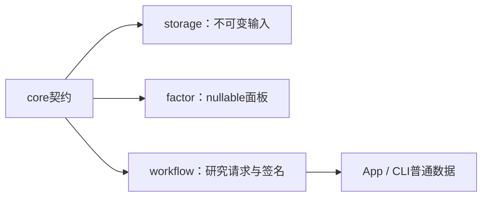

# analytics-core

无DuckDB、Python、Arrow或UI依赖的领域契约：行情行、日期切分、查询分页、模型manifest、
任务上下文、历史股票池、来源映射、因子样本策略及原始公司行动记录。



公共接口包括`MarketRow`、`DateRange`、`PageRequest`、`ModelManifest`、`TrainRequest`、
`TaskContext`，以及`pool`、`schedule`、`research_quality`和`source_map`中的序列化类型。
模型manifest2记录特征顺序、schema hash及公式版本；底层矩阵不能自行声称公式来源。

`market_rules`只保存和校验规则配置，不计算成交费用、不做账户现金预算；费用交给
AKQuant。`execution::CorporateAction`保留采集原始格式与历史价量核验，包含原供应商
登记／到账／上市日期；这些字段不表示新回测模拟了精细结算。自建ShareLedger已删除。
AKQuant研究只接受可映射事件，使用除权除息日语义，详见
[研究worker](../workflow/research/README.md)。原始数据格式不因此自动转换。

缺失值保持Option/null；领域层不隐式填零。日期拆分排序去重且互不重叠；标签截止与
动态成员规则由workflow按日期应用，不用未来缺项倒删历史成员。

```bash
cargo check -p analytics-core
cargo nextest run -p analytics-core
RUSTDOCFLAGS="-D warnings" cargo doc -p analytics-core --no-deps
```

验收覆盖日期、分页、manifest顺序、股票池、来源映射和调度边界。模块目录说明位于
[src/README.md](src/README.md)，规则来源URL随配置快照保留。
