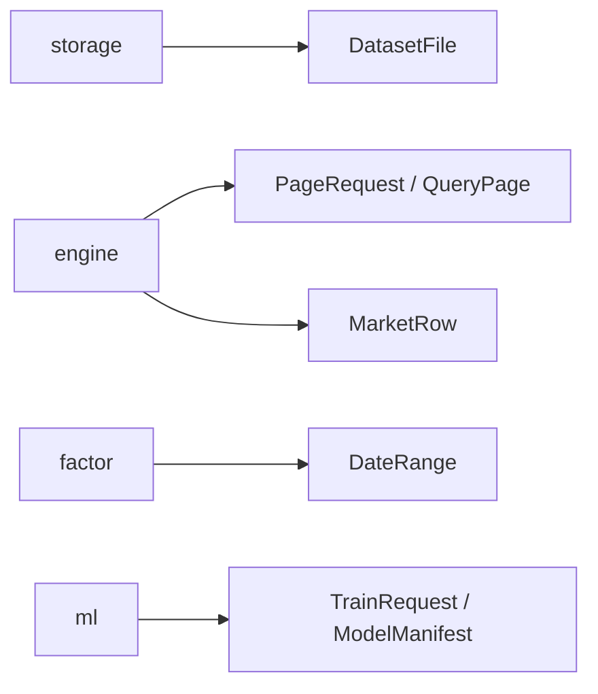

# analytics-core

## 职责

`analytics-core` 是工作区最底层的领域契约，不依赖 DuckDB、egui、Arrow 或 LightGBM。它定义数据行、日期拆分、分页请求、模型 manifest、训练请求和异步任务事件。

## 公共接口

| 类型 | 用途 |
|---|---|
| `MarketRow` | DuckDB as-of join 到因子 executor 的 nullable 行情边界 |
| `DateRange` / `DateSplit` | 日期校验和 70/15/15 时间拆分 |
| `ColumnSchema` / `DatasetFile` | 文件和查询结果 schema |
| `PageRequest` / `QueryPage` / `KeysetCursor` | SQL keyset 分页 |
| `ExportRequest` / `ExportFormat` | SQL 导出 |
| `FeatureSpec` / `ModelManifest` | 特征顺序、schema hash、formula version 的持久化契约 |
| `TrainRequest` / `TrainingArtifact` | 训练输入和产物路径 |
| `TaskEvent` / `Cancellation` | 长任务生命周期与取消 |

`chronological_date_split` 会排序、去重输入日期，要求至少三个不同日期，并返回互不重叠的 train、validation、test 区间。数值字段和 factor 输出保持 `Option`/null，不能在该层隐式填充。

## 数据流



## 构建

```bash
cargo check -p analytics-core
cargo nextest run -p analytics-core
RUSTDOCFLAGS="-D warnings" cargo doc -p analytics-core --no-deps
```

## 验收

```bash
cargo nextest run -p analytics-core
cargo test --doc -p analytics-core
```

验收重点：日期区间有序、拆分不重叠、分页 cursor 必须配 sort、manifest 能保留特征顺序和版本字段。

## 最新A股规则与费用快照

market_rules::MarketRulesPreset、ExchangeFees、BoardRules、BrokerCommission及FeeBreakdown是公共可序列化契约。a_share_latest返回schema_version=1预设，verified_on=2026-10-13；同一快照应用全部回测日期，不模拟历史费率。from_json允许部分账户覆盖但拒绝未知字段、不支持版本、非法数量、非有限/负费率和缺失市场规则；validate、classify、fees、affordable_buy_notional校验均为公共业务规则，不依赖clap。

| 内置常规现金股票费用 | 沪/深 | 北交所 | 收取方向 |
|---|---:|---:|---|
| 经手费 | 0.0000341 | 0.000125 | 双向 |
| 证管费 | 0.00002 | 0.00002 | 双向 |
| 过户费 | 0.00001 | 0.00001 | 双向 |
| 印花税 | 0.0005 | 0.0005 | 仅卖出 |

默认账户佣金为Gross全佣0.00025，每笔最低5元；它是可修改的账户假设，不是统一券商报价。Net另收经手费/证管费，Gross包含两项，AllInclusive还含过户费；FeeBreakdown把内含费用拆开但total不重复计费，成交额为0不触发最低佣金，各分项和总额按人民币分计。默认研究资金100万元由workflow模板设置，不由费用模块隐式创建账户。

常规板块涨跌幅为主板10%、科创/创业20%、北交所30%；最低买入和增量分别为100/100、200/1、100/100、100/1股，最小价位0.01元，买入T+1卖出。特殊上市、重上市、ST和实际限价需真实元数据，不能当作已覆盖的实盘撮合。

快照保留完整来源URL（与研究manifest一致），包括[深交所费用](https://investor.szse.cn/marketServices/deal/payFees/index.html)、[上交所服务](https://one.sse.com.cn/onething/gptz/)、[证监会](https://www.csrc.gov.cn/csrc/c100028/c7426794/content.shtml)、[中国结算](https://www.chinaclear.cn/zdjs/fbzyls/service_tlist.shtml)、[税务公告](https://shanghai.chinatax.gov.cn/zcfw/zcfgk/yhs/202308/t468451.html)及源码中交易规则链接。研究使用费用时冻结完整preset、佣金口径和验证日期；更新默认值不会改写旧manifest。

```json
{"commission":{"rate":0.0002,"minimum_cny":5,"mode":"gross"}}
```

## 不复权账户与公司行动

execution::CorporateAction、ShareLedger、Position、receivable权利及fill返回的FeeBreakdown承载原价、整数股、现金、T+1及跨年账本。公司行动schema中每股现金/红股数量、公告/登记/除权日、实际支付/上市日和来源必需；仅当相应分配数量为0时可不填结算日期。字段缺失和特殊分配解释失败必须拒绝，不能猜日期。登记日收盘确定权益、除权确认应收、实际支付/上市日释放可用现金/股份；登记后卖出旧股仍保有权益，除权日新买入不取得旧权益。

每年度模型换代不重置ShareLedger，不以年度虚拟卖出处理真实股数。买入预算含实际费用，按板块整手及价格规则成交；持仓估值包含未到账权益，不重复确认红利收益。缺失交易价时不成交。股数为整数，不支持不明确的零碎股分配或配股。

## 任务上下文与JSON数值

TaskContext::new/current/install/execute/report/check提供任务ID、取消Arc和进度回调，TaskScope在正常返回和unwind时恢复线程上下文。下载子worker显式继承，原生计算在所属worker内调用；取消以Interrupted错误返回，不跨线程传递DuckDB/LightGBM句柄。

ScalarValue::Float64的JSON使用有限数值或字符串NaN/Infinity/-Infinity保存非有限结果，解码只接受这三个标记。SQL NULL仍为独立Null枚举值；此表示不改变因子null到LightGBM missing的约定。
