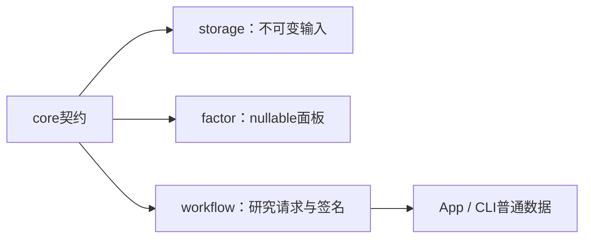
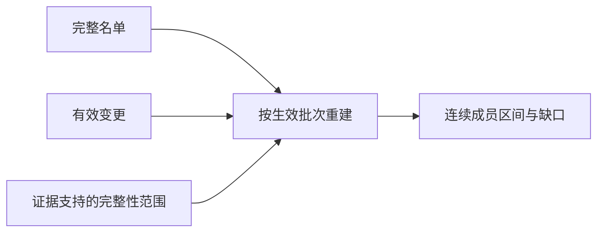

当前采集体系：HiThink（Rust REST主源）、通达信（Python SDK备用）、独立巨潮公告。服务版本见 workflow::service::PROTOCOL_VERSION、采集协议15、来源策略2；接口、价格口径、构建和验收见[采集组件](../storage/collectors/README.md)。

# analytics-core

指数配置允许 `msci` 映射。Core 仅维护纯数据与定位符语法，具体六位代码、币种及价格口径由 Storage 适配器核验。股票代码约束和既有模板保持不变；指数不能获得股票下单身份。

配股新增 `rights::{Fact,Terms,Policy}` 与 `rights_account::Ledger`：未知、确认和有证据的不适用分别序列化；条件退款不当作实际退款。`RightsIssueFacts` 可保存部分资料，旧 `RightsIssue` 仍可读取。资料合法性、参与所需字段及原生引擎支持分别检查。默认放弃认购；主动选择参与时，默认首日一次、现金内部分认购；显式参与和其他资金策略由调用者冻结。

状态机使用十进制数量与资金，登记日最终成交后记录权益；日初扣除订单预占后认购，股份上市前保持不可卖。待上市权益不构成购买力。验收：`cargo test -p analytics-core rights`，包括登记后卖出、缺费用、部分认购、全额或放弃、资金不足停止、截止日和零碎配额。

无DuckDB、Python、Arrow或UI依赖的领域契约：行情行、日期切分、查询分页、模型manifest、
任务上下文、历史股票池、来源映射、因子样本策略及原始公司行动记录。



公共接口包括`MarketRow`、`DateRange`、`PageRequest`、`ModelManifest`、`TrainRequest`、
`TaskContext`，以及`pool`、`schedule`、`research_quality`和`source_map`中的序列化类型。
模型manifest2记录特征顺序、schema hash及公式版本；底层矩阵不能自行声称公式来源。

`market_rules`只保存和校验规则配置，不计算成交费用、不做账户现金预算；费用交给
AKQuant。`execution::CorporateAction`保留采集原始格式与历史价量核验，包含原供应商
登记／到账／上市日期；这些字段不表示新回测模拟了精细结算。自建ShareLedger已删除。
AKQuant研究只接受可映射事件，使用除权除息日语义，详见
[研究worker](../workflow/research/README.md)。原始数据格式不因此自动转换。

缺失值保持Option/null；领域层不隐式填零。日期拆分排序去重且互不重叠；标签截止与
动态成员规则由workflow按日期应用，不用未来缺项倒删历史成员。

```bash
cargo check -p analytics-core
cargo nextest run -p analytics-core
RUSTDOCFLAGS="-D warnings" cargo doc -p analytics-core --no-deps
```

验收覆盖日期、分页、manifest顺序、股票池、来源映射和调度边界。模块目录说明位于
[src/README.md](src/README.md)，规则来源URL随配置快照保留。

## 研究阶段准入（2026-10）

`AdmissionCheck.stage` 标注 `training`、`execution` 或 `account`；历史报告缺省为 training。检查仍使用同一套状态、日期范围、证据和稳定错误码。训练缺失值策略不放宽执行数据要求。执行前的静态检查与实际持仓估值检查分别归属 execution/account；`not_run` 不能解释为已验证。

验收：`cargo test -p analytics-core admission`。

`CorporateAction`的金额与新增股份比例以十进制文本保存，公告/登记/到账/上市日期可为空。
普通历史事件要求可信除权日；`cash()`/`shares()`仅为既有历史参考计算的数值边界，跨源核对使用
采集规则Decimal。`share_multiplier()`精确生成上游拆股倍率，避免二进制浮点合计。
格式5数字只由受支持的历史读取适配接受；格式6强制十进制文本。因子公式、顺序与null行为不变。

来源身份与废弃来源拒绝集中在 `source_map::{removed_source,reject_removed_sources}`：递归检查结构化来源及混合证据，供注册、读取、修订和任务提交共用；拒绝后提示重新采集或配置，保留用户原文件。当前采集来源为HiThink、通达信和独立巨潮公告，受支持Qlib读取保留。

来源拒绝只检查来源标识、来源文件名和URL等出处字段，允许巨潮证券目录中的发行人名称及实施公告引用出现同名上市公司；原始业务数据不能被误判成采集来源。fixture覆盖该边界和混合来源拒绝。

供应商事件策略保留完整结构化历史要求；未解决事件由工作流按实际期初持仓核验后决定收益是否可发布，全类别审计策略保持事前严格核验。

配股在普通调仓前处理既有交收，再执行一次认购，随后更新当天生效的获配、退款与上市状态；同日认购与获配不会延迟到下一交易日。验收：`cargo test -p analytics-core rights`。

依赖升级：账户 Decimal 固定为 1.43.0，与原生 AKQuant 补丁一致；`hash::Hex` 固定小写双位十六进制输出，保留旧 SHA-256 字符串（包括前导零）。验收：`cargo test -p analytics-core`。

## 模型格式3的因子来源

ModelManifest继续读取格式2，并在格式3保留有序factor_refs和factor_definitions数据快照；
避免类型化读取/序列化时丢失自定义修订和算子收据。core不依赖因子执行器，具体版本和AST校验
由factor/workflow执行；格式3训练schema哈希同时绑定特征名称、类型、顺序和固定定义。
验收：`DUCKDB_DOWNLOAD_LIB=1 cargo test -p analytics-workflow custom_factors`及CLI混合因子集成测试。

`Schedule::resolve_for_input_check` 仅缩短预测/回测尾部并保留 requested；原 resolve API 的严格
覆盖规则保留。训练/验证不缩短。AdmissionReport 允许合格样本模式下明确排除证券的 market
缺失检查，但损坏、冲突、执行依赖及未执行检查仍不能被该策略放行。

`Schedule::resolve_for_training` 只要求训练和验证的日历覆盖；未执行的未来测试窗口不影响
独立训练准入。滚动训练沿用既有折选择及历史种子，检查报告只包含实际使用的阶段。

## Company transitions

`corporate_account` supplies a Decimal account journal, embedded in `rights_account::Ledger` so native matching and Rust verification use the same implementation. `Policy::ResearchTransitions` is an explicit simulation choice: terminal raw-close liquidation after fills, same-interest code migration, floor merger conversion and locked successor claims. Reviewed `last_trade_date` is a fact; floor allocation and liquidation are not registrar evidence. Transitions preserve zero-exposure records, reject repeated/out-of-order phases, and commit account changes atomically. Current-date successor quotes alone may mark pending shares; missing quotes carry predecessor value after the disclosed fractional loss.

Run `cargo test -p analytics-core`; acceptance includes final-close settlement, restore/repeat rejection, pre-existing successor positions, fractional loss and missing-current-quote valuation.

登记机构尾数排序／同尾随机分配由 `Allocation::RankedRemainder` 保留事实引用；单账户无法从全体排序推导非整数获配，实际分配接口返回错误。`corporate_account::Policy::ResearchTransitions` 的舍零仍独立执行并披露，不改写登记机构事实。

`Reference::Terminal` 表示原证券终止后不适用后续交易所参考价，仅适用于终止原证券的合并和退市。价格计算显式报错，不伪造不变价格；等待期账户估值继续由公司事件策略处理。

## Common index identities

`indices::{all,find,by_symbol}` exposes catalogue1, verified against linked publishers on
2026-10-17. `src/indices.json` is the shared metadata source:19 representative indices,
15 reviewed domestic SH/SZ price-index locators and4 reference entries awaiting a source
mapping (CSI A50/2000, MSCI A50 Connect RMB and FTSE A50). Official identifiers are kept
separate from exchange symbols, currencies and return variants. MSCI746059 is the CNY
variant; neither ETFs nor other A50 families are aliases. `None` never creates a locator.

Storage uses the same identities for index-only acquisition and identity adjustment;
App and CLI display the same entries offline. Catalogue membership proves no market
coverage, licensing entitlement or historical constituent availability. Current-member
routes are declared per provider; responses still require normal validation.

Acceptance: `cargo test -p analytics-core catalogue_preserves`.

## 运行时指数定义

`indices::IndexConfig` 格式1分开表达编制方身份、稳定 `data_key` 与供应商映射。
自定义数据键使用 `IDX_` 前缀；供应商代码不进入股票代码校验和订单规则。
Core 仅校验结构和内置身份约束，不读文件、不联网；具体接口能力由 Storage 声明。
`calculation_contract()` 排除名称、说明和参考链接，保留身份、币种、收益口径与映射。
SourceMap 明确读取格式1（既有交易所身份）及格式2（指数没有股票执行身份），无格式猜测。
验收：`cargo test -p analytics-core indices`，工作区版本与冻结验收见 workflow。

本次指数接入格式已收敛：AdjustmentRecord 仅接受格式4（`index_input` 必填，普通证券及内置目录指数显式为 null，自定义指数冻结完整合同）；SourceMap 仅接受格式2，指数无可下单证券身份；CollectionRequest 必须显式包含 `index_inputs`（可为空对象）。正常读取不升级旧版本、不猜测缺失字段。旧快照只作历史留存，显式离线转换后必须以新内容哈希重新登记，原始响应及采集器身份不得改写成当前版本。服务协议38、采集协议15拒绝旧检查点；格式更新不等于来源准入通过。

## 历史指数成员重建

`membership_history` 提供格式2的完整名单、原子变更批次、区间完整性审核及报告，规则版本`membership-history-2`。仅向前重建；更正链显式指定；重复事件幂等。`unspecified`边界不能推断。使用既有A股交易日历，可知时间按北京时间09:30开盘核验。事实覆盖与当时可知分别报告。

`PoolExpression::History { version }`引用不可变历史，继续输出`PoolMembership`。普通手工增删不代表证据审核。Core不读文件或联网。



同一事件修订出现矛盾生效日期时，保留所有冲突边界，从最早受影响交易日起阻断；反向导入得到相同结果，不能用后写记录裁决。

验收：`cargo test -p analytics-core history_`。


## 历史成员补证合同 v2

`membership_history` 保持纯逻辑：`resolve_revisions`先按稳定ID及显式替代链选择当前名单/事件，再由`reconstruct`检查批次、快照、类别覆盖和事前可知时间。请求内History、Report为格式2，规则`membership-history-2`；不接受格式1。旧修订缺项进入`trace`，同修订冲突、断链及循环仍阻断对应链。更正使用当前修订自己的`known_at`，不继承旧时间。

`SecurityEvidence`逐证券关联名单名称与代码证明；`Citation.transcription`区分原文和人工图片核对。Core不读取文件或把人工声明当作文件核验。`ReviewOutcome`区分区间完整性、该次有变化、该次明确无变化及尚未核实；单次审议最多覆盖对应开盘日的Review类别，不覆盖临时事件。报告的`subject`、`range`、`categories`、`evidence`及`next_action`共同构成补证清单；诊断数量不等于缺失交易日。

冻结日历必须覆盖锚点及中间交易日，不能把推出前锚点直接映射成缺少中间历史的日历首日。

验收：`cargo test -p analytics-core membership_history --lib`，包括更正旧缺项、晚公布更正、循环链、单次无变化越界与范围外事件。
