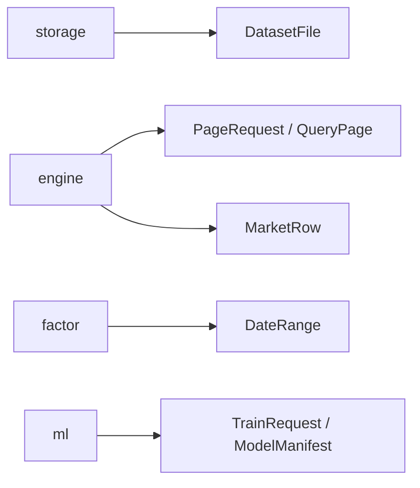
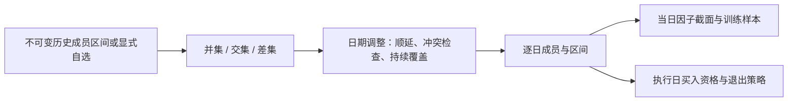
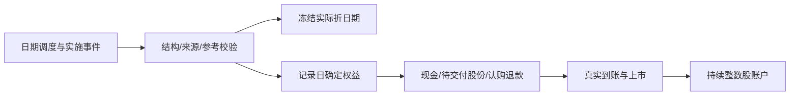
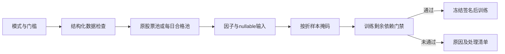

# analytics-core

目录导航：[全部组件](../README.md) · [src：普通数据、费用、股份权益与任务上下文](src/README.md)

## 职责

`analytics-core` 是工作区最底层的领域契约，不依赖 DuckDB、egui、Arrow 或 LightGBM。它定义数据行、日期拆分、分页请求、模型 manifest、训练请求和异步任务事件。

## 公共接口

| 类型 | 用途 |
|---|---|
| `MarketRow` | DuckDB as-of join 到因子 executor 的 nullable 行情边界 |
| `DateRange` / `DateSplit` | 日期校验和 70/15/15 时间拆分 |
| `ColumnSchema` / `DatasetFile` | 文件和查询结果 schema |
| `PageRequest` / `QueryPage` / `KeysetCursor` | SQL keyset 分页 |
| `ExportRequest` / `ExportFormat` | SQL 导出 |
| `FeatureSpec` / `ModelManifest` | 特征顺序、schema hash、formula version 的持久化契约 |
| `TrainRequest` / `TrainingArtifact` | 训练输入和产物路径 |
| `TaskEvent` / `Cancellation` | 长任务生命周期与取消 |

`chronological_date_split` 会排序、去重输入日期，要求至少三个不同日期，并返回互不重叠的 train、validation、test 区间。数值字段和 factor 输出保持 `Option`/null，不能在该层隐式填充。

## 数据流



## 构建

```bash
cargo check -p analytics-core
cargo nextest run -p analytics-core
RUSTDOCFLAGS="-D warnings" cargo doc -p analytics-core --no-deps
```

## 验收

```bash
cargo nextest run -p analytics-core
cargo test --doc -p analytics-core
```

验收重点：日期区间有序、拆分不重叠、分页 cursor 必须配 sort、manifest 能保留特征顺序和版本字段。

## 最新A股规则与费用快照

market_rules::MarketRulesPreset、ExchangeFees、BoardRules、BrokerCommission及FeeBreakdown是公共可序列化契约。a_share_latest返回schema_version=1预设，verified_on=2026-10-13；同一快照应用全部回测日期，不模拟历史费率。from_json允许部分账户覆盖但拒绝未知字段、不支持版本、非法数量、非有限/负费率和缺失市场规则；validate、classify、fees、affordable_buy_notional校验均为公共业务规则，不依赖clap。

| 内置常规现金股票费用 | 沪/深 | 北交所 | 收取方向 |
|---|---:|---:|---|
| 经手费 | 0.0000341 | 0.000125 | 双向 |
| 证管费 | 0.00002 | 0.00002 | 双向 |
| 过户费 | 0.00001 | 0.00001 | 双向 |
| 印花税 | 0.0005 | 0.0005 | 仅卖出 |

默认账户佣金为Gross全佣0.00025，每笔最低5元；它是可修改的账户假设，不是统一券商报价。Net另收经手费/证管费，Gross包含两项，AllInclusive还含过户费；FeeBreakdown把内含费用拆开但total不重复计费，成交额为0不触发最低佣金，各分项和总额按人民币分计。默认研究资金100万元由workflow模板设置，不由费用模块隐式创建账户。

常规板块涨跌幅为主板10%、科创/创业20%、北交所30%；最低买入和增量分别为100/100、200/1、100/100、100/1股，最小价位0.01元，买入T+1卖出。特殊上市、重上市、ST和实际限价需真实元数据，不能当作已覆盖的实盘撮合。

快照保留完整来源URL（与研究manifest一致），包括[深交所费用](https://investor.szse.cn/marketServices/deal/payFees/index.html)、[上交所服务](https://one.sse.com.cn/onething/gptz/)、[证监会](https://www.csrc.gov.cn/csrc/c100028/c7426794/content.shtml)、[中国结算](https://www.chinaclear.cn/zdjs/fbzyls/service_tlist.shtml)、[税务公告](https://shanghai.chinatax.gov.cn/zcfw/zcfgk/yhs/202308/t468451.html)及源码中交易规则链接。研究使用费用时冻结完整preset、佣金口径和验证日期；更新默认值不会改写旧manifest。

```json
{"commission":{"rate":0.0002,"minimum_cny":5,"mode":"gross"}}
```

## 不复权账户与公司行动

execution::CorporateAction、ShareLedger、Position、receivable权利及fill返回的FeeBreakdown承载原价、整数股、现金、T+1及跨年账本。公司行动schema中每股现金/红股数量、公告/登记/除权日、实际支付/上市日和来源必需；仅当相应分配数量为0时可不填结算日期。字段缺失和特殊分配解释失败必须拒绝，不能猜日期。登记日收盘确定权益、除权确认应收、实际支付/上市日释放可用现金/股份；登记后卖出旧股仍保有权益，除权日新买入不取得旧权益。

每年度模型换代不重置ShareLedger，不以年度虚拟卖出处理真实股数。买入预算含实际费用，按板块整手及价格规则成交；持仓估值包含未到账权益，不重复确认红利收益。缺失交易价时不成交。股数为整数；零碎股分配和配股须有实施证据及完整执行条款，缺项时拒绝。

## 任务上下文与JSON数值

TaskContext::new/current/install/execute/report/check提供任务ID、取消Arc和进度回调，TaskScope在正常返回和unwind时恢复线程上下文。下载子worker显式继承，原生计算在所属worker内调用；取消以Interrupted错误返回，不跨线程传递DuckDB/LightGBM句柄。

ScalarValue::Float64的JSON使用有限数值或字符串NaN/Infinity/-Infinity保存非有限结果，解码只接受这三个标记。SQL NULL仍为独立Null枚举值；此表示不改变因子null到LightGBM missing的约定。

## 日期生效股票池




`NextTradableDay` 默认在下一可交易日退出；`NextRebalance` 在下一正常调仓时启动退出，之后持续重试。纯类型和运算由 `cargo nextest run -p analytics-core` 验收；执行限制、权益和费用测试位于 ML 组件。

股票池求值只声明已经实际计算的交易日覆盖区间；定义中的未来增删可以保存，不能扩张当前数据覆盖，也不能改变过去成员。

## 历史调整与执行权益

CorporateAction::validate_adjustment_terms核验证券、公告/登记/除权日及每股金额/送转比例，用于历史价量。validate复用前者并要求实际支付/上市日期，用于账户权益。历史输入不创造过去账户，也不补猜结算日期；撮合仍使用原价、真实整数股及T+1。

## 任意日期与全类公司行动

`schedule::Schedule`只有single、rolling、manual三种当前模式；Fold包含任意train、可选validation和test日期。resolve根据所选日历生成requested/actual日期、756日预热范围；固定/扩展训练、日/月/年/交易日步长均从首折原始日期计算，保持月末语义。拒绝重叠、未来训练、空窗口和显式覆盖越界。

`actions::EventTerms`区分普通分派、差异化分派、配股、缩股/股权分置/重整/换股/代码变更和退市。实际权益与Reference除权参数分离，特殊金额保存十进制原文；Historical只支持历史调整核验，进入账户区间必须补齐可执行条款。ShareLedger按登记、缴款、退款、到账与上市推进；配股默认可用现金比例分配、事件ID分配余量，不借款。零碎股需Exact或有证据的Floor/CashInLieu规则；未上市继承权益与退市债权必须有报价或覆盖有效日期的估值。不主动行使现金选择权。



开发验收：`cargo nextest run -p analytics-core`覆盖月末/闰年/窗口、配股分配、换股延迟、差异化现金、非股东重整、零碎股及退市清偿。

## 为什么需要本组件

表达研究约束而非供应商接口。证券来源映射、成员日期、事件权益和账户规则必须在联网、GUI和模型之外独立验证。同一个600018先后对应不同证券，必须在快照中明确例外区间；例外来源映射保证旧证券行情不会混接，实际承继只通过公司行动执行。

设计依据：2026-10-14接受的当前组件职责、可复现实验与用户研究需求、组件接口及测试。未在代码或证据中确认的历史取舍不推定为既有设计理由；来源、法规或数据格式变化时重新评估。


## 三级研究模式：为什么允许筛选

决定日期2026-10-14，依据是用户接受的三级模式计划。正常预热空值、来源缺失和错误数据是不同问题：全部拒绝会浪费可用样本，全部放行又会混淆因子和真实权益。默认严格检查；另外提供“允许部分数据缺失”和“只用数据合格的股票”。模式是研究输入的一部分，不能作为训练失败后自动切换的兜底。

第二档保持原成员，纯缺失传播null；第三档派生每日合格成员，不改原始成员或证据。不能看到后来缺价而倒删早期股票。账户仍采用原价、整数股、T+1和连续权益；未裁定冲突、损坏、基准缺项及剩余必要依赖仍阻断。默认有效因子比例0表示至少一项有效，最低有标签样本1只表示可执行，不表示样本在统计上充分。所选因子整列无有效值不会被自动删除。

公共类型在[research_quality.rs](src/research_quality.rs)：ResearchStrictness、ResearchQualityPolicy、ProblemKind、ProblemDisposition及QualityDecision。策略校验与筛选门槛在core，clap类型留在CLI。AdmissionReport格式4保留passed/failed/not_run，另外记录处理方式；只有纯缺失的keep_null可在第二档非阻断，损坏和未执行不能改写为通过。枚举提供中文label/description供App统一显示。验收：`cargo nextest run -p analytics-core`。



## 2026-10-14：直接代码读取与分阶段研究

为什么调整：普通市场代码无需先登记身份；独立目录、审核和权威名录下载增加了研究前置负担。特殊历史代码仍需在快照内明确区间，不能将旧证券行情或权益接到另一证券。训练使用价量和标签，到账／交付资料只在实际账户执行时检查。

当前格式：模板6、需求3、准入4、股票池3、公司行动4、规范行情5、系数3、采集6、服务9、研究结果11；快照内来源映射1、训练产物1。工作区和任务记录1、GTJA191公式v4及默认178项顺序保持。旧格式明确拒绝，不自动转换。


验收：nextest覆盖来源日期边界、三档掩码、训练／回测分离及模型保留；Clippy、Rustdoc、格式、组件文档和包内CLI共同检查。生成数据、模型、运行记录和安装包不提交。另一台Apple Silicon/macOS14实机验收继续待完成。

`PoolMembership`格式3直接保存SH/SZ/BJ数据代码及特殊历史键。来源例外由[source_map.rs](src/source_map.rs)限定日期，代码冲突只影响所需日期；不创建独立身份目录或审核任务。
