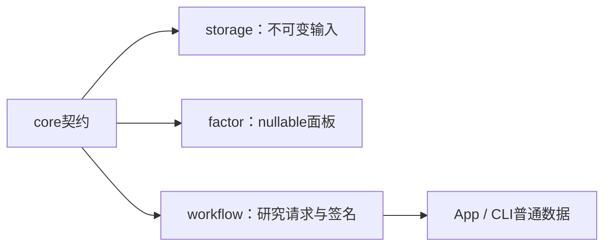

当前采集体系：HiThink（Rust REST主源）、通达信（Python SDK备用）、独立巨潮公告。服务协议21、采集协议13、来源策略2；接口、价格口径、构建和验收见[采集组件](../storage/collectors/README.md)。

# analytics-core

配股新增 `rights::{Fact,Terms,Policy}` 与 `rights_account::Ledger`：未知、确认和有证据的不适用分别序列化；条件退款不当作实际退款。`RightsIssueFacts` 可保存部分资料，旧 `RightsIssue` 仍可读取。资料合法性、参与所需字段及原生引擎支持分别检查。默认放弃认购；主动选择参与时，默认首日一次、现金内部分认购；显式参与和其他资金策略由调用者冻结。

状态机使用十进制数量与资金，登记日最终成交后记录权益；日初扣除订单预占后认购，股份上市前保持不可卖。待上市权益不构成购买力。验收：`cargo test -p analytics-core rights`，包括登记后卖出、缺费用、部分认购、全额或放弃、资金不足停止、截止日和零碎配额。

无DuckDB、Python、Arrow或UI依赖的领域契约：行情行、日期切分、查询分页、模型manifest、
任务上下文、历史股票池、来源映射、因子样本策略及原始公司行动记录。



公共接口包括`MarketRow`、`DateRange`、`PageRequest`、`ModelManifest`、`TrainRequest`、
`TaskContext`，以及`pool`、`schedule`、`research_quality`和`source_map`中的序列化类型。
模型manifest2记录特征顺序、schema hash及公式版本；底层矩阵不能自行声称公式来源。

`market_rules`只保存和校验规则配置，不计算成交费用、不做账户现金预算；费用交给
AKQuant。`execution::CorporateAction`保留采集原始格式与历史价量核验，包含原供应商
登记／到账／上市日期；这些字段不表示新回测模拟了精细结算。自建ShareLedger已删除。
AKQuant研究只接受可映射事件，使用除权除息日语义，详见
[研究worker](../workflow/research/README.md)。原始数据格式不因此自动转换。

缺失值保持Option/null；领域层不隐式填零。日期拆分排序去重且互不重叠；标签截止与
动态成员规则由workflow按日期应用，不用未来缺项倒删历史成员。

```bash
cargo check -p analytics-core
cargo nextest run -p analytics-core
RUSTDOCFLAGS="-D warnings" cargo doc -p analytics-core --no-deps
```

验收覆盖日期、分页、manifest顺序、股票池、来源映射和调度边界。模块目录说明位于
[src/README.md](src/README.md)，规则来源URL随配置快照保留。

## 研究阶段准入（2026-10）

`AdmissionCheck.stage` 标注 `training`、`execution` 或 `account`；历史报告缺省为 training。检查仍使用同一套状态、日期范围、证据和稳定错误码。训练缺失值策略不放宽执行数据要求。执行前的静态检查与实际持仓估值检查分别归属 execution/account；`not_run` 不能解释为已验证。

验收：`cargo test -p analytics-core admission`。

`CorporateAction`的金额与新增股份比例以十进制文本保存，公告/登记/到账/上市日期可为空。
普通历史事件要求可信除权日；`cash()`/`shares()`仅为既有历史参考计算的数值边界，跨源核对使用
采集规则Decimal。`share_multiplier()`精确生成上游拆股倍率，避免二进制浮点合计。
格式5数字只由受支持的历史读取适配接受；格式6强制十进制文本。因子公式、顺序与null行为不变。

来源身份与废弃来源拒绝集中在 `source_map::{removed_source,reject_removed_sources}`：递归检查结构化来源及混合证据，供注册、读取、修订和任务提交共用；拒绝后提示重新采集或配置，保留用户原文件。当前采集来源为HiThink、通达信和独立巨潮公告，受支持Qlib读取保留。

来源拒绝只检查来源标识、来源文件名和URL等出处字段，允许巨潮证券目录中的发行人名称及实施公告引用出现同名上市公司；原始业务数据不能被误判成采集来源。fixture覆盖该边界和混合来源拒绝。

供应商事件策略保留完整结构化历史要求；未解决事件由工作流按实际期初持仓核验后决定收益是否可发布，全类别审计策略保持事前严格核验。

配股在普通调仓前处理既有交收，再执行一次认购，随后更新当天生效的获配、退款与上市状态；同日认购与获配不会延迟到下一交易日。验收：`cargo test -p analytics-core rights`。
