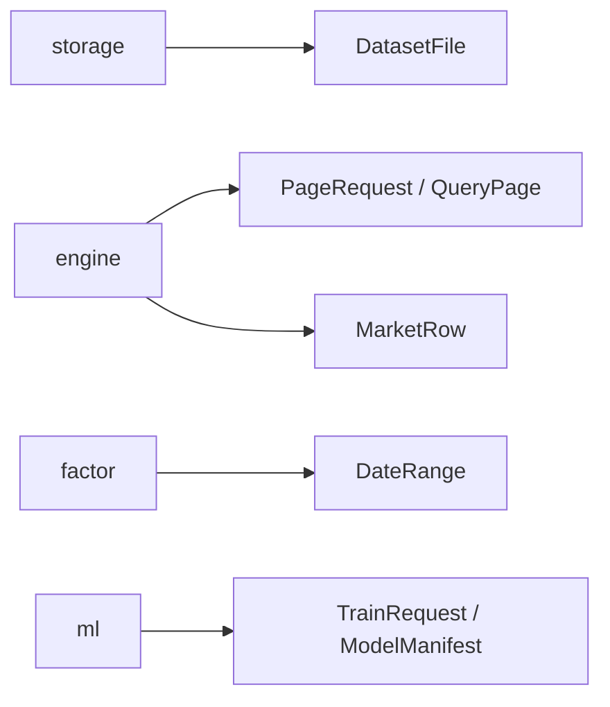

# analytics-core

## 职责

`analytics-core` 是工作区最底层的领域契约，不依赖 DuckDB、egui、Arrow 或 LightGBM。它定义数据行、日期拆分、分页请求、模型 manifest、训练请求和异步任务事件。

## 公共接口

| 类型 | 用途 |
|---|---|
| `MarketRow` | DuckDB as-of join 到因子 executor 的 nullable 行情边界 |
| `DateRange` / `DateSplit` | 日期校验和 70/15/15 时间拆分 |
| `ColumnSchema` / `DatasetFile` | 文件和查询结果 schema |
| `PageRequest` / `QueryPage` / `KeysetCursor` | SQL keyset 分页 |
| `ExportRequest` / `ExportFormat` | SQL 导出 |
| `FeatureSpec` / `ModelManifest` | 特征顺序、schema hash、formula version 的持久化契约 |
| `TrainRequest` / `TrainingArtifact` | 训练输入和产物路径 |
| `TaskEvent` / `Cancellation` | 长任务生命周期与取消 |

`chronological_date_split` 会排序、去重输入日期，要求至少三个不同日期，并返回互不重叠的 train、validation、test 区间。数值字段和 factor 输出保持 `Option`/null，不能在该层隐式填充。

## 数据流



## 构建

```bash
cargo check -p analytics-core
cargo test -p analytics-core
RUSTDOCFLAGS="-D warnings" cargo doc -p analytics-core --no-deps
```

## 验收

```bash
cargo test -p analytics-core
cargo test --doc -p analytics-core
```

验收重点：日期区间有序、拆分不重叠、分页 cursor 必须配 sort、manifest 能保留特征顺序和版本字段。
