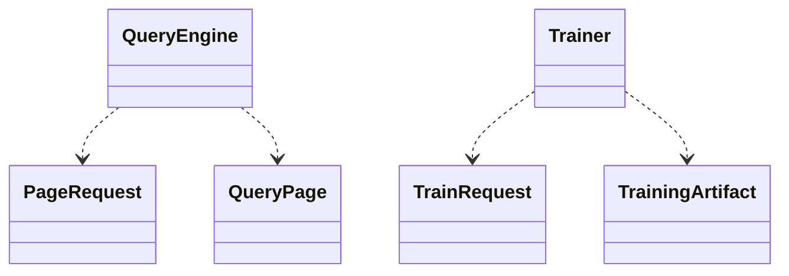

# core

Shared domain types and contracts. This crate intentionally has no DuckDB, egui, or LightGBM dependency.

`MarketRow` is the normalized DuckDB-to-factor boundary and preserves nullable market fields. `chronological_date_split` creates disjoint train/validation/test `DateRange` values using the 70/15/15 trading-date policy.

