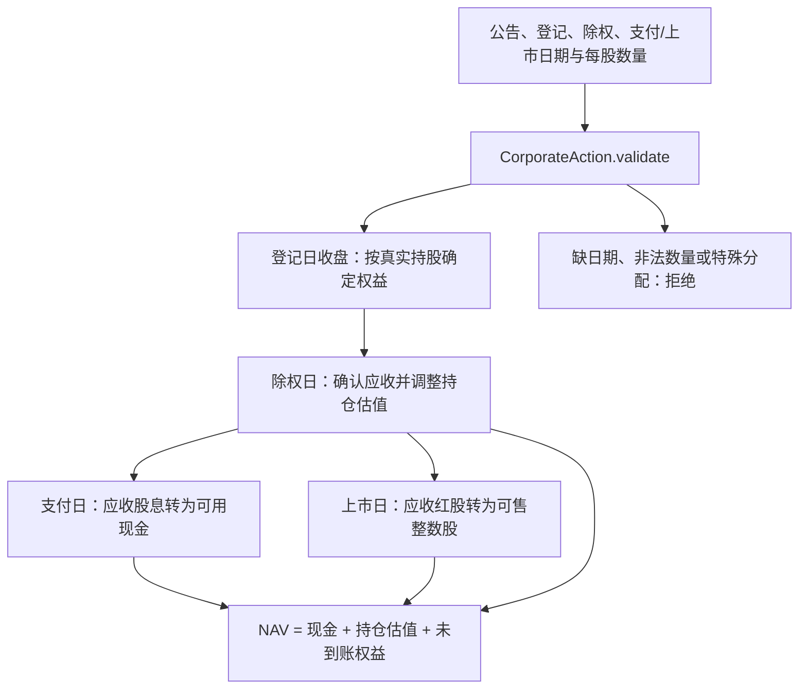
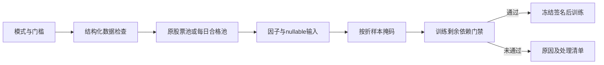

# Core 源码：普通数据、任务上下文与股份权益

[上级：analytics-core](../README.md) · [全年账户调用方](../../ml/src/backtest/README.md)

本目录是所有组件共享的最底层 Rust 契约。它不依赖原生库、数据库或界面；输入字段、日期、费用和权益校验都在这里保持可测试的纯数据边界。

## 文件与公共接口

| 文件 | 主要契约 |
|---|---|
| [lib.rs](lib.rs) | nullable `MarketRow`、日期拆分、查询/导出请求、`ScalarValue`、有序特征、manifest、训练请求/产物 |
| [market_rules.rs](market_rules.rs) | `MarketRulesPreset`、账户佣金、公费、板块数量规则、`FeeBreakdown`；最新费率统一用于全区间 |
| [source_map.rs](source_map.rs) | 快照内少量例外定位与日期冲突校验；普通市场代码直接作为数据键 |
| [execution.rs](execution.rs) | `CorporateAction::validate`、`ShareLedger::begin_day/end_day/fill/nav`；现金、整数股、T+1、应收权益 |
| [task.rs](task.rs) | `TaskContext` 和作用域安装/恢复；任务 ID、取消标记、进度回调 |
| [scalar_float.rs](scalar_float.rs) | Float64 JSON 中有限数值及 NaN/Infinity/-Infinity 标记；SQL Null 保持独立 |

## 公司行动为何不直接变成现金



登记后出售旧股不丢失已有权益，除权后新买入不取得旧权益。`begin_day` 推进到账和可售状态，`end_day` 登记当日持仓；`fill` 根据买卖方向、板块整手、可用资金和费用调整账本。账户跨年持续，不用虚拟年末卖出估算费用。

`TaskContext::execute` 安装当前线程上下文，返回或 unwind 后恢复。取消检查返回可识别的中断错误；子线程必须显式继承上下文。上下文仅携带普通数据/回调，不携带 DuckDB/LightGBM 句柄。

## 变更规则与验收

从仓库根目录执行，不需要原生库：

```bash
cargo nextest run -p analytics-core
cargo clippy -p analytics-core --all-targets -- -D warnings
RUSTDOCFLAGS="-D warnings" cargo doc -p analytics-core --no-deps
```

新增字段应定义序列化、缺省和错误行为，并同步调用方 manifest/模板文档。费用回归检查内含公费不重复相加、每笔最低费、零成交不收费和分价位四舍五入；权益回归检查延迟结算、登记后卖出、T+1、整数股及错误不部分改账。保持特征顺序、schema hash 和公式版本可保存，缺失值不得在领域层隐式填零。

## 日期生效股票池


`NextTradableDay` 默认在下一可交易日退出；`NextRebalance` 在下一正常调仓时启动退出，之后持续重试。纯类型和运算由 `cargo nextest run -p analytics-core` 验收；执行限制、权益和费用测试位于 ML 组件。

`PoolDefinition::evaluate` 返回所选日历内的实际首末交易日，不把定义中的更早或未来日期视为已验证覆盖。未来调整在新增交易日出现后生效，过去成员保持不变。

CorporateAction::validate_adjustment_terms与validate分别校验历史调整条款和执行权益。后者复用前者并强制到账/上市日期，历史数学输入不放宽真实账户限制。

## 日期与事件接口

[schedule.rs](schedule.rs)定义Schedule/Fold/ResolvedFold，解析日期而不训练；[actions.rs](actions.rs)定义十进制条款、Reference、Allocation、HistoricalKind和ActionPolicy。[execution.rs](execution.rs)维护普通与特殊权益、不可交易旧证券、当日实际认购费用。begin_day先结算到期现金再认购，end_day只捕获登记日权益；失败操作保留原账本。新事件类别测试与账本测试在对应模块旁，`cargo nextest run -p analytics-core`执行。

## 为什么需要本组件


设计依据：2026-10-14接受的当前组件职责、可复现实验与用户研究需求、组件接口及测试。未在代码或证据中确认的历史取舍不推定为既有设计理由；来源、法规或数据格式变化时重新评估。


## 三级研究模式：为什么允许筛选

决定日期2026-10-14，依据是用户接受的三级模式计划。正常预热空值、来源缺失和错误数据是不同问题：全部拒绝会浪费可用样本，全部放行又会混淆因子和真实权益。默认严格检查；另外提供“允许部分数据缺失”和“只用数据合格的股票”。模式是研究输入的一部分，不能作为训练失败后自动切换的兜底。

第二档保持原成员，纯缺失传播null；第三档派生每日合格成员，不改原始成员或证据。不能看到后来缺价而倒删早期股票。账户仍采用原价、整数股、T+1和连续权益；未裁定冲突、损坏、基准缺项及剩余必要依赖仍阻断。默认有效因子比例0表示至少一项有效，最低有标签样本1只表示可执行，不表示样本在统计上充分。所选因子整列无有效值不会被自动删除。

[research_quality.rs](research_quality.rs)负责三档、阈值和结构化处理；[admission.rs](admission.rs)负责事实状态与最终门禁。缺失、冲突、损坏、执行依赖有不同枚举，业务不能从错误文本猜分类。当前准入格式5冻结实际策略和逐日期处理记录；公式版本不属于准入格式版本。



## 2026-10-14：直接代码读取与分阶段研究

为什么调整：普通市场代码无需先登记身份；独立目录、审核和权威名录下载增加了研究前置负担。特殊历史代码仍需在快照内明确区间，不能将旧证券行情或权益接到另一证券。训练使用价量和标签，到账／交付资料只在实际账户执行时检查。

当前格式：模板8、需求3、准入5、股票池3、公司行动4、规范行情5、系数3、采集7、服务10、研究结果12；快照内来源映射1、训练产物2。工作区和任务记录1、GTJA191公式v4及默认178项顺序保持。旧格式明确拒绝，不自动转换。


验收：nextest覆盖来源日期边界、三档掩码、训练／回测分离及模型保留；Clippy、Rustdoc、格式、组件文档和包内CLI共同检查。生成数据、模型、运行记录和安装包不提交。另一台Apple Silicon/macOS14实机验收继续待完成。

## 来源映射的边界

`SourceMap`不是必填证券名录，缺文件等价于空exceptions。只有特殊历史别名、代码变更或复用才登记`exchange_symbol`、`kind`、`coverage`和provider/symbol/coverage/evidence。SH600018普通路径不读取SHT00018文件；SHT00018没有旧文件时保持缺失。exchange定位解析对应日期费用，qlib定位读取原文件，非重叠旧新期间不得自动延长。跨数据键同日复用一个供应商定位会拒绝。

## 来源与因子组合契约

research_quality.rs新增PriceBasis、FactorSet、Warn；schedule.rs按组合传入预热。admission.rs只放行明确允许的历史对账告警和未执行账户提示，不将任意失败视为通过。 完整接口、why、边界和验收见[组件契约](../README.md)。
