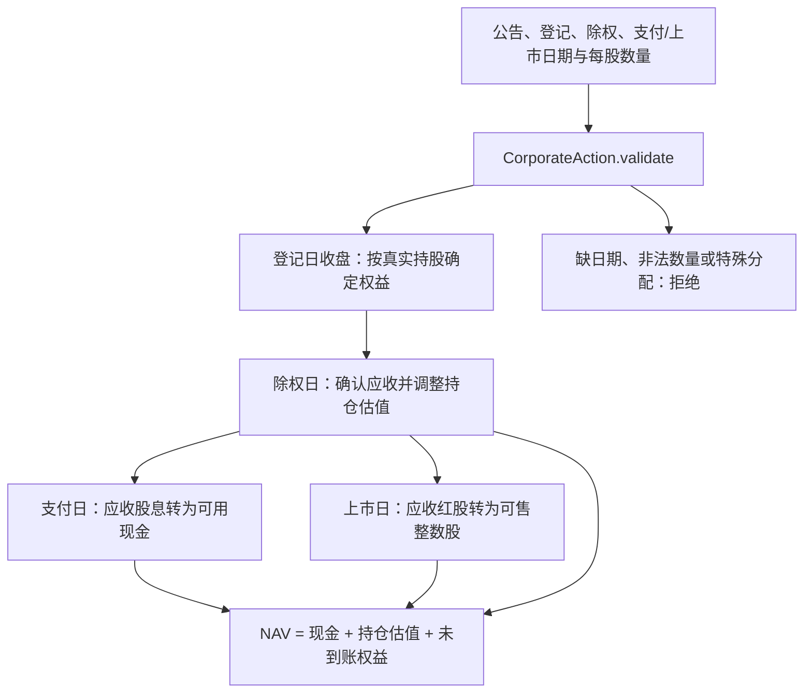

# Core 源码：普通数据、任务上下文与股份权益

[上级：analytics-core](../README.md) · [全年账户调用方](../../ml/src/backtest/README.md)

本目录是所有组件共享的最底层 Rust 契约。它不依赖原生库、数据库或界面；输入字段、日期、费用和权益校验都在这里保持可测试的纯数据边界。

## 文件与公共接口

| 文件 | 主要契约 |
|---|---|
| [lib.rs](lib.rs) | nullable `MarketRow`、日期拆分、查询/导出请求、`ScalarValue`、有序特征、manifest、训练请求/产物 |
| [market_rules.rs](market_rules.rs) | `MarketRulesPreset`、账户佣金、公费、板块数量规则、`FeeBreakdown`；最新费率统一用于全区间 |
| [execution.rs](execution.rs) | `CorporateAction::validate`、`ShareLedger::begin_day/end_day/fill/nav`；现金、整数股、T+1、应收权益 |
| [task.rs](task.rs) | `TaskContext` 和作用域安装/恢复；任务 ID、取消标记、进度回调 |
| [scalar_float.rs](scalar_float.rs) | Float64 JSON 中有限数值及 NaN/Infinity/-Infinity 标记；SQL Null 保持独立 |

## 公司行动为何不直接变成现金



登记后出售旧股不丢失已有权益，除权后新买入不取得旧权益。`begin_day` 推进到账和可售状态，`end_day` 登记当日持仓；`fill` 根据买卖方向、板块整手、可用资金和费用调整账本。账户跨年持续，不用虚拟年末卖出估算费用。

`TaskContext::execute` 安装当前线程上下文，返回或 unwind 后恢复。取消检查返回可识别的中断错误；子线程必须显式继承上下文。上下文仅携带普通数据/回调，不携带 DuckDB/LightGBM 句柄。

## 变更规则与验收

从仓库根目录执行，不需要原生库：

```bash
cargo nextest run -p analytics-core
cargo clippy -p analytics-core --all-targets -- -D warnings
RUSTDOCFLAGS="-D warnings" cargo doc -p analytics-core --no-deps
```

新增字段应定义序列化、缺省和错误行为，并同步调用方 manifest/模板文档。费用回归检查内含公费不重复相加、每笔最低费、零成交不收费和分价位四舍五入；权益回归检查延迟结算、登记后卖出、T+1、整数股及错误不部分改账。保持特征顺序、schema hash 和公式版本可保存，缺失值不得在领域层隐式填零。
