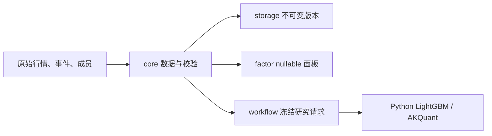

# Core 源码：领域数据与任务契约

[上级：analytics-core](../README.md) · [研究执行](../../workflow/src/research/README.md)

本目录仅保存纯 Rust 数据和校验，不创建数据库、Python、模型或账户句柄。

| 模块 | 公共接口与职责 |
|---|---|
| lib.rs | nullable MarketRow、查询分页、ModelManifest 2、有序特征与训练请求 |
| market_rules.rs | 账户费用与板块配置的序列化和校验；不计算实际费用 |
| execution.rs | EventCheckPolicy、CorporateAction 原始记录及历史价量参考校验 |
| actions.rs | 精确条款、来源证据与原始事件格式；不执行权益分配 |
| schedule.rs | 日期窗口、折及实际交易日解析 |
| pool.rs | 不可变历史成员区间、集合组合与日期调整 |
| research_quality.rs | 特征族、价格口径及样本策略 |
| task.rs | TaskContext 取消、进度、作用域安装与 unwind 恢复 |
| source_map.rs | 数据来源例外定位和日期冲突校验 |



ShareLedger、账户资金预算及自建费用执行已删除。原始事件仍保留登记、到账及上市日期，
以及历史数据格式的严格校验；AKQuant 适配器采用除权除息日分红与拆股语义，
不调用旧到账日校验模拟账户。已知无法表达的事件在回测前阻断。

股票池按交易日应用，未来数据不倒改过去成员。缺失值保持 Option/null，不能隐式填零。
特征顺序、schema hash 与公式版本必须可保存。TaskContext 不携带后端对象，
子线程显式继承上下文，返回或 unwind 后恢复原上下文。

从仓库根目录验收：

```bash
cargo test -p analytics-core
cargo clippy -p analytics-core --all-targets -- -D warnings
RUSTDOCFLAGS="-D warnings" cargo doc -p analytics-core --no-deps
```

测试覆盖日期、分页、manifest、股票池、来源映射、原始条款和取消边界。
实际成交、费用与连续账户行为在 workflow/research 组件验收。

ModelManifest新增可选数据快照factor_refs/factor_definitions以保留格式3来源信息；旧格式2缺省为空，
不补造定义。具体AST和算子收据由workflow调用factor验证，保持core无执行器依赖。
