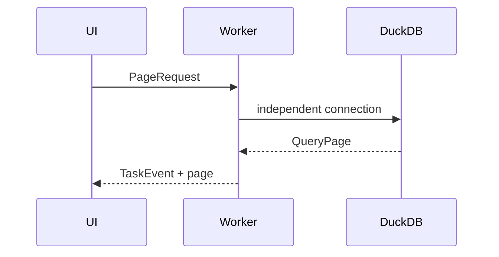

# engine

`QueryEngine` isolates the UI from DuckDB. Enable `duckdb-native` for a system library, or `duckdb-bundled` for a source build with the Parquet, JSON and ICU extensions.

The native backend also exposes a worker-local market loader. It joins historical universe membership as-of each market date, validates the date range, and returns normalized `MarketRow` values for factor execution. `query_page` applies stable sort keys and keyset cursor predicates instead of generating `OFFSET` pagination.

The crates.io `duckdb` package's bundled build requires a DuckDB source checkout for this version. Set up that checkout before using `duckdb-bundled`; the default workspace build keeps the backend feature-gated.

For a local native build without a system DuckDB library, `DUCKDB_DOWNLOAD_LIB=1` lets `libduckdb-sys` download the matching prebuilt library during development.

