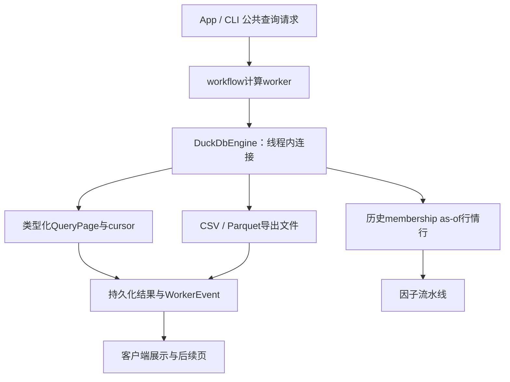

# analytics-engine

目录导航：[全部组件](../README.md) · [src：DuckDB查询、快照、分页与导出](src/README.md)

## 职责

analytics-engine 将 DuckDB 隔离在 QueryEngine trait 后，提供 SQL 描述、keyset 分页、Parquet/CSV 导出，以及市场行情与历史股票池的 as-of join。所有连接和 DuckDB statement 都在 worker 线程内创建和使用。

## 公共接口

| 接口 | 行为 |
|---|---|
| QueryEngine::list_parquet | 枚举 Parquet 文件 |
| QueryEngine::describe | 用 SELECT * FROM (<sql>) LIMIT 0 推断结果 schema |
| QueryEngine::query_page | limit+1 取数；按 sort 生成稳定 lexicographic cursor predicate，不使用 OFFSET |
| QueryEngine::export | DuckDB COPY 写 Parquet 或 CSV |
| DuckDbEngine::load_market_rows | 按市场日对股票池 membership 做 as-of join，保留 nullable 数值 |
| DuckDbEngine::replace_query_snapshot | 在当前连接创建临时结果表，替换旧快照并返回可分页 SELECT；原查询表达式只计算一次 |
| DuckDbEngine::clear_query_snapshot | 在所属 worker 线程删除当前临时结果表 |

describe 会执行 LIMIT 0 查询以初始化 DuckDB 的结果元数据，不读取数据行。query_page 保留 NULL、布尔、整数、浮点、日期和文本类型，避免数值转换成空字符串；超过 int64 范围的 uint64 返回错误，其他扩展类型用调试文本展示。导出只转义目标路径中的单引号，查询 SQL 原样嵌入 COPY，保留字符串与日期字面量。

PageRequest 的 cursor 数量必须和 sort key 数量相同；sort identifier 只允许 ASCII 字母、数字和下划线。排序列名按 DuckDB 的 ASCII 大小写不敏感规则匹配，未知列报错；全部排序键使用 `NULLS LAST`，复合游标用 `IS NOT DISTINCT FROM` 比较前缀，NULL 和 NaN/±Infinity 可正确跨页。页边界存在完全相同的排序键时返回错误并要求唯一 tie-breaker，避免静默漏行。无排序键时只返回一页，不再生成空游标。缺少 native feature 时所有构造入口返回 BackendUnavailable。

desktop 在 worker 中将任意列名引用、补全排序和隐藏唯一行号组合后创建快照；游标只关联该快照，能处理重复值与 NULL。原生 keyset 接口本身不创建快照，调用方需保证跨页源数据一致。临时快照占用当前数据库资源，新的快照替换或 connection drop 时释放；替换失败后旧快照也已被清除。导出使用原 SQL，basename 目标文件不会触发空父目录创建。

## 数据流

## 构建与环境

    cargo check -p analytics-engine
    cargo check -p analytics-engine --features duckdb-native
    DUCKDB_DOWNLOAD_LIB=1 cargo check -p analytics-engine --features duckdb-native
    cargo check -p analytics-engine --features duckdb-bundled

duckdb-native 使用系统或下载的 DuckDB 动态库；DUCKDB_DOWNLOAD_LIB=1 让 libduckdb-sys 在开发期下载匹配版本。duckdb-bundled 需要对应版本的 DuckDB 源码 checkout 和 CMake 构建环境。

## 验收

    cargo nextest run -p analytics-engine
    cargo test --doc -p analytics-engine
    cargo clippy -p analytics-engine --all-targets -- -D warnings

native 环境还要验证单 worker 连接、非法 sort identifier、cursor 长度错误、CSV/Parquet 导出和 as-of membership 边界。

界面操作与真实 backend 的回归测试在 desktop crate，包含 Describe、分页、类型保留、含引号的导出，以及流水线/重训预览：

    DUCKDB_DOWNLOAD_LIB=1 cargo nextest run -p analytics-desktop -E 'test(worker::tests::)'

`DuckDbEngine::set_file_root`在worker内配置固定的DuckDB文件搜索根目录；App查询相对输入路径按工作区解释，不改变进程cwd，输出路径由worker在提交时解析为工作区路径。工作区名中的单引号按SQL字面量转义，参数修改不影响其他线程的文件系统基准。

## 为什么需要本组件

把SQL快照与原生资源约束封装起来。DuckDB负责查询和导出，分页会话须独立且有生命周期。引擎返回可展示错误，worker拥有句柄；用户看到的是查询失败原因，而非调试器内部异常。

设计依据：2026-10-14接受的当前组件职责、可复现实验与用户研究需求、组件接口及测试。未在代码或证据中确认的历史取舍不推定为既有设计理由；来源、法规或数据格式变化时重新评估。

## 2026-10-14：直接代码读取与分阶段研究

为什么调整：普通市场代码无需先登记身份；独立目录、审核和权威名录下载增加了研究前置负担。特殊历史代码仍需在快照内明确区间，不能将旧证券行情或权益接到另一证券。训练使用价量和标签，到账／交付资料只在实际账户执行时检查。

当前格式：模板6、需求3、准入4、股票池3、公司行动4、规范行情5、系数3、采集6、服务9、研究结果11；快照内来源映射1、训练产物1。工作区和任务记录1、GTJA191公式v4及默认178项顺序保持。旧格式明确拒绝，不自动转换。

验收：nextest覆盖来源日期边界、三档掩码、训练／回测分离及模型保留；Clippy、Rustdoc、格式、组件文档和包内CLI共同检查。生成数据、模型、运行记录和安装包不提交。另一台Apple Silicon/macOS14实机验收继续待完成。
