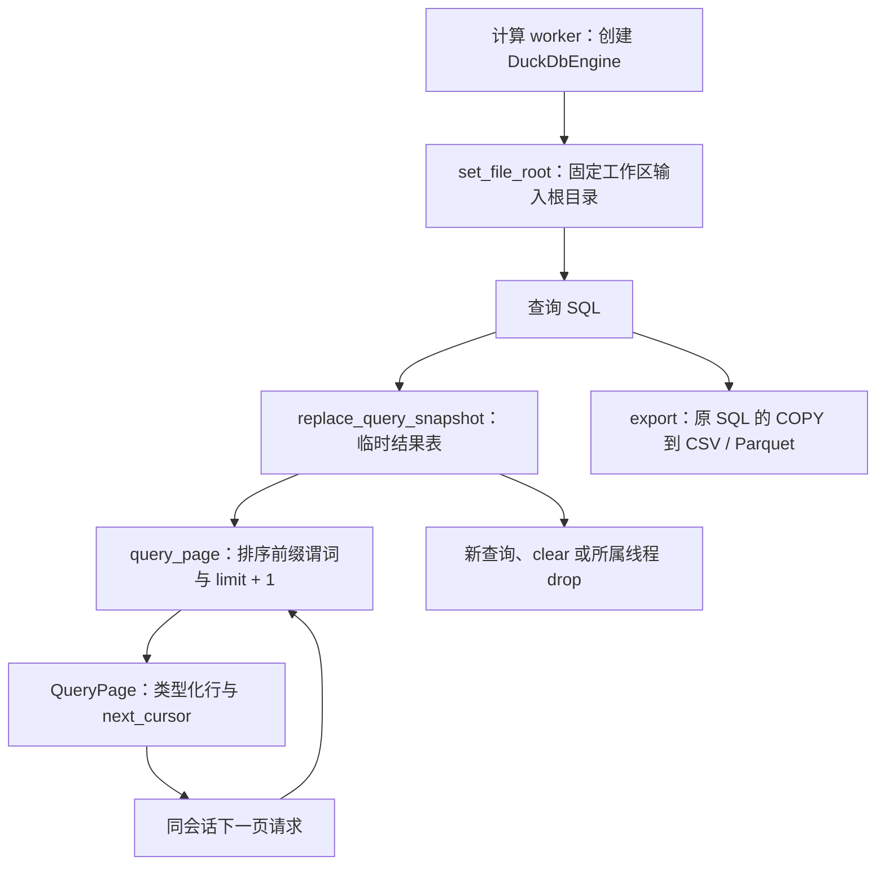

# Engine 源码：DuckDB 边界与查询快照

[上级：analytics-engine](../README.md) · [会话拥有者](../../workflow/src/README.md) · [流水线调用方](../../ml/src/README.md)

[lib.rs](lib.rs) 定义 `QueryEngine`、`EngineError` 和 feature 条件下的 `DuckDbEngine`。本目录提供描述、keyset 取页、COPY 导出和历史股票池 as-of join；工作区服务负责会话 ID、空闲过期、记录和并发策略。

## 查询如何保持跨页一致



快照使随机表达式、源文件变化不影响后续页。导出重新执行原 SQL，不保证与已有快照逐字一致。原生 `query_page` 接口本身不生成唯一排序键：完全重复的页边界会报错；workflow 在快照中追加隐藏 ordinal，承载 App 的任意列名、重复键及 NULL 分页。

## 数据与 feature 契约

`describe` 通过 LIMIT 0 初始化结果元数据；行值保留 NULL/布尔/整数/浮点/日期/文本。排序键按原生请求校验，游标长度必须匹配；NULL 使用显式空值排序和前缀比较，不拼接显示文本。`load_market_rows` 以市场日期连接历史 membership，保留 nullable 行情，不将今日成分回填历史。

默认 feature 不链接 DuckDB，构造 native backend 返回 `BackendUnavailable`。`duckdb-native` 使用系统/开发下载库，`duckdb-bundled` 需要匹配源码和 CMake；不要用 all-features 意外开启另一种原生构建。connection/statement 仅在拥有它们的 worker 中使用和释放。

## 验收命令

从仓库根目录执行，原生环境配置见 [Crates 导航](../../README.md#开发与验收)。

```bash
cargo nextest run -p analytics-engine
DUCKDB_DOWNLOAD_LIB=1 cargo nextest run -p analytics-engine --features duckdb-native
cargo nextest run -p analytics-desktop -E 'test(worker::tests::desktop_pages) | test(worker::tests::desktop_snapshot)'
```

修改排序或快照时验证 NULL/重复键、中文列名、隐藏列名冲突、源文件删除与随机 SQL。修改导出时验证单引号路径和 basename 输出；修改连接时验证历史 membership 首尾边界和缺失数据传递。错误不能泄露原生句柄到 UI 或使可重试 SQL 错误退役整个后台。

## 为什么需要本组件

保证查询会话、分页和导出具有一致语义。这里封装DuckDB原生边界、结果类型和游标。客户端不能共享或覆盖另一个查询快照；缺文件和SQL错误保留为明确结果，不使后台控制接口失去响应。

设计依据：2026-10-14接受的证券身份与完整准入计划、组件接口及测试。未在代码或证据中确认的历史取舍不推定为既有设计理由；来源、法规或数据格式变化时重新评估。
