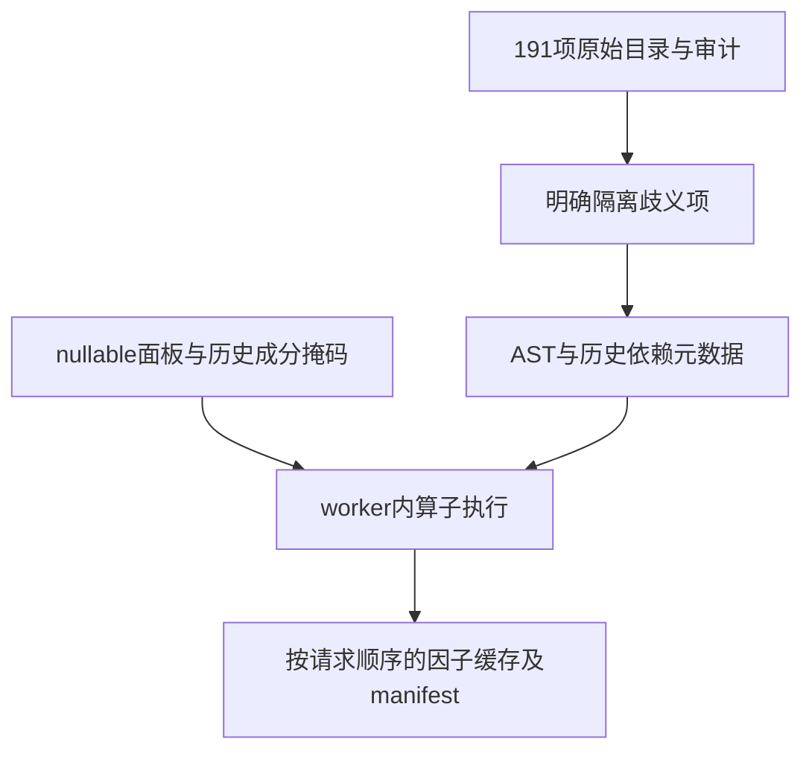
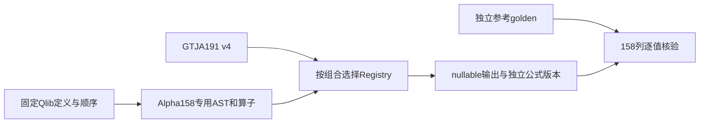

# analytics-factor

目录导航：[全部组件](../README.md) · [src：目录、AST、执行与隔离](src/README.md) · [examples：带版本AST与审计目录导出](examples/README.md) · [testdata：合成fixture与独立NumPy参考](testdata/README.md)

## 职责与公共接口

注册国泰君安191个canonical ID及独立Alpha158组合；按组合解析公式并在单个worker的内存面板执行，输出保留缺失值的因子宽表。当前版本 `gtja191-paper-2017+jfquant-audit-v4`；版本变化必须重算缓存、重训模型，不能复用v3模型/预测冒充v4。

| 接口 | 契约 |
|---|---|
| FactorRegistry::for_set / FactorSpec | GTJA191或Alpha158的ID、原始目录公式、AST、输入列、版本；lookback由AST组合，requires_recursive_state说明递归历史 |
| unsupported_ids / audit::entries | 12项隔离原因；全部191项的原报告页码、执行状态和验证范围 |
| InMemoryFactorExecutor::compute / compute_streaming | 验证panel、保持请求特征顺序，核对请求公式版本、重复ID，检查取消并以错误停止，不产出部分成功；发送进度；streaming共享分组索引并逐因子回调 |
| Panel::validate | instrument/date/各数值列等长，instrument内按日期计算，重复instrument/date拒绝 |
| next_return_labels | 每证券下一条close收益，尾行null |
| FactorRunArtifact::write_parquet_with_labels | nullable因子、labels、feature order与manifest |

## GTJA191审计结论与执行约定

完整逐项记录见 [FACTOR_AUDIT.md](FACTOR_AUDIT.md)。191项注册不代表191项严格等价或可用：12项因公式/初值歧义隔离，179项可执行；真实研究还缺Alpha030的MKT/SMB/HML，当前选择178项。原始报告、DolphinDB注释目录和DolphinDB函数体之间本身有差异，不能互当数值真值。

v4修正WMA为归一化的`0.9^lag`权重，SIGN(0)=0，HIGHDAY/LOWDAY最新值距离为0，多元REGRESI保留全部预测变量和截距，SMA递推使用M/N。短窗口相关系数需稳定地保留数学上的±1，排名并列采用相对/绝对尺度`1e-12*max(1,abs(a),abs(b))`容差，避免浮点舍入制造名次。RANK/TSRANK输出最大并列名次/n；STD/COV使用样本分母n-1；这些是明确约定，原报告没有完整规定。

滚动算子要求完整且有限的窗口，历史不足或任一缺失输出null，不删除缺失点重排权重。FILTER条件回归例外：在最近252条交易行中选择同时有效的条件观测，保留其条件语义。条件为null时IF输出null，零除/非法幂/非有限结果输出null。模型适配器才将null映射为NaN。

SMA以首个有限输入为种子，缺失点输出null并保留递归状态；不是有限N日均值。lookback表示首个结果的最少观测数，递归项另外依赖种子之前的载入历史，不能把最长数字当完整嵌套窗口。SEQUENCE以持续时间位置实现，每个窗口斜率等价于1..N，不能周期回绕。

MAX/MIN第二参数为正整数时采用目录中滚动窗口的约定，0或表达式参数为逐元素比较；这是原附录MAX(A,B)与公式MAX(X,n)记法不一致时的公开解释。Alpha028保留印刷版第二分母TSMAX(LOW,9)，不偷偷替换成常见随机指标版本。SMEAN/COVIANCE/DELAT、字段VOL/HGIH/L等拼写及已确认标点修复保留在parser；缺窗口、多余参数和非法窗口不再被忽略或默认成identity/MEAN。

Panel可选`__universe_member`列：只有1参与当日横截面排名、缩放、标准化，时间历史仍保留；无此列时全体参与。研究适配器删除缺失价格行会压缩交易时间，该局限见ml README。



## 构建与验收

```bash
cargo check -p analytics-factor
cargo nextest run -p analytics-factor
cargo test --doc -p analytics-factor
cargo clippy -p analytics-factor --all-targets -- -D warnings
```

验收覆盖：179条可执行AST与独立NumPy算子参考输出、手算Alpha002、WMA/SIGN/空值/极值距离、多元OLS与奇异矩阵、FILTER回归、嵌套lookback、递归状态、未来值不影响过去、特征顺序、历史成分隔离和12项明确拒绝。参考生成器是合成测试工具，不参与回测，也不认证原始公式解读。

```bash
cargo run -p analytics-factor --example audit_catalog > .jfquant/audit-catalog.json
python -m pip install numpy
python crates/factor/testdata/reference_ops.py .jfquant/audit-catalog.json .jfquant/operator-golden.json
```

测试使用提交的合成fixture `testdata/operator_golden.json`，不联网。更改新因子或算子时必须独立重核期望值，不得用Rust执行器输出直接覆盖golden。

## 为什么需要本组件

将GTJA191定义与执行数据口径分开审计。公式v4和固定特征顺序可以独立于供应商复核。来源转换错误不能通过修改公式掩盖；隔离项保持明确理由，可用因子通过独立fixture或golden输出验证。

设计依据：2026-10-14接受的当前组件职责、可复现实验与用户研究需求、组件接口及测试。未在代码或证据中确认的历史取舍不推定为既有设计理由；来源、法规或数据格式变化时重新评估。

## 2026-10-14：直接代码读取与分阶段研究

为什么调整：普通市场代码无需先登记身份；独立目录、审核和权威名录下载增加了研究前置负担。特殊历史代码仍需在快照内明确区间，不能将旧证券行情或权益接到另一证券。训练使用价量和标签，到账／交付资料只在实际账户执行时检查。

当前格式：模板9、需求3、准入5、股票池3、公司行动5、规范行情5、系数3、采集7、服务11、研究结果13；快照内来源映射1、训练产物2。工作区和任务记录1、GTJA191公式v4及默认178项顺序保持。旧格式明确拒绝，不自动转换。


验收：nextest覆盖来源日期边界、三档掩码、训练／回测分离及模型保留；Clippy、Rustdoc、格式、组件文档和包内CLI共同检查。生成数据、模型、运行记录和安装包不提交。另一台Apple Silicon/macOS14实机验收继续待完成。

## Alpha158为什么使用独立实现

GTJA191的完整窗口、排名及空值语义不能直接替代Qlib Alpha158。`FactorRegistry::for_set`选择一个组合，`alpha158.rs`实现其独立AST及算子，不修改GTJA191 v4及默认178项。Alpha158锁定Qlib提交b87a2c294d364a33fb739359886acffe8ec907d1，158项按原loader顺序编号，公式版本`qlib-alpha158-b87a2c2+jfquant-units-v1`。JFQuant输入明确使用股/元；同一公式中的1e-12常数不因换供应商而改写。

定义依据：[固定loader](https://github.com/microsoft/qlib/blob/b87a2c294d364a33fb739359886acffe8ec907d1/qlib/contrib/data/loader.py)、同提交data/ops.py及data/_libs/rolling.pyx。滚动min_periods=1、样本标准差、线性分位数、平均并列排名、极值首位置、OLS及近零方差保护单独实现。零量、缺失、短窗口、常量与并列在全158列golden中覆盖。golden是独立Pandas/NumPy参考实现，不能称为直接运行Qlib所得；运行时不引入Qlib。



Alpha158派生定义保留[固定Qlib MIT许可](QLIB_LICENSE.txt)，打包时随App的Resources/Licenses分发；公式源提交及哈希见testdata/alpha158_formulas.json。
