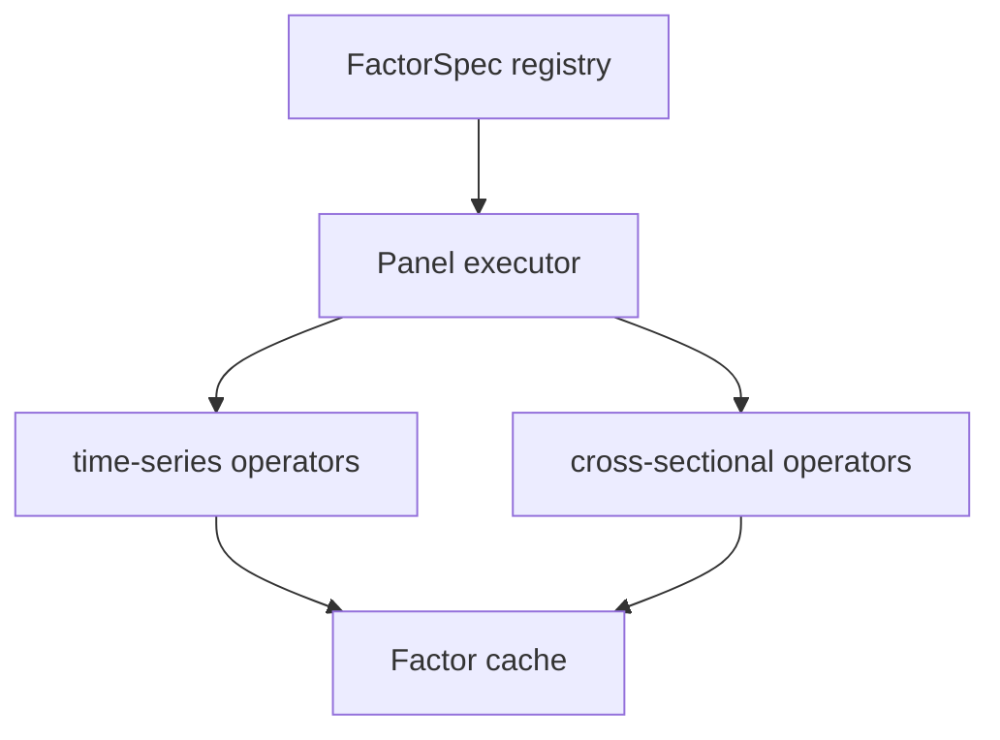

# factor

Alpha191 registry and panel executor. The formula catalog is pinned to the DolphinDB GTJA191 reference version. The executor uses time-series groups by instrument and cross-sectional groups by trade date.

The registry contains all 191 canonical formula strings. A small recursive-descent parser normalizes the published DolphinDB spellings (including `./`, `.*`, logical operators, and known catalog typos) into the Rust `FactorExpr` DSL. The registry test asserts that all 191 formulas parse and that each expression executes against a complete fixture schema. The executor supports rolling, regression, conditional, logical, cross-sectional, cumulative, and filter operators; missing history remains null rather than being forward-filled.

Results are written as a wide Parquet cache, optionally with `label_next_return`. `next_return_labels` creates per-instrument next-observation returns with a null tail. The output manifest records the formula version and selected factor IDs. The checked-in golden harness compares fixture values with a shared tolerance; the full 191-column DolphinDB export remains the final numerical parity gate before production use.

