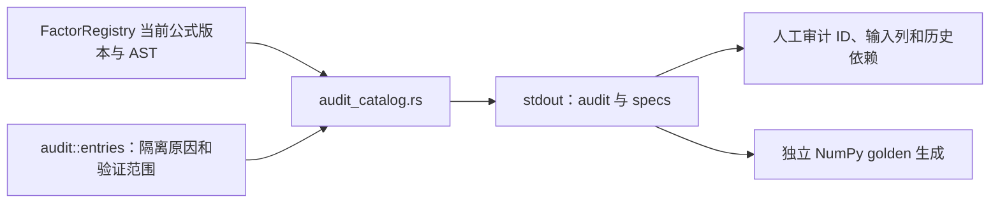

# 因子审计目录导出工具

[上级：analytics-factor](../README.md) · [参考生成器](../testdata/README.md) · [解析与执行](../src/README.md)

[audit_catalog.rs](audit_catalog.rs) 是开发用导出器。它从当前 `FactorRegistry` 读取全部191项 spec 和审计记录，将一个 JSON 对象写 stdout；不执行因子、不读取行情、不训练模型。日常因子目录查看使用 `jfquant factors list`。



## 输出契约与命令

`audit` 是逐项审计数组；`specs` 是注册项数组，包含canonical ID、公式、表达式、输入列、版本与历史依赖元数据。Unsupported项仍保留在目录供检查，不能因导出成功宣称可以运行。

从仓库根目录执行；输出保存在 `.jfquant/`，不提交生成目录：

```bash
mkdir -p .jfquant/audit
cargo run -p analytics-factor --example audit_catalog > .jfquant/audit/catalog.json
jfquant factors list
```

该工具不依赖原生库。例子构建检查用 `cargo check -p analytics-factor --examples`；后续 golden 核验命令见 [testdata README](../testdata/README.md#重新生成与核验)。接口或版本改变后，检查191项身份、12项隔离原因和179项可执行AST；导出的公式版本必须与夹具一致。
