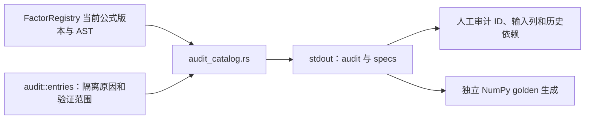

# 因子审计目录导出工具

[上级：analytics-factor](../README.md) · [参考生成器](../testdata/README.md) · [解析与执行](../src/README.md)

[audit_catalog.rs](audit_catalog.rs) 是开发用导出器。它从当前 `FactorRegistry` 读取全部191项 spec 和审计记录，将一个 JSON 对象写 stdout；不执行因子、不读取行情、不训练模型。日常因子目录查看使用 `jfquant factors list`。



## 输出契约与命令

`audit` 是逐项审计数组；`specs` 是注册项数组，包含canonical ID、公式、表达式、输入列、版本与历史依赖元数据。Unsupported项仍保留在目录供检查，不能因导出成功宣称可以运行。

从仓库根目录执行；输出保存在 `.jfquant/`，不提交生成目录：

```bash
mkdir -p .jfquant/audit
cargo run -p analytics-factor --example audit_catalog > .jfquant/audit/catalog.json
jfquant factors list
```

该工具不依赖原生库。例子构建检查用 `cargo check -p analytics-factor --examples`；后续 golden 核验命令见 [testdata README](../testdata/README.md#重新生成与核验)。接口或版本改变后，检查191项来源映射、12项隔离原因和179项可执行AST；导出的公式版本必须与夹具一致。

## 为什么需要本组件

使公式复核能够在平台之外重复。示例展示当前公式与输入契约，帮助定位公式、单位或数据口径问题。它们用于开发验证，不替代正式jfquant研究任务和来源冻结。

设计依据：2026-10-14接受的当前组件职责、可复现实验与用户研究需求、组件接口及测试。未在代码或证据中确认的历史取舍不推定为既有设计理由；来源、法规或数据格式变化时重新评估。

## 2026-10-14：直接代码读取与分阶段研究

为什么调整：普通市场代码无需先登记身份；独立目录、审核和权威名录下载增加了研究前置负担。特殊历史代码仍需在快照内明确区间，不能将旧证券行情或权益接到另一证券。训练使用价量和标签，到账／交付资料只在实际账户执行时检查。

当前格式：模板10、需求3、准入5、股票池3、公司行动5、规范行情5/HiThink6、系数3、采集7、服务14、研究结果14；快照内来源映射1、训练产物3。工作区和任务记录1、GTJA191公式v4及默认178项顺序保持。旧格式明确拒绝，不自动转换。


验收：nextest覆盖来源日期边界、三档掩码、训练／回测分离及模型保留；Clippy、Rustdoc、格式、组件文档和包内CLI共同检查。生成数据、模型、运行记录和安装包不提交。另一台Apple Silicon/macOS14实机验收继续待完成。
