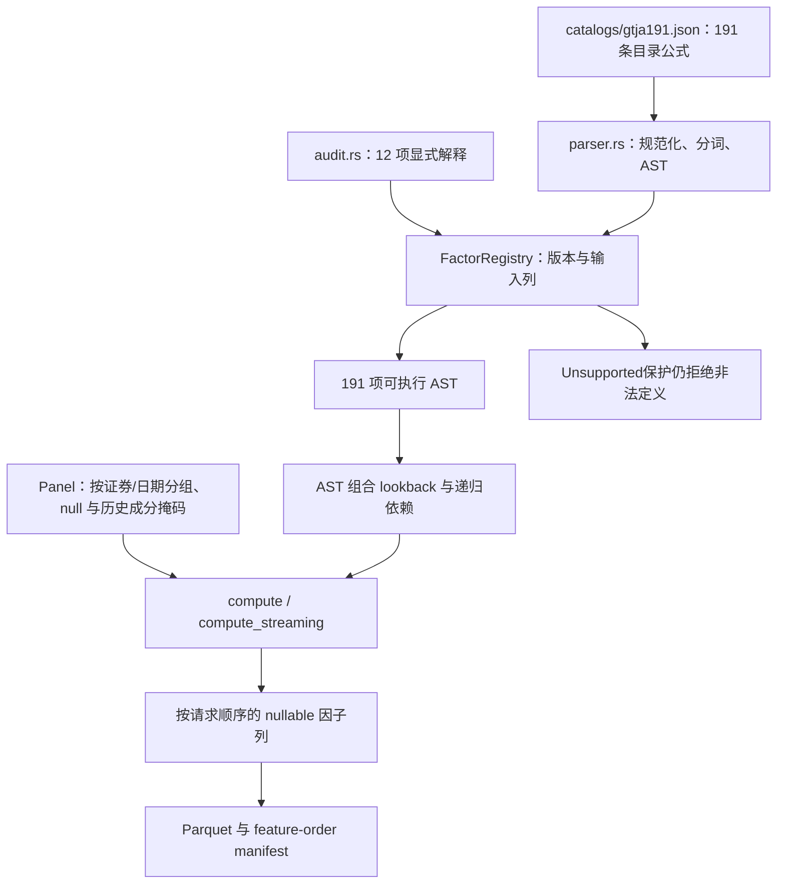

# Factor 源码：目录、AST、执行和审计

[上级：analytics-factor](../README.md) · [逐项审计](../FACTOR_AUDIT.md) · [独立夹具](../testdata/README.md) · [导出工具](../examples/README.md)

本目录把 GTJA191 公式目录转换为可审计 AST，在 nullable 面板上执行。191项均可执行；12项采用公开v5解释，输入齐备仍需逐任务检查，尤其Alpha030的外部三因子。

## 模块与公共接口

| 文件 | 职责 |
|---|---|
| [formulas.rs](formulas.rs) | 共同JSON目录加载器；保留191原始文本和158数据AST |
| [parser.rs](parser.rs) | `parse_formula/input_columns`、词法/优先级/算子参数；拒绝缺窗口和非法常量 |
| [audit.rs](audit.rs) | `quarantine_reason/quarantined_ids/interpretation_note/entries`；原报告定位、显式解释与验证范围 |
| [lib.rs](lib.rs) | `FactorRegistry/FactorSpec/FactorExpr`、`Panel`、executor、lookback 与 recursive-state 元数据、Parquet 产物 |



默认年度研究190项；Alpha030可选择，并经storage的three_factor_returns.json读取真实MKT/SMB/HML。缺失数据继续进入输入/样本策略。

## 执行约定与修改边界

`Panel::validate` 检查列长、键与重复证券/日期；时间算子在每证券历史上计算，横截面算子使用同日成员掩码。普通滚动窗口要求完整有限观测，非法算术与缺失输出 null；模型层才转换 NaN。SMA 保留递归状态，lookback 不是无限历史的替代。

`compute_streaming` 共享分组索引，逐因子回调并检查取消；取消或算子错误不能被注册成部分成功。固定请求的特征顺序和公式版本必须进入产物；禁止用 BTreeMap 的排序代替用户选择顺序。

修正公式时同时核对 parser 参数语义、AST 输入列、嵌套历史依赖、审计说明及独立 golden。当前目录格式2的execution_formula必须显式填字符串或null；FactorSpec不补缺失的执行式或递归状态。歧义式使用目录execution_formula及审计中的显式解释，禁止静默猜测。完整算子约定见 [组件 README](../README.md#审计结论与执行约定)。

## 验收

从仓库根目录执行，不需要 DuckDB 或 LightGBM：

```bash
cargo nextest run -p analytics-factor
cargo clippy -p analytics-factor --all-targets -- -D warnings
cargo test --doc -p analytics-factor
```

检查既有179项及新增12项直接公式参考尾值、并列排名/舍入、空窗口、SMA递归、FILTER条件回归、多元OLS、未来值不影响过去、请求顺序、历史成分隔离、12项解释、Alpha143和R/S手算边界。独立算子参考不等于原始报告公式语义完全被认证。

## 为什么需要本组件

公式解释与缺失传播需要一致的实现。因子执行保留null并按日期和成员执行截面运算。未知成员不等于空池；同一证券身份的时序输入与当日截面资格分别处理，避免历史成员变化引入未来信息。

设计依据：2026-10-14接受的当前组件职责、可复现实验与用户研究需求、组件接口及测试。未在代码或证据中确认的历史取舍不推定为既有设计理由；来源、法规或数据格式变化时重新评估。

## 2026-10-14：直接代码读取与分阶段研究

为什么调整：普通市场代码无需先登记身份；独立目录、审核和权威名录下载增加了研究前置负担。特殊历史代码仍需在快照内明确区间，不能将旧证券行情或权益接到另一证券。训练使用价量和标签，到账／交付资料只在实际账户执行时检查。

当前服务43、研究worker4、模板12、结果22、采集16、因子目录2、GTJA191公式v5（默认190项）。具体数据格式以所属组件的序列化类型与验证器为准；正常入口拒绝旧协议及旧格式，升级仅通过显式本地迁移执行。特征顺序、公式版本和来源哈希仍随产物冻结。


验收：nextest覆盖来源日期边界、三档掩码、训练／回测分离及模型保留；Clippy、Rustdoc、格式、组件文档和包内CLI共同检查。生成数据、模型、运行记录和安装包不提交。另一台Apple Silicon/macOS14实机验收继续待完成。

## 独立Alpha158语义

alpha158.rs保存专用数据AST和逐证券滚动算子；lib.rs按组合选择Registry。原因是两套公式的null、窗口、排名语义不同，不能复用GTJA算子后只换名称。 完整接口、why、边界和验收见[组件契约](../README.md)。

`operators.rs`集中管理OperatorRegistry/OperatorSpec、严格公式编译、统一表达式及内核适配；
`selection.rs`定义不可变CustomFactorDefinition、有序FactorRef及混合注册表解析。原生AST仍作为
兼容适配类型，计算入口统一经过显式算子ID；原GTJA解析器的来源修复不会作用于用户公式。
目录位于相邻`../catalogs/`，版本、规则、公式示例和验收见[组件README](../README.md)。
