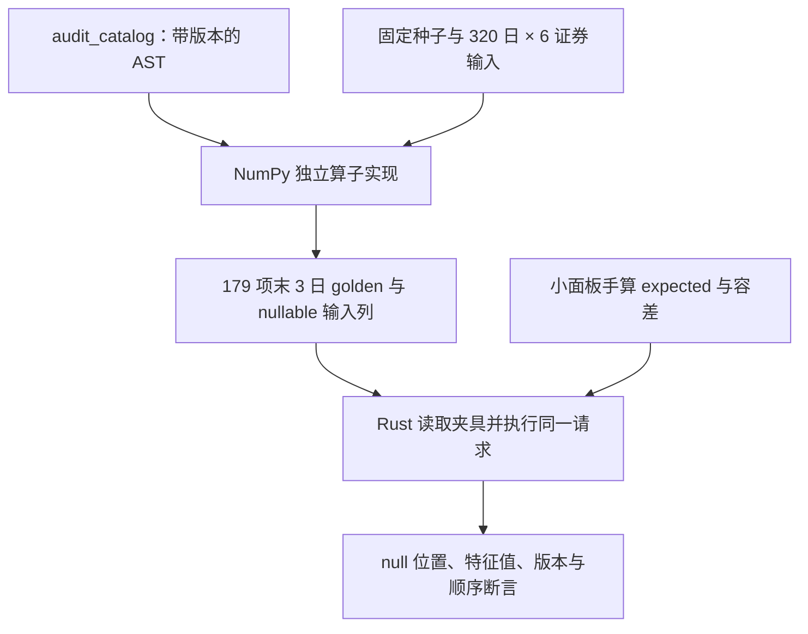
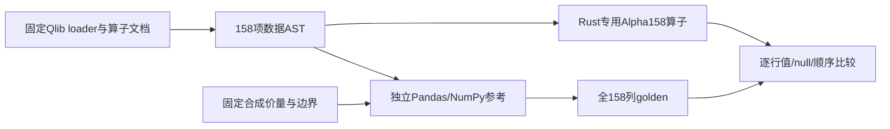

# 因子合成夹具与独立参考值

[上级：analytics-factor](../README.md) · [被测算子](../src/README.md) · [AST 导出](../examples/README.md)

本目录是可提交的确定性合成测试数据，不是下载行情或研究缓存。小面板golden与独立NumPy参考验证数值；12项v5补充采用直接公式参考，不读取导出AST，含义选择仍见原报告歧义审计。

## 文件格式与生成关系

| 文件 | 内容与边界 |
|---|---|
| [alpha191_expected.json](alpha191_expected.json) | `unit-panel-v1` 小面板的指定 expected 列、公式版本和绝对/相对容差；并非191项全公式真值 |
| [operator_golden.json](operator_golden.json) | 320日×6证券合成列；v4的179项可执行AST的最后3日值，保持原文件不变；date-major平铺，非有限值写JSON null |
| [reference_ops.py](reference_ops.py) | 独立 NumPy 算子 oracle，固定随机种子191；读取导出的 AST，不调用 Rust 执行器、Qlib或真实行情 |



`operator_golden.json` 的 `columns` 包含因子所需价量、基准及合成三因子；`expected` 每项18个尾值（3日×6证券）。这些三因子仅用来验证 Alpha030 算子，不能注入真实年度研究冒充可用市场输入。

## 重新生成与核验

从仓库根目录执行；需要开发用 Python/NumPy。App/CLI 运行不使用该脚本。先写入忽略目录，核对差异再更新受控 golden，避免直接覆盖已审核参考值。

```bash
mkdir -p .jfquant/audit
cargo run -p analytics-factor --example audit_catalog > .jfquant/audit/catalog.json
python3 crates/factor/testdata/reference_completion.py .jfquant/audit/completion.json
cmp crates/factor/testdata/gtja191_completion_expected.json .jfquant/audit/completion.json
cargo nextest run -p analytics-factor
```

相同环境生成应可复现；`cmp` 失败时先查算子、公式版本、NumPy环境和浮点约定，不能为让测试变绿直接接受新文件。经解释的公式/实现修改才更新 fixture，并在 [FACTOR_AUDIT.md](../FACTOR_AUDIT.md) 记录范围。新增因子实现至少提供手算 fixture 或独立 golden；训练收益不是因子正确性的替代检验。

## 为什么需要本组件

避免因子测试与实现互相复制错误。独立输入和golden输出为公式定义提供外部核对。新增公式必须有可手算或独立计算依据；输出变化需要说明原因，不能只更新快照让测试变绿。

设计依据：2026-10-14接受的当前组件职责、可复现实验与用户研究需求、组件接口及测试。未在代码或证据中确认的历史取舍不推定为既有设计理由；来源、法规或数据格式变化时重新评估。

## 2026-10-14：直接代码读取与分阶段研究

为什么调整：普通市场代码无需先登记身份；独立目录、审核和权威名录下载增加了研究前置负担。特殊历史代码仍需在快照内明确区间，不能将旧证券行情或权益接到另一证券。训练使用价量和标签，到账／交付资料只在实际账户执行时检查。

当前服务43、研究worker4、模板12、结果22、采集16、因子目录2、GTJA191公式v5（默认190项）。具体数据格式以所属组件的序列化类型与验证器为准；正常入口拒绝旧协议及旧格式，升级仅通过显式本地迁移执行。特征顺序、公式版本和来源哈希仍随产物冻结。


验收：nextest覆盖来源日期边界、三档掩码、训练／回测分离及模型保留；Clippy、Rustdoc、格式、组件文档和包内CLI共同检查。生成数据、模型、运行记录和安装包不提交。另一台Apple Silicon/macOS14实机验收继续待完成。

## Alpha158的独立全列参考

为什么另建参考：GTJA的rolling/null语义不能替代固定Qlib定义。../catalogs/alpha158.json保存固定loader的来源URL/哈希、158项顺序及数据AST；alpha158_expected.json包含85日×3证券全部158列，覆盖短窗口、缺失、零量、常量和并列。reference_alpha158.py用独立Pandas/NumPy实现固定语义，**未直接调用Qlib**，不能把它标为Qlib实际执行输出。运行时不依赖这个脚本或Qlib。



开发重现：`target/collector-build/python/bin/python3 -I crates/factor/testdata/reference_alpha158.py target/alpha158-expected.json`，再`cmp crates/factor/testdata/alpha158_expected.json target/alpha158-expected.json`，最后`cargo nextest run -p analytics-factor`。输出不一致必须解释公式/算子或数值依赖变化，不能直接覆盖夹具让测试变绿。GTJA原v4的179项golden保持，新v5另有12项补充golden。

`custom_operator_golden.json`为手算的5行合成序列，覆盖GTJA延迟/递归SMA嵌套在Qlib滚动均值中的
结果与null位置。`operators::tests`同时校验递归历史元数据、严格语法拒绝，以及两套原AST经统一注册表
无损往返。正式因子目录已移动到`../catalogs/`，本目录只保留独立数值夹具和参考脚本。

## GTJA191 v5补充参考

`reference_completion.py`读取已有operator_golden的320日×6证券输入，用直接NumPy公式独立计算
010/036/054/127/143/146/157/165/166/181/183/190，不读取Rust AST或Rust输出。
`gtja191_completion_expected.json`保存12项末3日、公式v5及原输入fixture SHA-256；
Rust测试合并既有179项并比较全部191项。原operator_golden及Alpha158 golden保持不变。
Alpha143和R/S另有手算边界，避免递归极小值/零尾值掩盖初值或窗口错误。
`reference_ops.py`是原v4的AST算子oracle；用v5目录导出时应改用补充直接公式脚本，
不能拿新的全量目录覆盖旧golden。所有输入仅为合成fixture，不作为真实三因子来源。
