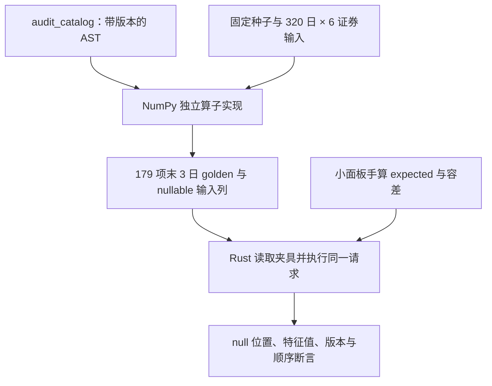

# 因子合成夹具与独立参考值

[上级：analytics-factor](../README.md) · [被测算子](../src/README.md) · [AST 导出](../examples/README.md)

本目录是可提交的确定性合成测试数据，不是下载行情或研究缓存。小面板 golden 和独立 NumPy 参考分别验证手算边界与大量 AST 的算子实现，不能替代原报告歧义审计。

## 文件格式与生成关系

| 文件 | 内容与边界 |
|---|---|
| [alpha191_expected.json](alpha191_expected.json) | `unit-panel-v1` 小面板的指定 expected 列、公式版本和绝对/相对容差；并非191项全公式真值 |
| [operator_golden.json](operator_golden.json) | 320日×6证券合成列；179项可执行AST的最后3日值；date-major平铺，非有限值写JSON null |
| [reference_ops.py](reference_ops.py) | 独立 NumPy 算子 oracle，固定随机种子191；读取导出的 AST，不调用 Rust 执行器、Qlib或真实行情 |



`operator_golden.json` 的 `columns` 包含因子所需价量、基准及合成三因子；`expected` 每项18个尾值（3日×6证券）。这些三因子仅用来验证 Alpha030 算子，不能注入真实年度研究冒充可用市场输入。

## 重新生成与核验

从仓库根目录执行；需要开发用 Python/NumPy。App/CLI 运行不使用该脚本。先写入忽略目录，核对差异再更新受控 golden，避免直接覆盖已审核参考值。

```bash
mkdir -p .jfquant/audit
cargo run -p analytics-factor --example audit_catalog > .jfquant/audit/catalog.json
python3 crates/factor/testdata/reference_ops.py .jfquant/audit/catalog.json .jfquant/audit/operator_golden.json
cmp crates/factor/testdata/operator_golden.json .jfquant/audit/operator_golden.json
cargo nextest run -p analytics-factor
```

相同环境生成应可复现；`cmp` 失败时先查算子、公式版本、NumPy环境和浮点约定，不能为让测试变绿直接接受新文件。经解释的公式/实现修改才更新 fixture，并在 [FACTOR_AUDIT.md](../FACTOR_AUDIT.md) 记录范围。新增因子实现至少提供手算 fixture 或独立 golden；训练收益不是因子正确性的替代检验。
