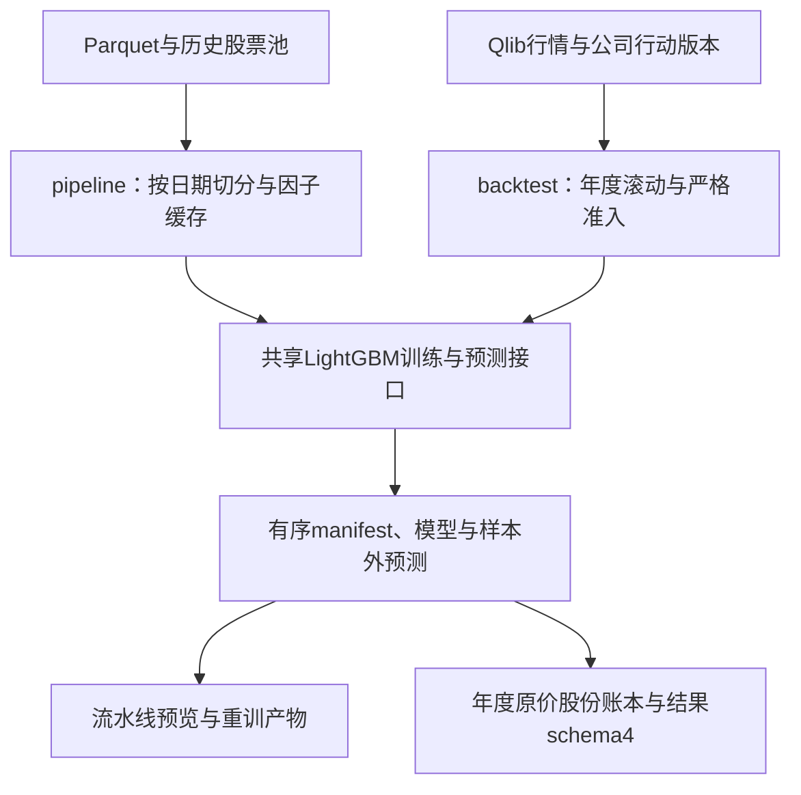
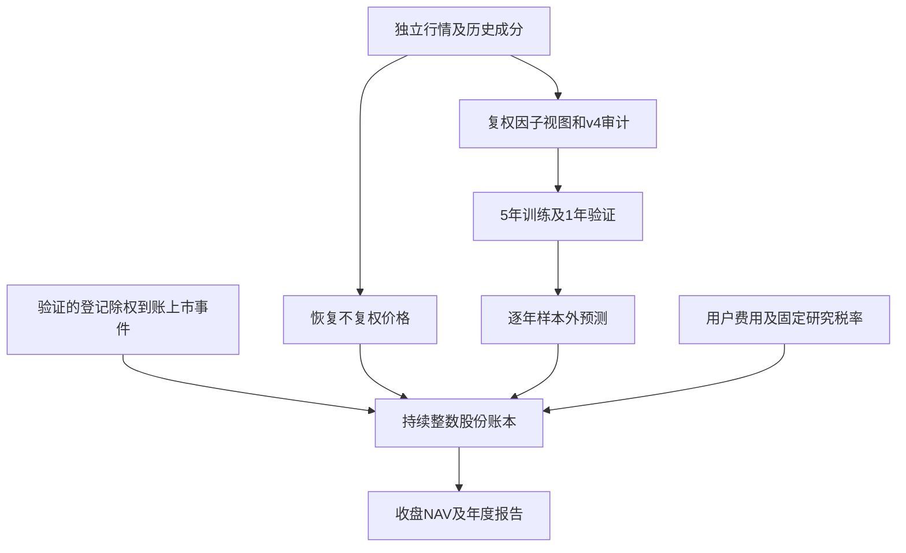

# analytics-ml

目录导航：[全部组件](../README.md) · [src：公共模型接口、流水线与年度研究](src/README.md) · [examples：原生开发验收与完成结果绘图](examples/README.md)

## 职责

analytics-ml 是 LightGBM C API、训练/预测接口和端到端 pipeline 的边界。默认构建不链接原生库；desktop 和 native example 显式开启 lightgbm-native 与 duckdb-native。

## 公共接口

| 接口 | 契约 |
|---|---|
| DenseMatrix / TrainingSplit | 行主序特征、labels、70/15/15 三个矩阵，缺失特征用 NaN |
| Trainer | 写出 model、manifest、metrics、feature importance；逐轮发 TrainEvent |
| Predictor | 普通预测或 feature contributions |
| pipeline::run_factor_pipeline | market/universe -> factors -> labels -> split -> train -> predictions |
| pipeline::train_from_factor_cache | 从 factors.parquet 独立重训 |
| PipelineEvent | Loading、market rows、factor progress、training iterations、artifact writing |
| PipelineArtifact | 因子缓存、manifest、模型产物、预测路径和 split 行数 |
| backtest::ResearchRequest / run | 显式 JFQuant 下载目录，5年训练/1年验证/次年测试，年度模型、预测、市场费用预设与数据审计（lightgbm-native） |
| load_manifest | 读取模型 manifest JSON |

Pipeline manifest 保留 feature order、training schema hash、formula version、universe、date range、input snapshot hash。LightGBM Dataset、Booster 和 Predictor 都只在 worker 内创建。

## 数据流



## 构建与环境

    cargo check -p analytics-ml
    brew install lightgbm
    cargo check -p analytics-ml --features lightgbm-native,duckdb-native
    LIGHTGBM_LIB_DIR=/path/to/lightgbm/lib cargo check -p analytics-ml --features lightgbm-native

`native_paths.rs` 由 ml 和 desktop 构建脚本共用。`LIGHTGBM_LIB_DIR` 非空时必须包含当前目标平台的 LightGBM 动态库；为空或未设置时自动探测 `brew --prefix lightgbm`、标准 Homebrew 目录和 `$HOME/homebrew` / `$HOME/.linuxbrew` 对应路径。不会硬编码开发者个人目录。非空无效路径直接报构建错误；无法探测库时 native 构建最终链接失败。macOS native example 可通过 `DYLD_LIBRARY_PATH` 配置 LightGBM/OpenMP，desktop 自动写入本机 rpath；仅在关闭 native feature 的构建中，trainer/predictor 返回 `BackendUnavailable`。

## 验收

    cargo nextest run -p analytics-ml
    cargo test --doc -p analytics-ml
    cargo nextest run -p analytics-ml --features lightgbm-native,duckdb-native
    jfquant factors --help

native 测试包含 synthetic market/universe 端到端 pipeline 和从 cache 重训；真实数据验收需检查 factors、model、manifest、metrics、importance、predictions 六类产物。

## 中证500年度滚动研究

默认使用**不复权撮合、真实整数股数和公司行动账本**。因子输入使用独立的复权价量视图，成交价用原价；两个视图不混用。先按[storage README](../storage/README.md)独立下载行情、公司行动及详情，核验/补齐缺失的实际支付与上市日期，再执行：

```bash
export JFQUANT_WORKSPACE="$HOME/JFQuantWorkspace"
jfquant templates default --output recipe.json
jfquant research check --template recipe.json --market MARKET_VERSION --actions ACTION_VERSION
jfquant jobs wait CHECK_TASK_UUID
jfquant research run --template recipe.json --market MARKET_VERSION --actions ACTION_VERSION
jfquant jobs wait RESEARCH_TASK_UUID
jfquant jobs results RESEARCH_TASK_UUID
```

`ResearchRequest`显式包含corporate_actions、费用、资金及dividend_withholding_rate，执行仅采用严格原价账本。动作不完整、源冲突、无法解释的复权因子变化/配股会在训练前拒绝，写execution_readiness.json。research check只审计而不训练；ready=false表示输入仍未就绪，不能生成完整真实回测。
2026-10-13本地公开数据验收：四路采集与区间重解析后，仍有80个现金日、13个上市日缺失和60只证券来源失败。实际运行严格模式在训练前以company-action history unavailable停止，审计模式返回ready=false；没有生成新版模型、预测或收益报告。补录执行数据应以公司公告验证日期、分配对象和数量，不能删除失败项绕过准入。执行覆盖统计包括期末已登记、未来除权的权益，因此可能多于按除权日截断的下载统计。

### 账户与自定义费用

默认最新A股预设：全佣万2.5、每笔最低5元，另收过户费和卖出印花税；初始资金100万元。公开费用只用当前快照统一应用全区间，不恢复历史政策，不输出多档单边成本。账户佣金可配置，见[core README](../core/README.md)。

通过templates default导出完整模板后，编辑initial_cash_cny、market_rules.commission和dividend_withholding_rate；App提供同一字段的表单。以下账户配置用于完整模板对应字段：

```json
{"initial_cash_cny":2000000,"market_rules":{"commission":{"rate":0.0002,"minimum_cny":5,"mode":"gross"}},"dividend_withholding_rate":0}
```

该片段用于说明字段，执行时保存完整模板，并用templates validate检查。

生成预设拒绝覆盖已有文件。JSON允许只覆盖commission（缺省字段用默认），CLI覆盖JSON与参数位置无关。费用以实际CNY订单计，每笔按分四舍五入；整手预算包含最低佣金，未成交无费用。dividend-withholding-rate是显式固定研究扣税比例，默认0为税前股息；不是送红股所得税或个人FIFO持股期补税，不宣称个人税后收益。

### 原价账户和研究边界

模型按Y-6至Y-2训练、Y-1验证、Y测试；训练/验证及IC剔除跨截止日实现的标签。标签为`adjusted_open[t+2]/adjusted_open[t+1]-1`。最多200轮、早停20、学习率.05、31叶、min_data_in_leaf=200、feature_fraction=.8、lambda_l2=10、seed=17、4线程及确定性设置，测试集不选参；保存模型/RMSE/预测一致使用最佳轮数。

行情覆盖2000-01-04—2026-10-12；历史中证500从2007-01-31开始，样本外最早2013，2026为部分年度。不用今天成分回填历史。因子面板保留入选前756交易日预热，横截面按历史入选掩码。复权价量视图按每证券初始归一化factor锚定，成交量还原为股、成交额为元；DBM按原附录`max(open-low, open-prev_open)`，不擅自改成相反符号。早期成分历史不足时允许整列暂为null，finite_counts明确记录，不为了凑可用数使用部分窗口。缺失价格行会压缩因子时间序列，递归SMA预热截断历史；这些仍是研究局限。

v4隔离12条歧义公式，Alpha030另因真实MKT/SMB/HML缺失排除，当前178项用于研究。179个可执行AST通过独立NumPy算子fixture，不能因此宣称原始191式全部严格等价；详见[factor审计](../factor/FACTOR_AUDIT.md)。版本已变，旧189因子v3预测/模型必须重算，不能直接用于本版回测。

原价执行在完整交易日历逐日运行：日终信号下一开盘成交，每5日调预测前50目标等权，先卖后买，遵守整数股数、板块最小数量/增量、分价位及T+1。现金不足整手时留现金。账户与调仓时钟跨模型年份连续，最后一日信号可交给下一年；不年度重置、不估算虚拟强制平仓。收盘NAV包含应收权益，基准为同日中证500**收盘价格指数**收益（无分红）。

登记日收盘确定股数，除权日确认应收现金/红股，实际到账日增加可用现金，上市日增加可售整数股；登记后卖出旧股仍保留权益，除权日新买入没有旧权益。停牌无报价不成交，并在除权日调整旧估值，再计应收，避免重复收益。缺支付/上市日、来源冲突、配股/未知因子跳变、零碎股实际分配不明、重叠未上市分配均拒绝。因子变动按现金/送转理论除权参考值对账（容差0.2%，源float32及分价位），不从factor反推分红事件。

涨跌停仍为最新常规板块比例减0.5个百分点缓冲，缺精确交易所限价、上市特例、逐笔流动性、冲击、退市清算；不是完整实盘撮合复现。年化252日，Sharpe无风险0，回撤包含初值1；IC/RankIC为至少30只股票的每日均值、并列平均，标签期限不同于5日组合期限。

### 当前研究产物（schema_version=4）

backtest::RESEARCH_SCHEMA_VERSION=4；validate_result返回可识别的UnsupportedResultFormat，报告生成、平台读取与只读导入共用校验。仅接受当前公式、raw_integer_shares、来源/双签名、完整执行配置、年度报告及汇总字段。旧结果不转换、不重新计费；保留磁盘文件，读取时返回unsupported_result_format。

| 文件 | 契约 |
|---|---|
| execution.json | raw_integer_shares、完整费用预设、初始资金、固定股息税率、公司行动文件SHA256及研究配置 |
| execution_readiness.json | 公司行动/因子跳变校验ready、错误原因、区间缺支付/上市日和来源失败统计；训练前生成 |
| data_audit.json / factor_audit.json | 来源、覆盖、178项特征顺序、公式版本及双签名；191项审计、隔离原因和验证范围 |
| factor-cache/YYYY.json + .bin | 行/标签年份/有序特征/有效数；row-major little-endian float32，NaN为missing；raw成交另从独立行情恢复原价 |
| fold-YYYY/model.txt / manifest.json | schema hash、特征顺序、公式版本、来源签名、research_execution；同worker持有native句柄 |
| fold-YYYY/predictions.csv / metrics.json / feature_importance.json | 样本外预测、最佳轮指标及重要性 |
| fold-YYYY/ledger.json | raw年末持续现金、整数股、可售股、应收权益和日期状态；只作审计，不作为任意断点恢复接口 |
| fold-YYYY/daily.json / report.json | 单预设日收益/费用/换手/持仓/受阻订单；费用仅来自实际模拟成交，不含估值平仓字段 |
| annual_reports.json / summary.json | 年度与连续账户汇总，schema4及双签名 |
| report.md / nav.csv | 可读报告及日期、策略净值、价格指数净值 |

特征签名覆盖数据、顺序、v4公式和价量适配约定；执行签名另含费用、初始资金、年份、模式、税率和完整公司行动文件哈希。改变金额/日期/来源会改变执行签名；已有不同签名输出拒绝覆盖。因子manifest的lookback由AST组合，requires_recursive_state单列说明，不能把递归历史表示成有限窗口。



### 验收

```bash
export DUCKDB_LIB_DIR="$PWD/target/debug/deps"
export DYLD_LIBRARY_PATH="$DUCKDB_LIB_DIR:$(brew --prefix lightgbm)/lib:$(brew --prefix libomp)/lib"
cargo nextest run --workspace --features analytics-ml/lightgbm-native
cargo clippy --workspace --all-targets --features analytics-ml/lightgbm-native -- -D warnings
RUSTDOCFLAGS="-D warnings" cargo doc --workspace --no-deps --features analytics-ml/lightgbm-native
cargo fmt --all -- --check
```

DuckDB未下载时先用`DUCKDB_DOWNLOAD_LIB=1 cargo build -p analytics-desktop`。不要用all-features把互斥的bundled-cmake源构建也打开。macOS直接运行workspace统一特性构建的example时需含DuckDB动态库路径。

测试覆盖跨年真实股数/连续资金、登记日/除权日差异、延迟现金和红股、T+1/整手与手续费、未知factor跳变拒绝、缺失日期/零碎股拒绝，及预测对齐、费用口径、早停和UI错误恢复。原价综合fixture手算：登记100股原价10元，每股现金1元加0.5股，除权价6元；应收现金100元+红股50股保持资产一致，不提前释放流动性。

绘图工具`python crates/ml/examples/plot_research.py RUN`只读取完成的nav.csv，不参与策略。数据/模型/报告/图片均写已忽略data/或.jfquant/，不提交。

## 平台任务接口与验收

ResearchConfig提供训练/验证年数、top_n、rebalance_days、有序factor_ids及crate根路径TrainingConfig；默认5/1/50/5和既有模型参数。模板拒绝重复、隔离及缺输入因子。run_with_context接受TaskContext；run是同一实现的默认上下文包装，供模块调用，不是旧命令入口。年度准备、逐因子、训练迭代、逐日撮合/对账检查取消；训练进度线程在返回前join。

App、jfquant research和序列化TaskRequest共用workflow适配器。流水线使用PipelineRequest，通过jfquant factors run --request pipeline.json提交；后台保存新UUID的factors.parquet、模型、manifest、指标、重要性与预测。缓存重训通过jfquant model train --cache PATH；参数文件仅含parameters映射与early_stopping_rounds，不保留旧类型重导出。

nextest覆盖标准CLI与公共API/egui的冻结参数、特征顺序、双签名、跨年账本、分红送转、费用及年度结果一致；旧格式/旧口径和不完整结果明确拒绝且文件不变，真实缺项停止在训练前。安装包运行不用Python或Cargo，绘图脚本仅作开发时的可选离线工具。
