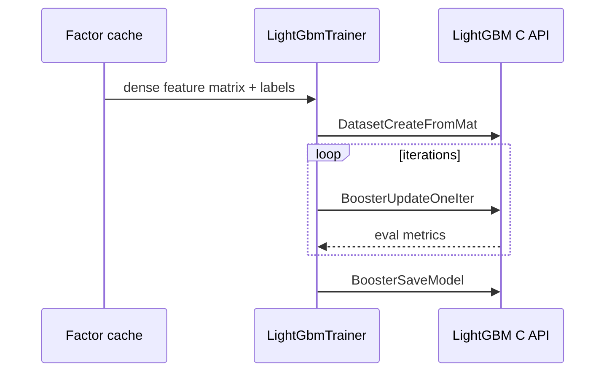

# ml

LightGBM training and prediction boundary. The default build has no native dependency; enable `lightgbm-native` and set `LIGHTGBM_LIB_DIR` when the official LightGBM library is available.



The dense adapter supports a single matrix and `TrainingSplit` (`train`, `validation`, `test`). Validation is registered through `LGBM_BoosterAddValidData`; `early_stopping_rounds` monitors validation metrics and the saved model is truncated to the best iteration. Test RMSE is computed only after training and recorded in `metrics.json`. Native prediction supports normal output and feature contributions. Arrow stream and chunked `PushRowsWithMetadata` adapters remain the next production data path for very large Parquet datasets.

With a local LightGBM dylib, run the real native smoke test without writing generated files into the repository:

```bash
LIGHTGBM_LIB_DIR=/path/to/lightgbm/lib \
DYLD_LIBRARY_PATH=/path/to/lightgbm/lib:/path/to/openmp/lib \
cargo run -p analytics-ml --features lightgbm-native --example native_smoke -- /tmp/jfquant-lightgbm-smoke
```

The factor-to-model integration example reads real market and historical-universe Parquet files, computes selected Alpha191 expressions, writes `factors.parquet` and `factor_run_manifest.json`, performs a 70/15/15 date split, trains the official LightGBM C API backend, and writes `predictions.parquet`:

```bash
LIGHTGBM_LIB_DIR=/path/to/lightgbm/lib \
DYLD_LIBRARY_PATH=/path/to/lightgbm/lib:/path/to/openmp/lib \
DUCKDB_DOWNLOAD_LIB=1 \
cargo run -p analytics-ml --features lightgbm-native,duckdb-native --example factor_pipeline -- \
  --market /path/to/market --universe /path/to/universe \
  --start 2020-01-01 --end 2025-12-31 --output /tmp/jfquant-factor-pipeline
```

