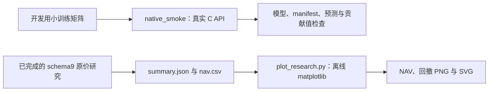

# ML 开发例子与离线绘图

[上级：analytics-ml](../README.md) · [模型实现](../src/README.md) · [App分发自检](../../app/packaging/README.md)

本目录只保留原生C API开发验收和已完成研究的可选绘图工具。业务调用使用独立`jfquant factors/model/research`，不提供factor_pipeline或rolling_backtest旧命令。

## 文件与验证对象

[native_smoke.rs](native_smoke.rs) 创建小矩阵，训练、读取manifest并执行普通预测/贡献值，检查官方LightGBM接口与产物形状。[plot_research.py](plot_research.py) 读取schema9严格研究的summary.json和nav.csv，以初始净值1计算回撤并生成nav.png/nav.svg；需要开发用matplotlib，不参与训练、策略或安装包运行。



## 命令与输出边界

从仓库根目录执行；先按[Crates导航](../../README.md#开发与验收)设置原生环境，特别是直接运行example时的LightGBM/OpenMP库路径。

```bash
cargo run -p analytics-ml --features lightgbm-native --example native_smoke -- .jfquant/runs/native-smoke
python3 crates/ml/examples/plot_research.py .jfquant/runs/RESEARCH_TASK_UUID
```

绘图输入必须是完成的当前研究目录；旧schema或其他执行口径拒绝，不能修改schema数字绕过检查。标题的特征数量来自冻结research_config；窗口、账户和公式以execution/manifest为准，不能硬编码旧189项或年度重置说明。

生成模型与图片在`.jfquant/`，不提交Git。安装包原生自检通过`jfquant self-check --output DIR`调用公共后台；本example是开发检查，不能代替[清空环境包内验收](../../app/packaging/README.md#验收边界)。

```bash
cargo check -p analytics-ml --examples --features lightgbm-native
cargo nextest run -p analytics-ml --features lightgbm-native,duckdb-native
```

plot_research.py只接收schema9、raw_integer_shares及价量来源哈希；读取benchmark_price_index_nav列，标题取冻结benchmark，不固定中证500。此开发绘图工具需要matplotlib，不作为App运行依赖。

## 为什么需要本组件

提供当前研究结果的可复现查看方式。示例只读取当前结果格式和冻结来源，不重建旧近似收益。绘图展示折、自然年度、费用和净值，让报告能够离线审查；示例数据及图片属于本地产物。

设计依据：2026-10-14接受的证券身份与完整准入计划、组件接口及测试。未在代码或证据中确认的历史取舍不推定为既有设计理由；来源、法规或数据格式变化时重新评估。
