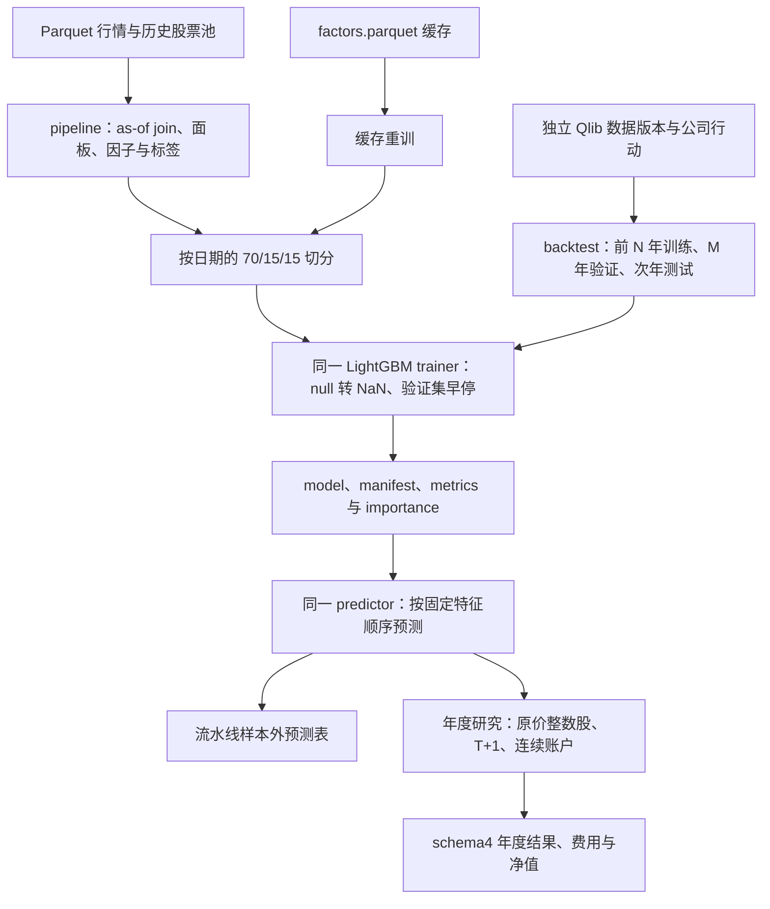

# ML 源码：原生模型与两条研究路径

[上级：analytics-ml](../README.md) · [年度研究内部模块](backtest/README.md) · [原生开发例子](../examples/README.md)

本目录封装 LightGBM C API 和普通矩阵/产物接口。Parquet 流水线与 Qlib 年度研究共享 trainer/predictor、公式与费用模块，但各自的切分、标签和账户语义必须明确。

## 模块与公共接口

| 文件 | 主要接口与职责 |
|---|---|
| [lib.rs](lib.rs) | `DenseMatrix/TrainingSplit`、`Trainer/Predictor`、`LightGbmTrainer/LightGbmPredictor`、`TrainEvent`、`load_manifest`；native句柄作用域与释放 |
| [training_config.rs](training_config.rs) | crate根路径 `TrainingConfig`：原生参数映射、早停轮数；禁止未知字段 |
| [pipeline.rs](pipeline.rs) | `PipelineRequest/run_factor_pipeline/load_factor_cache/train_from_factor_cache/build_training_split`；Parquet输入到缓存/模型/预测 |
| [backtest.rs](backtest.rs) | `ResearchConfig/ResearchRequest/run_with_context/validate_result`；年度滚动、输入准入、持续真实股数账本、schema4结果 |



Parquet流水线标签为每证券下一条 close 收益；年度研究标签是下一开盘到再下一开盘的复权收益，并剔除跨训练/验证/IC边界标签。标签期限与组合调仓间隔不是同一个参数。年度研究细节见 [backtest README](backtest/README.md)。

## 原生与文件契约

`DenseMatrix` 为row-major特征与f32标签；null由适配器转换NaN，不填0。manifest保存feature order、schema hash、formula version与输入签名，预测不能按列名字典顺序重排。

LightGBM Dataset/Booster/Predictor在调用worker创建与释放，不共享到UI。默认无native feature时，trainer/predictor返回BackendUnavailable；实际App/workflow启用原生features。native错误、取消、早停必须正确释放句柄和join进度线程；模型保存与预测使用相同最佳轮数。

## 构建和验收

从仓库根目录执行；原生环境见 [Crates 导航](../../README.md#开发与验收)。

```bash
cargo check -p analytics-ml
cargo nextest run -p analytics-ml --features lightgbm-native,duckdb-native
cargo nextest run -p analytics-cli -E 'test(standard_pipeline) | test(current_research_cli)'
cargo clippy -p analytics-ml --all-targets --features lightgbm-native,duckdb-native -- -D warnings
```

修改训练/预测时核对矩阵形状、缺失值、chronological split、早停和贡献值列数；修改流水线时核对有序缓存、manifest和重训产物；修改年度研究时核对持续账本与准入。不能以缺少原生库时的桩错误测试替代真实C API验收。
