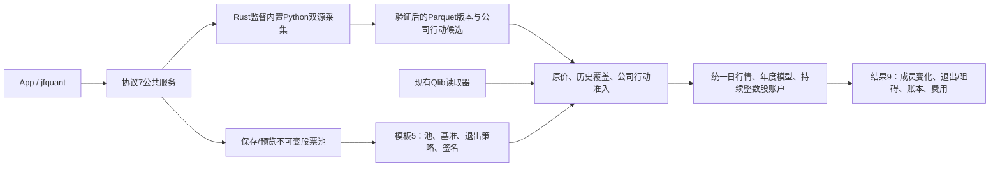
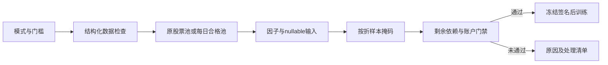

# ML 源码：原生模型与两条研究路径

[上级：analytics-ml](../README.md) · [年度研究内部模块](backtest/README.md) · [原生开发例子](../examples/README.md)

本目录封装 LightGBM C API 和普通矩阵/产物接口。Parquet 流水线与 Qlib 年度研究共享 trainer/predictor、公式与费用模块，但各自的切分、标签和账户语义必须明确。

## 模块与公共接口

| 文件 | 主要接口与职责 |
|---|---|
| [lib.rs](lib.rs) | `DenseMatrix/TrainingSplit`、`Trainer/Predictor`、`LightGbmTrainer/LightGbmPredictor`、`TrainEvent`、`load_manifest`；native句柄作用域与释放 |
| [training_config.rs](training_config.rs) | crate根路径 `TrainingConfig`：原生参数映射、早停轮数；禁止未知字段 |
| [pipeline.rs](pipeline.rs) | `PipelineRequest/run_factor_pipeline/load_factor_cache/train_from_factor_cache/build_training_split`；Parquet输入到缓存/模型/预测 |
| [backtest.rs](backtest.rs) | `ResearchConfig/ResearchRequest/run_with_context/validate_result`；年度滚动、输入准入、持续真实股数账本、schema9结果 |


Parquet流水线标签为每证券下一条 close 收益；年度研究标签是下一开盘到再下一开盘的复权收益，并剔除跨训练/验证/IC边界标签。标签期限与组合调仓间隔不是同一个参数。年度研究细节见 [backtest README](backtest/README.md)。

## 原生与文件契约

`DenseMatrix` 为row-major特征与f32标签；null由适配器转换NaN，不填0。manifest保存feature order、schema hash、formula version与输入签名，预测不能按列名字典顺序重排。

LightGBM Dataset/Booster/Predictor在调用worker创建与释放，不共享到UI。默认无native feature时，trainer/predictor返回BackendUnavailable；实际App/workflow启用原生features。native错误、取消、早停必须正确释放句柄和join进度线程；模型保存与预测使用相同最佳轮数。

## 构建和验收

从仓库根目录执行；原生环境见 [Crates 导航](../../README.md#开发与验收)。

```bash
cargo check -p analytics-ml
cargo nextest run -p analytics-ml --features lightgbm-native,duckdb-native
cargo nextest run -p analytics-cli -E 'test(standard_pipeline) | test(current_research_cli)'
cargo clippy -p analytics-ml --all-targets --features lightgbm-native,duckdb-native -- -D warnings
```

修改训练/预测时核对矩阵形状、缺失值、chronological split、早停和贡献值列数；修改流水线时核对有序缓存、manifest和重训产物；修改年度研究时核对持续账本与准入。不能以缺少原生库时的桩错误测试替代真实C API验收。

## 动态股票池与 Python 采集接口

当前模板schema 5、研究结果schema 9、服务协议7；公式仍为v4。模板增加 `pool_version`、`benchmark` 和 `pool_exit_policy`；默认 `builtin:csi500` / `SH000905`，沪深300模板使用 `builtin:csi300` / `SH000300`。自选和集合组合引用不可变pool版本，冻结成员区间、人工日期调整及输入哈希；模型manifest和缓存签名包含这些研究输入。原schema结果明确拒绝，历史状态和日志仍可查看，不转换旧文件。



`pools create/validate/import/export/list/versions/preview` 使用公共定义及解析器；`data collect --provider akshare|yfinance --kind market|actions` 提交后台任务，使用 jobs wait 显式等待。`run --request` 可提交完整公共请求。App提供来源、采集日期/证券、股票池JSON编辑、日期预览、退出策略及失败采集恢复按钮。包内Python和依赖只用于采集，不需要外部Python；日常操作不调用Cargo。

```bash
jfquant templates default --universe csi300 --output csi300-template.json
jfquant pools validate --definition pool.json
jfquant pools create --definition pool.json
jfquant pools preview pool-0123456789abcdef --market market-0123456789abcdef --date 2026-10-12
jfquant data collect --provider akshare --start 2004-01-01 --end 2026-10-13 --instruments SH600000,SZ000001,SH000300 --benchmarks SH000300
jfquant data collect --kind actions --provider akshare --start 2004-01-01 --end 2026-10-13 --instruments SH600000,SZ000001
jfquant research demo-parquet
```

示例ID须换为实际版本。下载可恢复验证过的证券；重新提交时参数必须与owner一致。临时/缺失输入不会自动换源、补字段或启动训练。原价撮合不使用Yahoo拆股调整价；缺支付/上市日期或指数历史成员仍阻止研究。2010样本外的5+1窗口需要2004—2009完整历史池及行情，不能以当前成分回填。

开发验收先运行 `crates/app/packaging/build-collector.sh`，再执行workspace nextest、严格Clippy/Rustdoc和格式检查。解释器、依赖、数据、模型、缓存、日志、运行记录及DMG均留在忽略目录。另一台Apple Silicon/macOS14实机验收待完成。

年度研究预检核验独立系数、训练/验证/预热历史公司行动及执行权益。失败按证券写入 `factor_basis_issues`、`adjustment_issues` 与受影响 `affected_factor_ids`，在生成因子缓存前停止；Qlib已有系数读取契约继续保留。

年度研究先核验独立系数及训练/验证/预热历史事件，再核验当前执行权益；逐证券错误位于factor_basis_issues、adjustment_issues及affected_factor_ids。execution价量清单和哈希加入缓存与模型manifest；schema9拒绝缺失或被修改的价量来源。

## 日期执行职责

backtest.rs先解析/冻结schedule和独立检查结果，再生成缓存与模型；preview_samples统计各折可用标签和预测行。backtest/data.rs用label_end精确截取任意日期矩阵并保留缺标签预测。raw_portfolio.rs在折间空档继续账户时钟，独立记录认购费用并处理事件承继；report.rs读取完整daily.json生成连续净值，折报告与自然年汇总分开。

## 为什么需要本组件

训练器只消费已经通过准入的研究样本。特征顺序、公式版本和来源签名共同决定缓存及模型身份。因子有效性先在暂存区检查，再发布缓存并训练；无验证集禁用早停，测试尾部无标签仍可预测但不计算IC。

设计依据：2026-10-14接受的证券身份与完整准入计划、组件接口及测试。未在代码或证据中确认的历史取舍不推定为既有设计理由；来源、法规或数据格式变化时重新评估。

## 三级研究模式：为什么允许筛选

决定日期2026-10-14，依据是用户接受的三级模式计划。正常预热空值、来源缺失和错误数据是不同问题：全部拒绝会浪费可用样本，全部放行又会混淆因子和真实权益。默认严格检查；另外提供“允许部分数据缺失”和“只用数据合格的股票”。模式是研究输入的一部分，不能作为训练失败后自动切换的兜底。

第二档保持原成员，纯缺失传播null；第三档派生每日合格成员，不改原始成员或证据。不能看到后来缺价而倒删早期股票。账户仍采用原价、整数股、T+1和连续权益；未裁定冲突、损坏、基准缺项及剩余必要依赖仍阻断。默认有效因子比例0表示至少一项有效，最低有标签样本1只表示可执行，不表示样本在统计上充分。所选因子整列无有效值不会被自动删除。

[backtest/quality.rs](backtest/quality.rs)在工作线程生成每日资格，并对可能持仓保守预检；[backtest/data.rs](backtest/data.rs)在因子计算后生成样本掩码。两者不是同一个股票集合：仅排除训练行不修改截面，缺测试标签也不排除预测。ResearchRequest增加quality_policy，schema9读取检查准入格式2及策略/掩码哈希，模型和DuckDB句柄仍不跨线程。


