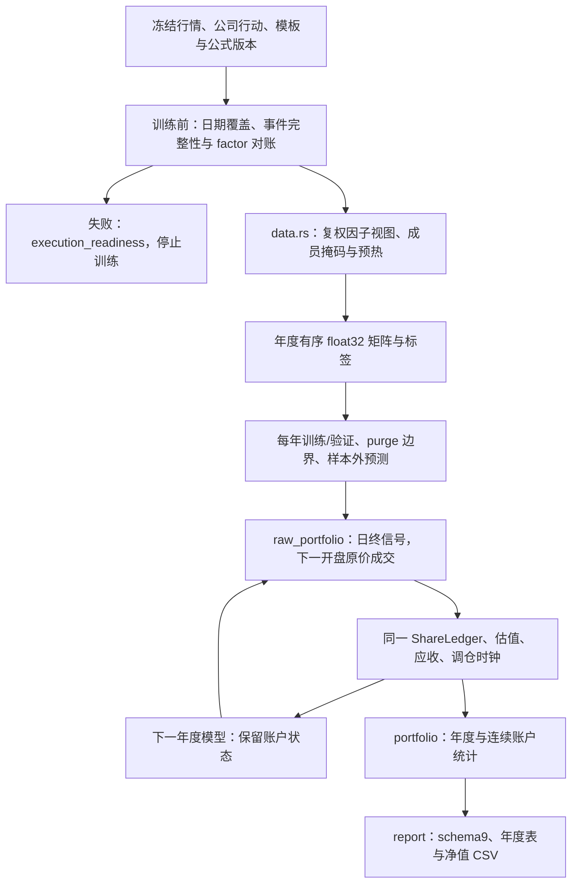
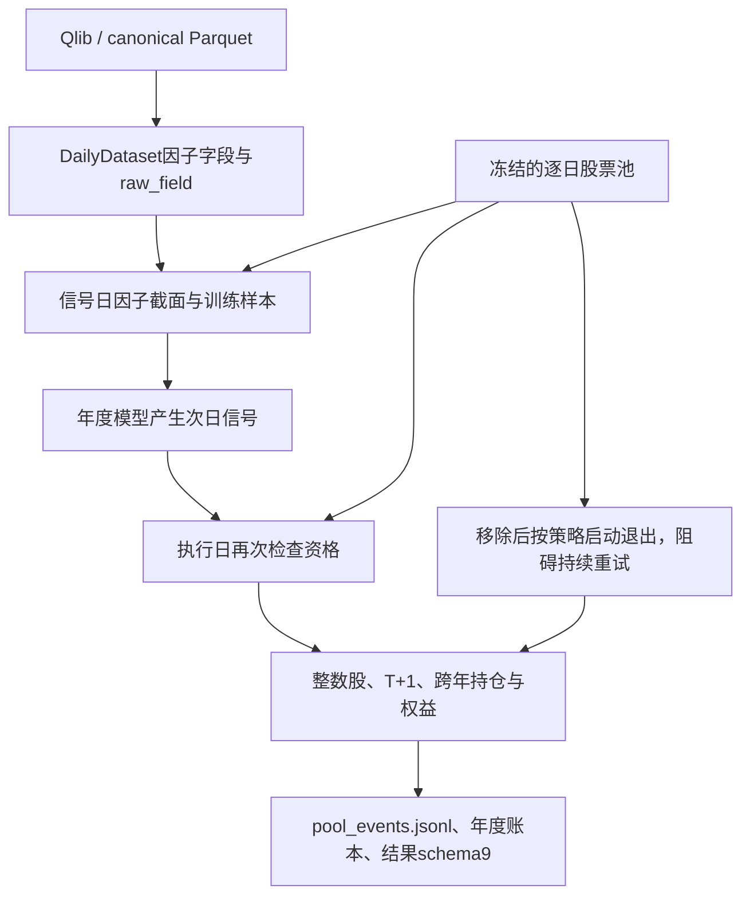
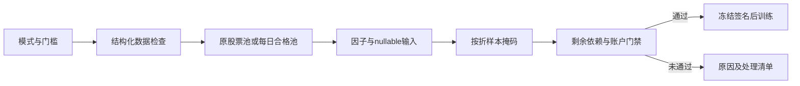

# 年度滚动研究内部模块

[上级：ML源码](../README.md) · [公共请求与结果](../../README.md#中证500年度滚动研究) · [股份权益](../../../core/src/README.md)

本目录是 `backtest.rs` 的内部实现，不提供独立CLI或旧口径。公开入口由父模块 `ResearchRequest/run_with_context` 提供，App/CLI均通过workflow适配器调用。

## 模块与输入输出

| 文件 | 职责 |
|---|---|
| [data.rs](data.rs) | 756交易日预热、历史成员面板、因子列、跨边界标签；年度 `.json + .bin` 缓存和矩阵拼接 |
| [raw_portfolio.rs](raw_portfolio.rs) | 公司行动准入、每日原价与常规限价缓冲、调仓、T+1；`RawPortfolio` 跨模型年份持续 |
| [portfolio.rs](portfolio.rs) | `DayResult/Performance`、每日IC/RankIC与收益/回撤/费用统计；没有复权碎股模拟器 |
| [report.rs](report.rs) | 先校验schema9严格结果，再渲染report.md和nav.csv；不训练或改变策略 |



## 时间、缓存和撮合语义

训练、验证和样本外使用所选Schedule的真实日期，5/1仅为内置模板默认；首折仍受历史覆盖约束。因子输入可复权，成交和估值通过行情/factor恢复原价，不能以复权价格计算真实股数。

缓存 `YearMeta` 保存signature、factor_ids、Sample行及finite_counts；`.bin`为row-major little-endian f32，NaN是missing。加载核对签名、列顺序与字节形状，旧近似报价/基准字段不属于当前缓存。没有当前数据版本内容签名时先重新登记。

账户逐日先推进到账及可售状态，执行前一日信号，收盘登记权益并计算包含应收的NAV。停牌不成交，除权日调整持仓标记避免重复收益；最后一日信号可以交给下一年度。模型换代不重置现金、股数或调仓时钟，末年也不构造虚拟强制卖出。

缺实际支付/上市日、源冲突、未知复权因子跳变、配股、零碎股分配或重叠未上市动作解释失败时停止。常规板块限制仍使用0.5个百分点保守缓冲；缺少ST/上市特例、精确限价、逐笔流动性与退市清算，不能宣称完整实盘复现。

## 结果、手算与验收

完整产物表见 [ML README](../../README.md)。schema9包含双签名、公式版本、执行配置、年度报告及汇总；`validate_result`被报告、平台读取和只读导入复用。旧格式返回unsupported_result_format，不迁移或重新计费。

合成平台fixture用1005元、最低5元佣金买100股；每股分红0.1元并送0.1股，之后原价9元，两个样本外年末均为110股与现金10元，累计费用5元，总收益−5/1005。跨年延迟支付/上市fixture另外验证登记后出售、到账前不可花费/出售和除权估值。

从仓库根目录执行，原生环境见 [Crates导航](../../../README.md#开发与验收)：

```bash
cargo nextest run -p analytics-ml --features lightgbm-native,duckdb-native -E 'test(backtest::)'
cargo nextest run -p analytics-workflow -E 'test(synthetic_annual) | test(incomplete_action)'
cargo nextest run -p analytics-desktop -E 'test(research_worker) | test(unsupported_history)'
```

真实公开数据仍可能被严格准入阻止；成功的合成研究只验证流程和账本，不是中证500历史收益结论。

## 统一行情与动态资格

年度流程通过storage `DailyDataset`读取日历、因子字段和独立原价，Qlib与规范Parquet共用模型和账本。因子价量保持同一重基准规则，输入变化纳入缓存签名。基准从模板显式传入，同时用于因子与收益比较。



移除持仓的默认策略为下一可交易日退出，可选择下次正常调仓启动退出；该退出不依赖新的预测。停牌、涨跌停及T+1阻碍会记录并重试；重新入池取消未成交退出，正常调仓避免重复卖出。退池前登记的分红和红股权益继续结算，红股上市后仍按股票池资格处理。空池保持现金和既有权益，不扩大股票池。训练/验证无有效样本失败，缺历史覆盖或公司行动在训练前报告数据未就绪。

`execution_readiness.json` 记录 `factor_basis_issues / adjustment_issues / affected_factor_ids`；研究价量来自独立系数，历史核验覆盖训练、验证、预热和测试。缺事件、缺跳变、未知参考价、逆向系数或特殊行动均在缓存和训练前停止。

系数来源、锚点及规则冻结到execution和每fold模型manifest，并加入factor/research签名。raw_portfolio::adjustment_issues核验训练、验证、预热及测试历史；validate_actions另要求账户支付/上市日期。RawFields读取raw_volume和独立adjustment_factors，撮合不使用研究成交量。

## 日期窗口与完整事件

当前窗口由公共Schedule/Fold提供，已删除training_years、validation_years及首末测试年份参数。固定5+1只是内置rolling模板；首折可自由指定训练、可选验证和测试日期，单次/手动模式不按自然年裁切。年文件是缓存分片，不是训练边界。test标签越界不参与IC，尾部预测保留。

公司行动参考调用CorporateAction::reference_price，支持差异化分红、配股参考及公告明确的无除权事件；每个实际参考变化仍需事件解释。执行准备检查后继证券原价或日期化待交付估值。各fold的daily只含本折测试日，gap_daily记录前面的空档；总daily和自然年报告覆盖完整账户。

## 为什么需要本组件

将模型折与账户时间分开。模型可以按任意日期滚动，现金、持仓、权益和调仓时钟不能随折重置。测试间隔继续估值和结算，证券承继转移真实权益而不拼接价格；年度结果由连续账户汇总。

设计依据：2026-10-14接受的证券身份与完整准入计划、组件接口及测试。未在代码或证据中确认的历史取舍不推定为既有设计理由；来源、法规或数据格式变化时重新评估。


普通分红送转的Distribution可显式提供allocation。实际账户出现零碎股时按登记证据取整或现金补偿，补偿按给定到账日结算；公开研究遇到非整数送转比例且无有效规则时在训练前阻断。合并关系目录只确认主体与比例，event_id未裁定不会补猜权益日期。该限制避免先训练、后因无法解释股数而失去完整账户结果。

## 三级研究模式：为什么允许筛选

决定日期2026-10-14，依据是用户接受的三级模式计划。正常预热空值、来源缺失和错误数据是不同问题：全部拒绝会浪费可用样本，全部放行又会混淆因子和真实权益。默认严格检查；另外提供“允许部分数据缺失”和“只用数据合格的股票”。模式是研究输入的一部分，不能作为训练失败后自动切换的兜底。

第二档保持原成员，纯缺失传播null；第三档派生每日合格成员，不改原始成员或证据。不能看到后来缺价而倒删早期股票。账户仍采用原价、整数股、T+1和连续权益；未裁定冲突、损坏、基准缺项及剩余必要依赖仍阻断。默认有效因子比例0表示至少一项有效，最低有标签样本1只表示可执行，不表示样本在统计上充分。所选因子整列无有效值不会被自动删除。

[quality.rs](quality.rs)保存原池和派生池，资格只在对应日期起生效；公司行动类别覆盖的首个缺口只影响该日及以后。来源失败未能区分缺失与真实冲突时保守阻断，不依据字符串放行。已有可能持仓的执行检查保留整个潜在持有区间，所以晚期缺项不能靠删候选绕过。

[data.rs](data.rs)的同一selection_mask用于训练、验证和预测；前两者要求截止前的标签，预测只检查有效因子。最低比例默认0但至少一项有效，严格模式保持现有因子null规则。report.rs显示中文模式和研究范围；quality.json、admission.json、sample_selection.json与sample_masks共同提供离线可审计记录。验收包括未来行情/事件缺口不修改早期成员、损坏/冲突阻断和源格式一致性。


